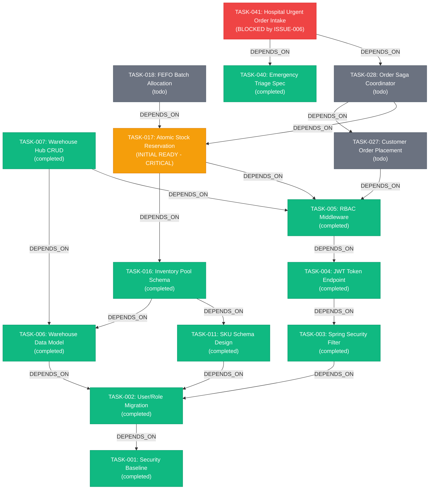

# PROJECT ATLAS — FalkorDB Graph Data Model

## Graph Topology Summary

The Project ATLAS knowledge graph represents the end-to-end engineering, requirement, architectural, and operational topology of the autonomous logistics platform.

- **Total Graph Nodes**: 124
- **Total Directed Relationships**: 388
- **Primary Database**: FalkorDB (OpenCypher)
- **Partition Key**: `barsa_atlas_proj_atlas`

---

## 1. Node Types & Property Schema

| Node Label | Count | Purpose | Properties |
| :--- | :---: | :--- | :--- |
| **`Project`** | 1 | Root repository and workspace container. | `id`, `name`, `description`, `status` |
| **`Task`** | 60 | Actionable units of engineering work across 12 modules. | `id`, `raw_id`, `title`, `status` (`completed`, `todo`), `priority` (`critical`, `high`, `medium`, `low`), `module_id` |
| **`Capability`** | 18 | Discrete technical competencies required or possessed. | `id`, `name`, `category` (`backend`, `frontend`, `database`, `security`, `qa`, `devops`, `domain`) |
| **`Agent`** | 8 | AI agent configurations and operational roles. | `id`, `name`, `provider` (`anthropic`, `openai`, `google`), `model`, `role` |
| **`Decision`** | 12 | Architecture Decision Records (ADRs). | `id`, `title`, `decision`, `rationale`, `status` (`approved`) |
| **`Knowledge`** | 15 | Architectural guides, standards, and domain specifications. | `id`, `title`, `content` |
| **`Issue`** | 10 | Incidents, active blockers, and environmental impediments. | `id`, `title`, `severity`, `status` (`open`, `resolved`), `module_id` |
| **`Artifact`** | 10 | Source code files, migrations, docker-compose, and specifications. | `id`, `name`, `type`, `uri` |
| **`Checkpoint`**| 8 | Resumable state snapshots capturing in-flight work. | `id`, `task_id`, `agent_id`, `status`, `next_action`, `base_revision` |

---

## 2. Directed Relationships (388 Edges)

| Edge Type | Count | Semantics | Example Cypher Pattern |
| :--- | :---: | :--- | :--- |
| **`HAS_TASK`** | 60 | Project containment of development tasks. | `(p:Project)-[:HAS_TASK]->(t:Task)` |
| **`DEPENDS_ON`** | 65 | Prerequisite dependency between tasks. | `(t2:Task)-[:DEPENDS_ON]->(t1:Task)` |
| **`REQUIRES`** | 90 | Skills strictly required to execute a task. | `(t:Task)-[:REQUIRES]->(c:Capability)` |
| **`HAS_CAPABILITY`**| 24 | Verified technical capabilities of an AI agent. | `(a:Agent)-[:HAS_CAPABILITY]->(c:Capability)` |
| **`AFFECTS`** | 22 | Architectural constraints imposed on tasks by ADRs. | `(d:Decision)-[:AFFECTS]->(t:Task)` |
| **`ASSIGNED_TO`** | 60 | Task assignment to suitable agent personas. | `(t:Task)-[:ASSIGNED_TO]->(a:Agent)` |
| **`REFERENCES`** | 20 | Contextual links between tasks and knowledge documents. | `(t:Task)-[:REFERENCES]->(k:Knowledge)` |
| **`BLOCKED_BY`** | 2+ | Active issues or incidents blocking execution. | `(t:Task)-[:BLOCKED_BY]->(i:Issue)` |
| **`CREATED_BY`** | 18 | Authorship attribution for artifacts and checkpoints. | `(art:Artifact)-[:CREATED_BY]->(a:Agent)` |

---

## 3. Core Task Dependency Subgraph (Representative Slice)

