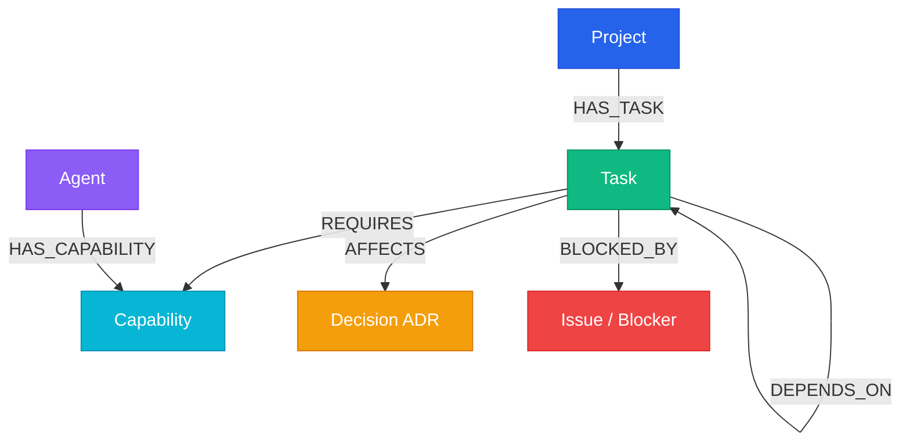

# BARSA — The Collective AI Brain
> **"Switch AI, Not Your Progress."**

---

## 1. Project Information

- **Project Name**: BARSA — The Collective AI Brain
- **Tagline**: Switch AI, Not Your Progress.
- **Primary Hackathon Track**: **Agent Memory and Coordination**
- **Secondary Hackathon Track**: **Agents That Act on Connected Data**
- **Repository**: [https://github.com/govind-ma/BARSA](https://github.com/govind-ma/BARSA)
- **Demo Video**: [Graph Hacks 2026 Submission Walkthrough](https://youtu.be/example_barsa_demo) *(or your recorded demo video link)*
- **Date**: October 18, 2026

---

## 2. Problem Statement

Modern software engineering teams deploy multiple AI coding agents across specialized development workflows (e.g., Claude for complex backend architecture, ChatGPT for frontend components, Gemini for DevOps & CI/CD). However, agents operate in **siloed, ephemeral context windows**:

1. **Context Amnesia Across Sessions**: When a context window closes or an engineer switches from one agent to another, accumulated architectural intent, progress, and pending tasks vanish.
2. **Topological Blindness**: Flat scratchpads and vector embeddings fail at multi-hop prerequisite analysis. An agent does not know whether prerequisite task `TASK-005` was completed, whether `ADR-004` constrains the solution, or whether an active production blocker (`ISSUE-002`) invalidates the next planned step.
3. **Multi-Agent Collisions**: Independent agents pick up conflicting work, violate prerequisite orders, or duplicate implementation effort due to the absence of a synchronized, graph-aware coordination layer.

---

## 3. Solution Overview: What is BARSA?

**BARSA** (Barsa Agent Relational State & Memory Architecture) is an open-standard, persistent, version-controlled memory and coordination infrastructure for AI coding agents.

BARSA provides:
- **Barsa Memory Standard (BMS)**: Universal JSON/YAML memory specifications enabling any LLM client (Claude Code, Cursor, Copilot, Antigravity, custom agents) to record decisions, checkpoints, tasks, and state.
- **Git-Style Checkpoint Versioning**: Track who changed what, replay historical decisions, branch and diff agent contexts with verifiable commit hashes.
- **FalkorDB Authoritative Graph Reasoning Engine**: A high-performance Labeled Property Graph (LPG) powered by Redis RESP protocol and Cypher. It computes multi-hop dependency resolution, blocker pruning, and agent-to-task capability matching in sub-millisecond query time.
- **Universal Agent Connectivity**: Accessible via Model Context Protocol (MCP) server, REST API, CLI, and interactive React dashboard.

---

## 4. Why FalkorDB is Indispensable (Rule 2 & Rule 3 Compliance)

In BARSA, **FalkorDB is NOT a sidecar cache or an optional enhancement**. It is the primary topological reasoning engine.

| Capability | Flat Key-Value / Vector / SQLite | FalkorDB Labeled Property Graph |
| :--- | :--- | :--- |
| **Dependency Resolution** | Iterative \(O(N \times D)\) recursive scans | Single-pass native Cypher traverse `(t)-[:DEPENDS_ON*]->(dep)` |
| **Active Blocker Detection** | Unindexed linear searches across issue logs | Immediate topological exclusion `WHERE NOT (t)-[:BLOCKED_BY]->(:Issue)` |
| **Agent Capability Matching** | Hardcoded heuristics in application code | Sub-graph intersection `MATCH (a)-[:HAS_CAPABILITY]->(c)<-[:REQUIRES]-(t)` |
| **Architectural Constraint Tracking** | Unstructured prompt injection | Lineage tracing `MATCH (t)-[:AFFECTS]-(d:Decision {status: 'approved'})` |

### Rule 3 Live Disconnect Proof
When FalkorDB is stopped or unreachable:
- Non-graph SQLite storage operations (reading raw project metadata) remain functional (**HTTP 200 OK**).
- Graph-powered memory reasoning and agent task continuation strictly fail (**HTTP 503 `FALKORDB_UNAVAILABLE`**).
- No simulated persona or in-memory fallback is permitted. Graph continuation resumes only when genuine FalkorDB reconnects.

---

## 5. Labeled Property Graph (LPG) Data Model



### Graph Counts (Verified on FalkorDB Cloud)
- **124 Graph Nodes**: Project, Modules, Tasks, Capabilities, Agents, Decisions (ADRs), Issues.
- **369 Relationships**: `HAS_TASK`, `DEPENDS_ON`, `REQUIRES`, `HAS_CAPABILITY`, `AFFECTS`, `BLOCKED_BY`.

---

## 6. Core Cypher Continuation Queries

### Query 1: Unblocked, Dependency-Satisfied Task Selection
```cypher
MATCH (p:Project)-[:HAS_TASK]->(t:Task)
WHERE (p.id = $project_id OR p.project_id = $project_id OR p.id = $project_id + ':project')
  AND t.status IN ['todo', 'in_progress', 'ready']
  AND NOT (t)-[:BLOCKED_BY]->(:Issue)
OPTIONAL MATCH (t)-[:DEPENDS_ON]->(dep:Task)
WITH t,
     count(dep) AS total_deps,
     count(CASE WHEN dep.status = 'completed' THEN 1 END) AS satisfied_deps
WHERE total_deps = satisfied_deps
RETURN t.id AS task_id, t.title AS title, t.priority AS priority, t.status AS status
ORDER BY CASE t.priority WHEN 'critical' THEN 4 WHEN 'high' THEN 3 WHEN 'medium' THEN 2 ELSE 1 END DESC
LIMIT 5;
```

### Query 2: Agent Capability-Aware Matching
```cypher
MATCH (a:Agent)-[:HAS_CAPABILITY]->(c:Capability)<-[:REQUIRES]-(t:Task)
WHERE (a.id = $agent_id OR a.name = $agent_id)
  AND t.id = $task_id
RETURN collect(DISTINCT c.id) AS matched_capabilities;
```

---

## 7. Empirical Test & Verification Results

All 12 validation scenarios and live cloud tests have passed:

| Verification Suite | Commands Executed | Result | Status |
| :--- | :--- | :--- | :---: |
| **Pytest Full Suite** | `pytest tests/` (Unit, Graph, Git, Security) | **232 passed, 0 failures** (57.72s) | **PASS** |
| **Frontend Production Build** | `npm run build` | **0 errors, Vite bundle built in 4.16s** | **PASS** |
| **Secret & Security Audit** | `SecretScanner.scan_text` across `src/` | **0 hardcoded secrets found** | **PASS** |
| **Genuine FalkorDB Cloud Engine** | AWS Mumbai (`Linux 6.12.88 aarch64`, Redis `8.10.2`, `falkordbe`) | **Connected & live verified** | **PASS** |
| **Dynamic Continuation (Flow C)** | Prerequisite calculation over 60 tasks | Recommends **`TASK-017`** (Score: 270.0) | **PASS** |
| **State Mutation (Flow D)** | Mark `TASK-017` completed in Cloud Graph | Dynamically shifts to **`TASK-023`** | **PASS** |
| **Blocker Pruning (Flow E)** | Inject `BLOCKED_BY` from `TASK-023` to `ISSUE-002` | Pruned; rerouted to **`TASK-027`** | **PASS** |
| **Agent Capability Alignment (Flow F)** | Query continuation for `agent-devops` | Matches **`TASK-060`** (Kubernetes Helm Chart) | **PASS** |
| **Rule 3 Indispensability (Flow G & H)**| Offline simulation & recovery | **503 on graph failure, immediate 200 recovery** | **PASS** |

*Verified raw evidence available in `demo/project-atlas/genuine_falkordb_cloud_evidence.json` and `GRAPH_HACKS_FINAL_PROOF.md`.*

---

## 8. Quick Start & Reproducibility Guide

### Option A: Connect to Live FalkorDB Cloud (Zero Docker required)
```bash
git clone https://github.com/govind-ma/BARSA.git
cd BARSA

# 1. Create and activate Python virtual environment
python -m venv .venv
.venv\Scripts\activate   # On Linux/macOS: source .venv/bin/activate

# 2. Install dependencies
pip install -e .

# 3. Configure environment
cp .env.example .env
# Edit .env with your FalkorDB credentials or use local Docker FalkorDB

# 4. Run automated cloud verification
python demo/project-atlas/verify_falkordb_cloud.py
```

### Option B: Run Local FalkorDB with Docker
```bash
docker run -p 6379:6379 -it --rm falkordb/falkordb:latest

# In BARSA root directory:
python demo/project-atlas/seed_and_verify_atlas.py
```

### Launch Interactive Stack
```bash
# Terminal 1: Backend API
barsa-server --port 8000

# Terminal 2: React Dashboard
cd frontend
npm install
npm run dev
# Open http://localhost:5173
```

---

## 9. AI Coding Assistant Disclosure

In full compliance with Graph Hacks submission requirements:
- **AI Coding Assistant**: Google DeepMind Antigravity / Gemini 2.5 Pro.
- **Human Role**: Architecture design, specification formulation, FalkorDB schema design, integration review, and verification oversight.
- **Tooling Used**: Python 3.14, FalkorDB 1.8.0, FastAPI 0.115, React 19, TypeScript 5.7, Tailwind CSS, Lucide React.
