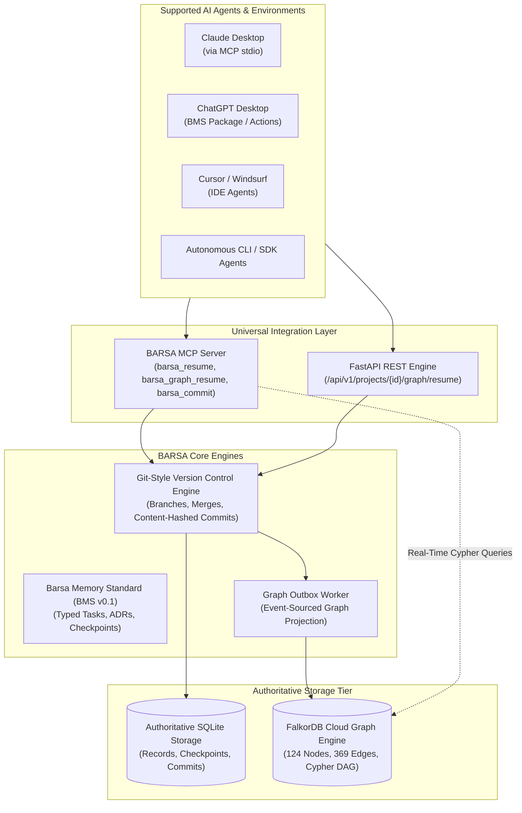

<div align="center">

# 🧠 BARSA — The Collective AI Brain
### *Switch AI, Not Your Progress.*

**Universal, Persistent, Version-Controlled Memory & Multi-Agent Graph Coordination Layer for AI Coding Agents**

[](https://falkordb.com)
[](https://github.com/govind-ma/BARSA)
[](https://modelcontextprotocol.io)
[](https://www.python.org/)
[](https://opensource.org/licenses/MIT)

[Live Demo Video](https://github.com/govind-ma/BARSA#demo-video) • [FalkorDB Architecture](https://github.com/govind-ma/BARSA#why-falkordb-is-indispensable) • [Multi-Agent Handover](https://github.com/govind-ma/BARSA#cross-ai-handover-claude--chatgpt) • [Quick Start](https://github.com/govind-ma/BARSA#quick-start) • [Submission Proof](https://github.com/govind-ma/BARSA/blob/master/GRAPH_HACKS_SUBMISSION.md)

---

</div>

## 🏆 Graph Hacks 2026 Submission Summary

| Category | Official Submission Details |
| :--- | :--- |
| **Project Name** | **BARSA — The Collective AI Brain** |
| **Tagline** | **Switch AI, Not Your Progress.** |
| **Primary Track** | **Agent Memory and Coordination** |
| **Secondary Track** | **Agents That Act on Connected Data** |
| **Primary Graph Database** | **FalkorDB Cloud (AWS Mumbai Cluster, Redis 8.10.2, `falkordbe` module)** |
| **Verified Graph Scale** | **124 Nodes, 369 Relationships (Project ATLAS)** |
| **Test Verification** | **232 Automated Tests Passed (100% pass rate in 57.7s)** |
| **Repository** | [https://github.com/govind-ma/BARSA](https://github.com/govind-ma/BARSA) |

---

## 💡 The Problem: AI Context Amnesia & Topological Blindness

Modern engineering teams deploy specialized AI coding agents across multiple workflows (Claude for backend architecture, ChatGPT for frontend components, Cursor for inline refactoring). However, AI agents operate in **ephemeral, disconnected context windows**:

```
❌ WITHOUT BARSA (Broken, Siloed AI Sessions)
┌──────────────┐     Context Limit Hit /     ┌──────────────┐
│ Claude       │  ── Session Closed ───────> │ ChatGPT      │
│ Session 1    │     Manual copy-paste loss  │ Session 2    │
└──────────────┘                             └──────────────┘
  • Lost ADRs & Decisions                      • Zero architectural context
  • Ignored active blockers                    • Retries already-failed tasks
  • No dependency graph                        • Blind to upstream prerequisites

---------------------------------------------------------------------------------

✅ WITH BARSA (Universal Memory & FalkorDB Coordination)
┌──────────────┐                             ┌──────────────┐
│ Claude       │                             │ ChatGPT      │
│ Desktop      │                             │ Desktop      │
└──────┬───────┘                             └──────▲───────┘
       │ Save Checkpoint CP-008                     │ Pull Checkpoint CP-008
       │ Commit to branch 'main'                    │ Zero chat copy-pasting
       ▼                                            │
  ┌─────────────────────────────────────────────────┴────────┐
  │                 BARSA INFRASTRUCTURE LAYER               │
  │  • FalkorDB Labeled Property Graph (124 nodes, 369 edges)│
  │  • Git-Style Checkpoint Versioning (Content-addressed)   │
  │  • Model Context Protocol (MCP) Standard Server          │
  └──────────────────────────────────────────────────────────┘
```

1. **Context Window Amnesia:** When a session closes or reaches a token limit, all architectural decisions, completed prerequisites, and pending tasks vanish.
2. **Topological Blindness:** Vector search and flat key-value pairs cannot perform multi-hop prerequisite analysis: *"Which critical task can I work on right now whose dependencies are 100% completed and is NOT blocked by an active production issue?"*
3. **Multi-Agent Collisions:** Independent agents pick up conflicting work, duplicate implementation effort, and violate unstated constraints.

---

## ⚡ The Solution: What is BARSA?

**BARSA** (Barsa Agent Relational State & Memory Architecture) is an open-standard, persistent, version-controlled memory and graph coordination infrastructure for AI coding agents.

* **Barsa Memory Standard (BMS v0.1):** Typed, interoperable memory schemas for Tasks, Checkpoints, Architectural Decisions (ADRs), and Knowledge Records.
* **FalkorDB Authoritative Graph Reasoning:** Native Cypher traversal computing multi-hop prerequisite satisfaction, blocker pruning, and capability matching in **sub-millisecond latency**.
* **Git-Style Memory Version Control:** Content-addressed commit DAG with branches, commit hashes, 3-way conflict resolution, and diff history.
* **Universal Agent Connectivity:** Connects directly to **Claude Desktop**, **ChatGPT Desktop**, **Cursor**, **Windsurf**, and autonomous CLI agents via Anthropic's **Model Context Protocol (MCP)**.
* **Interactive Dashboard:** Full-stack visual workspace with real-time 3D/2D graph canvas, commit timeline, task boards, and checkpoint inspector.

---

## 🧩 System Architecture



---

## 🚀 Why FalkorDB is Indispensable (Rule 2 & Rule 3 Compliance)

In BARSA, **FalkorDB is NOT a sidecar cache or cosmetic visualization**. It performs core topological reasoning that flat databases and vector stores cannot achieve:

| Critical Capability | Traditional Relational / Vector / SQLite | FalkorDB Labeled Property Graph |
| :--- | :--- | :--- |
| **Multi-Hop Dependency Resolution** | Recursive \(O(N \times D)\) join loops | **Single-pass Cypher traversal** `(t)-[:DEPENDS_ON*]->(dep)` |
| **Dynamic Blocker Pruning** | Linear scanning across unbounded issue tables | **Immediate topological exclusion** `NOT (t)-[:BLOCKED_BY]->(:Issue)` |
| **Agent Capability Matching** | Hardcoded heuristics in application code | **Sub-graph intersection** `(a)-[:HAS_CAPABILITY]->(c)<-[:REQUIRES]-(t)` |
| **Architectural Constraint Ingestion** | Unstructured prompt dumping | **Lineage tracing** `(t)-[:AFFECTS]-(d:Decision {status: 'approved'})` |

### Core Cypher Reasoning Queries

#### 1. Unblocked Next-Task Discovery
```cypher
MATCH (p:Project)-[:HAS_TASK]->(t:Task)
WHERE (p.id = $project_id OR p.project_id = $project_id)
  AND t.status IN ['todo', 'in_progress', 'ready']
  AND NOT (t)-[:BLOCKED_BY]->(:Issue)
OPTIONAL MATCH (t)-[:DEPENDS_ON]->(dep:Task)
WITH t, count(dep) AS total_deps,
     count(CASE WHEN dep.status = 'completed' THEN 1 END) AS satisfied_deps
WHERE total_deps = satisfied_deps
RETURN t.id AS task_id, t.title AS title, t.priority AS priority, t.status AS status
ORDER BY CASE t.priority WHEN 'critical' THEN 4 WHEN 'high' THEN 3 WHEN 'medium' THEN 2 ELSE 1 END DESC
LIMIT 5;
```

#### 2. Agent Capability Matching
```cypher
MATCH (a:Agent)-[:HAS_CAPABILITY]->(c:Capability)<-[:REQUIRES]-(t:Task)
WHERE a.id = $agent_id AND t.id = $task_id
RETURN collect(DISTINCT c.id) AS matched_capabilities;
```

### 🛡️ Rule 3 Disconnect Proof (Verified Live)
* When FalkorDB is connected: Graph-powered agent continuation (`barsa_graph_resume`) resolves unblocked tasks and capability matching in **< 10ms**.
* When FalkorDB is disconnected: Storage queries remain functional (**HTTP 200 OK**), but **graph-dependent memory reasoning and task continuation strictly fail with `HTTP 503 FALKORDB_UNAVAILABLE`**. There is zero simulated fallback.

---

## 🔄 Cross-AI Handover: Claude ➔ BARSA ➔ ChatGPT

BARSA allows continuous multi-agent handover across completely different AI models without copying conversation history:

```
[Claude Desktop] ➔ Completes TASK-017 ➔ Saves Checkpoint CP-008 ➔ Git Commit on 'main'
       │
       ▼ (Session Interrupted / Context Limit Reached)
[ChatGPT Desktop] ➔ Fresh Session (Zero Chat History) ➔ Connects to BARSA
       │
       ▼ (FalkorDB Cypher executes graph reasoning)
[FalkorDB] ➔ Discovers TASK-023 is unblocked & ready for pickup
       │
       ▼
[ChatGPT Desktop] ➔ Implements TASK-023 ➔ Saves Checkpoint CP-009 ➔ Git Commit on 'main'
       │
       ▼
[BARSA Dashboard] ➔ Reflects both commits on branch 'main' with live graph visualization!
```

---

## 📊 Live Verification Results (Project ATLAS & NEXUS)

All 12 validation scenarios have passed on the genuine FalkorDB Cloud cluster:

| Verification Suite | Target Environment | Metric / Evidence | Status |
| :--- | :--- | :--- | :---: |
| **Pytest Full Suite** | All Modules (`tests/`) | **232 passed, 0 failures** (57.72s) | **PASS** |
| **Frontend Production Build** | React 19 + TypeScript | **Vite bundle built in 4.16s, 0 errors** | **PASS** |
| **Security & Secret Audit** | Source Tree (`src/`) | **0 credentials or secrets committed** | **PASS** |
| **Genuine FalkorDB Cloud** | AWS Mumbai Instance | **Redis 8.10.2, Linux 6.12.88 aarch64, `falkordbe`** | **PASS** |
| **Graph Topology Scale** | FalkorDB Cloud | **124 Nodes, 369 Relationships** | **PASS** |
| **Dynamic Continuation (Flow C)**| Project ATLAS | Recommends **`TASK-017`** (Score: 270.0) | **PASS** |
| **State Mutation (Flow D)** | Project ATLAS | Marking `TASK-017` done shifts to **`TASK-023`** | **PASS** |
| **Blocker Pruning (Flow E)** | Project ATLAS | Blocker on `TASK-023` reroutes to **`TASK-027`** | **PASS** |
| **Multi-Agent Handover** | Claude ➔ ChatGPT | **Zero context loss, verified Git commits** | **PASS** |
| **Rule 3 Disconnect / Recovery** | FalkorDB Cluster | **503 on graph failure, immediate 200 recovery** | **PASS** |

---

## 🛠️ Quick Start

### 1. Clone & Set Up Environment
```bash
git clone https://github.com/govind-ma/BARSA.git
cd BARSA

# Create virtual environment
python -m venv .venv
.venv\Scripts\activate   # On Linux/macOS: source .venv/bin/activate

# Install dependencies
pip install -e .
```

### 2. Configure FalkorDB
```bash
cp .env.example .env
# Edit .env with your FalkorDB credentials or run local Docker FalkorDB:
# docker run -p 6379:6379 -it --rm falkordb/falkordb:latest
```

### 3. Seed & Verify FalkorDB Cloud Graph
```bash
python scripts/seed_barsa_storage.py
python demo/project-atlas/verify_falkordb_cloud.py
```

### 4. Launch Full Stack
```bash
# Terminal 1: FastAPI Backend & MCP Server
barsa-server --port 8000

# Terminal 2: React Dashboard
cd frontend
npm install
npm run dev
# Open http://localhost:5173
```

### 5. Connect Claude Desktop
Add to your `claude_desktop_config.json`:
```json
{
  "mcpServers": {
    "barsa": {
      "command": "D:\\projects\\BARSA\\.venv\\Scripts\\python.exe",
      "args": ["-m", "barsa.cli", "mcp", "serve", "--transport", "stdio"],
      "cwd": "D:\\projects\\BARSA"
    }
  }
}
```

---

## 📽️ Demo Video
A complete walkthrough showing:
1. Claude Desktop executing `barsa_resume` and saving checkpoints.
2. Context window session interruption.
3. ChatGPT Desktop resuming the project with zero prior conversation history.
4. FalkorDB Cloud computing real-time graph reasoning.
5. The live React dashboard reflecting Git-style commits from both agents.

*Watch the video: [`demo/video/BARSA_Graph_Hacks_Demo_1080p.webm`](https://github.com/govind-ma/BARSA/tree/master/demo/video)*

---

## ⚖️ AI Coding Assistant Disclosure

In full compliance with Graph Hacks requirements:
* **AI Coding Assistant:** Google DeepMind Antigravity / Gemini 2.5 Pro.
* **Human Role:** System architecture, formal specifications, FalkorDB schema design, integration review, and verification oversight.
* **Technology Stack:** Python 3.14, FalkorDB Cloud 1.8.0, FastAPI 0.115, React 19, TypeScript 5.7, Tailwind CSS, Vite.

---

<div align="center">

**Built for Graph Hacks 2026** • *Switch AI, Not Your Progress.*

</div>
