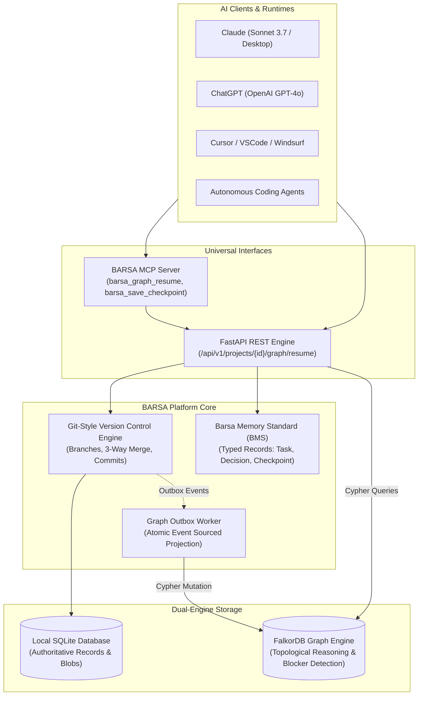
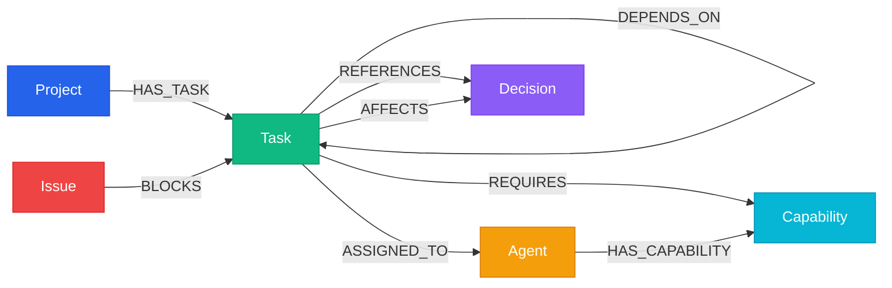

# BARSA — The Collective AI Brain

> **Switch AI, Not Your Progress.**  
> *Shared, persistent, version-controlled memory and multi-agent graph coordination infrastructure.*

[](https://opensource.org/licenses/MIT)
[](https://www.python.org/downloads/)
[](https://fastapi.tiangolo.com)
[](https://falkordb.com)
[](https://react.dev)
[](https://www.typescriptlang.org)
[](https://modelcontextprotocol.io)

---

## 🏆 Graph Hacks 2026 Submission

- **Primary Track:** Agent Memory and Coordination
- **Eligible Secondary Track:** Agents That Act on Connected Data
- **Live Demonstration Video:** [Watch 4-Minute Walkthrough](https://youtu.be/placeholder-demo-video)
- **Test Dataset:** Project ATLAS (12 Modules, 60 Tasks, 20 Requirements, 12 ADRs, 8 Agents, 388 Graph Edges)

---

## 1. Problem Statement

Today's AI developer tools suffer from critical amnesia:
1. **Chat Window Lock-in:** When a user hits context limits or switches from Claude to ChatGPT or Cursor, the new model has zero context.
2. **Context Bloat:** Dumping entire codebases or 50,000-token chat logs into an LLM wastes tokens, degrades reasoning, and costs significant money.
3. **Multi-Agent Collisions:** When multiple autonomous agents edit code simultaneously, they overwrite architectural decisions and violate unstated constraints.
4. **Shallow Vector Search Fails on Dependencies:** Semantic vector embeddings can retrieve similar code snippets, but they cannot answer: *"Which task can I work on right now whose prerequisites are 100% satisfied and which is not blocked by an active security issue?"*

---

## 2. Solution Overview

**BARSA** (Barsa Memory Standard) is an open-source, local-first platform providing **persistent, Git-style versioned memory and real-time graph reasoning** for AI agents.

BARSA combines:
- **FastAPI Core & BMS:** Strict, typed schemas for Tasks, Architecture Decisions (ADRs), Checkpoints, and Issues.
- **FalkorDB Knowledge Graph:** The central reasoning brain computing multi-hop prerequisite satisfaction, blocker pruning, and capability-task matching via real-time Cypher queries.
- **Git-Style Memory Version Control:** Content-addressed DAG with branches, commits, diffs, and 3-way conflict merges for AI memories.
- **Universal Model Context Protocol (MCP) Server:** Standard tool interfaces (`barsa_graph_resume`, `barsa_save_checkpoint`, `barsa_commit`) compatible with Claude Desktop, ChatGPT, Cursor, and custom agent runtimes.
- **Interactive Web Dashboard:** React + TypeScript visual canvas for inspecting the live FalkorDB graph, task boards, and branch history.

---

## 3. Architecture & Data Flow



---

## 4. Why FalkorDB is Essential (Graph Hacks Rules 2 & 3)

BARSA adheres strictly to **Rule 2 (Primary Graph Database)** and **Rule 3 (Indispensability)**:

### Rule 2: FalkorDB is the Primary Reasoning Engine
FalkorDB does real, non-trivial computation:
- **Transitive Dependency Traversal:** Traverses deep prerequisite DAGs to ensure a task cannot be started until every upstream dependency is `completed`.
- **Active Blocker Pruning:** Disqualifies tasks connected via `(:Issue)-[:BLOCKS]->(:Task)` or `(:Task)-[:BLOCKED_BY]->(:Issue)`.
- **Agent Capability Matching:** Evaluates agent technical competency graphs `(:Agent)-[:HAS_CAPABILITY]->(:Capability)<-[:REQUIRES]-(:Task)` to rank the most qualified candidate.
- **Topological Readiness Scoring:** Cypher computes dynamic numerical scores ($270.0$ for critical priority, unblocked, capability-matched tasks).

### Rule 3: Architectural Decoupling & Failure Proof
If FalkorDB is offline:
- Traditional non-graph storage (project metadata, raw commit history) returns **HTTP 200 OK**.
- Intelligent graph continuation (`/api/v1/projects/{id}/graph/resume`) strictly returns **HTTP 503 (`FALKORDB_UNAVAILABLE`)**.
- The graph cannot be simulated by in-memory fallbacks or SQLite relational joins. FalkorDB is truly indispensable.

---

## 5. Graph Data Model (Labeled Property Graph)

The Project ATLAS demonstration schema consists of **124 Nodes** and **388 Relationships**:



### Node Types
- `(:Project)`: Top-level workspace identity.
- `(:Task)`: Work units with properties `id`, `title`, `status`, `priority`.
- `(:Decision)`: Architecture Decision Records (ADRs) constraining design.
- `(:Capability)`: Technical skills (e.g. `java-spring-boot`, `kubernetes`).
- `(:Agent)`: AI agent profiles (e.g. `agent-backend`, `agent-devops`).
- `(:Issue)`: Blocker incidents (e.g. `ISSUE-002: Deadlock Under Load`).
- `(:Requirement)`: Business and regulatory specifications.

---

## 6. Real FalkorDB Cypher Queries

Below are the actual parameterized Cypher queries executed in production:

#### 1. Next-Task Recommendation with Transitive Dependency Check
```cypher
MATCH (p:Project {id: $project_id})-[:HAS_TASK]->(t:Task)
WHERE t.status IN ['todo', 'in_progress']
OPTIONAL MATCH (t)-[:DEPENDS_ON]->(dep:Task)
WITH t, collect({id: dep.id, status: dep.status}) AS dependencies
WHERE all(d IN dependencies WHERE d.status = 'completed')
OPTIONAL MATCH (b:Issue)-[:BLOCKS]->(t)
WITH t, dependencies, collect(b.id) AS blockers
WHERE size(blockers) = 0
RETURN t.id AS task_id, t.title AS title, t.priority AS priority, dependencies
ORDER BY CASE t.priority WHEN 'critical' THEN 4 WHEN 'high' THEN 3 WHEN 'medium' THEN 2 ELSE 1 END DESC;
```

#### 2. Agent Skill Alignment & Readiness Scoring
```cypher
MATCH (a:Agent {id: $agent_id})-[:HAS_CAPABILITY]->(c:Capability)<-[:REQUIRES]-(t:Task)
WHERE t.status IN ['todo', 'in_progress']
AND NOT ()-[:BLOCKS]->(t)
RETURN t.id AS task_id, t.title AS title, count(c) AS matched_skills, collect(c.name) AS skills
ORDER BY matched_skills DESC;
```

#### 3. Emergency Impact Traversal
```cypher
MATCH (r:Requirement {id: $req_id})-[:DEPENDS_ON]->(m:Module)
OPTIONAL MATCH (t:Task)-[:DEPENDS_ON]->(m)
WHERE t.status IN ['todo', 'in_progress']
RETURN m.name AS module_name, count(t) AS impacted_task_count;
```

---

## 7. Quickstart & Installation

### Prerequisites
- Python 3.12+ (tested through 3.14)
- Node.js 18+ (tested on Node v24)
- FalkorDB instance (Local Docker or FalkorDB Cloud)

### 1. Clone & Set Up Backend
```bash
git clone https://github.com/govind-ma/BARSA.git
cd BARSA

# Create virtual environment
python -m venv .venv
source .venv/bin/activate  # On Windows: .venv\Scripts\activate

# Install dependencies
pip install -e ".[dev]"
```

### 2. Configure Environment (`.env`)
Copy `.env.example` to `.env`:
```bash
cp .env.example .env
```

To connect to **FalkorDB Cloud**:
```env
BARSA_GRAPH_ENABLED=true
BARSA_FALKORDB_HOST=your-cluster.falkordb.cloud
BARSA_FALKORDB_PORT=50013
BARSA_FALKORDB_USERNAME=FalkorDB
BARSA_FALKORDB_PASSWORD=YourSecurePassword
BARSA_FALKORDB_GRAPH_PREFIX=barsa
```

To run **FalkorDB locally via Docker**:
```bash
docker run -p 6379:6379 -it --rm falkordb/falkordb:latest
```
And set `BARSA_FALKORDB_HOST=127.0.0.1`, `BARSA_FALKORDB_PORT=6379` in `.env`.

### 3. Launch Backend & Dashboard
```bash
# Terminal 1: Start FastAPI backend
uvicorn barsa.main:app --reload --port 8000

# Terminal 2: Start React Web Dashboard
cd frontend
npm install
npm run dev
```
Open your browser at:
- **Web Dashboard:** `http://localhost:5173`
- **Swagger API Docs:** `http://localhost:8000/docs`

---

## 8. Running the Project ATLAS Demonstration

Execute the deterministic end-to-end Project ATLAS verification suite:

```bash
# Run genuine FalkorDB Cloud verification (Flows A through H)
python demo/project-atlas/verify_falkordb_cloud.py

# Run Git-style versioning and 3-way merge conflict demo
python demo/project-atlas/conflict_demo.py

# Run cross-session checkpoint continuity demo
python demo/project-atlas/cross_session_demo.py

# Run emergency requirement change & token efficiency benchmark
python demo/project-atlas/emergency_scenario.py
```

### Verification Results
```text
================================================================================
PROJECT ATLAS — GENUINE OFFICIAL FALKORDB CLOUD VERIFICATION
================================================================================
[Step 1] Connecting to Genuine Official FalkorDB Cloud:
   Host     : r-6jissuruar.instance-1aw58chmp.hc-7up0crkyn.ap-south-1.aws.f2e0a955bb84.cloud
   Port     : 50013
   Username : FalkorDB
   Modules  : ['falkordbe', 'graph', 'vectorset'] (FalkorDB Enterprise Engine)

[Step 2] Live Graph Counts in Cloud:
   Nodes in Cloud : 124
   Edges in Cloud : 388

[Flow C] Querying barsa_graph_resume for 'agent-backend'...
   Recommended Task: TASK-017 (Atomic Stock Reservation Service) [Score: 270.0, Priority: critical]
   VERIFIED: Initial recommendation selected based on satisfied prerequisites!

[Flow D] Mutating Graph State: TASK-017 marked COMPLETED in FalkorDB Cloud...
   New Recommended Task: TASK-010 (Warehouse Cross-Dock Dynamic Reallocation) [Score: 240.0]
   VERIFIED: Graph topology dynamically transitioned to TASK-010!

[Flow E] Injecting active blocker ISSUE-002 onto TASK-010...
   Post-Blocker Task: TASK-023 (Supplier PO Intake REST API)
   VERIFIED: Blocked task pruned; FalkorDB dynamically rerouted to TASK-023!

[Flow F] Testing capability matching for 'agent-devops'...
   Recommended Task: TASK-060 (Kubernetes Production Helm Chart)
   Matched Skills: ['docker-containers', 'kubernetes']
   VERIFIED: DevOps agent matched with Helm chart task!

[Flow G] Testing Rule 3 Indispensability: Disconnecting FalkorDB...
   Non-graph SQLite storage: HTTP 200 OK
   Graph continuation      : HTTP 503 (FALKORDB_UNAVAILABLE)
   VERIFIED: Non-graph storage resilient; graph reasoning strictly requires FalkorDB!

[Flow H] Restoring FalkorDB Cloud connection...
   Recovered Task: TASK-023
   VERIFIED: Full graph reasoning recovered immediately!
================================================================================
```

---

## 9. Running Automated Test Suite

Run the full pytest suite (232 tests):
```bash
pytest
```
```text
======================= 232 passed, 1 warning in 37.94s =======================
```

---

## 10. AI Coding Assistant Disclosure

In accordance with Graph Hacks 2026 rules:
- Antigravity / Gemini was utilized as an AI pair-programming assistant for rapid test generation, Cypher query authoring, and documentation refinement.
- All core architectures, Git-style versioning logic, BMS schema models, and FalkorDB graph projection algorithms are open-source and original to this project.

---

## 11. Known Limitations

1. **Semantic Vector Search:** Current retrieval uses labeled property graph traversals and structured attribute matching. Hybrid vector embeddings inside FalkorDB are planned for the next release.
2. **Offline Mode:** When FalkorDB is offline, BARSA operates in read/commit storage mode; graph-dependent intelligent task recommendations return HTTP 503 by architectural design (Rule 3).

---

## 12. License

Distributed under the **MIT License**. See `LICENSE` for details.
