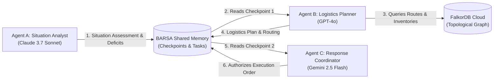

# PROJECT AEGIS — Vision & Mission Overview

## 1. Project Identity
* **Name:** AEGIS — AI Emergency Response & Resource Coordination
* **Tagline:** Coordinated Multi-Agent Disaster Response Powered by Graph Reasoning
* **Platform:** BARSA (Universal AI Memory Infrastructure) + FalkorDB Cloud

---

## 2. Executive Vision
During large-scale emergency events, resource allocation fails not due to lack of goodwill, but due to fragmented information, uncoordinated AI agents, and lack of relational awareness. 

Single LLMs operate with isolated conversational amnesia:
* When an analyst AI hits rate limits or token exhaustion, subsequent dispatch planners lose situational awareness.
* Flat vector databases cannot understand that a closed bridge invalidates a route, even if the destination is geographically close.

**AEGIS proves that three independent, specialized AI agents can execute a single life-critical mission by sharing persistent memory through BARSA and evaluating live graph topology through FalkorDB Cloud.**

---

## 3. The Three Agents

1. **Agent A — Situation Analyst (Claude 3.7 Sonnet):**
   * Inspects incoming distress signals across hospitals and evacuation shelters.
   * Traverses facility nodes in FalkorDB to flag critical resource deficits.
   * Produces `reports/SITUATION_ASSESSMENT.md`.
2. **Agent B — Logistics Planner (GPT-4o):**
   * Consumes Agent A's findings directly from BARSA (zero chat copy-paste).
   * Queries FalkorDB for open arterial roads, depot stock levels, and vehicle tonnages.
   * Produces `reports/LOGISTICS_PLAN.md`.
3. **Agent C — Response Coordinator (Gemini 2.5 Flash):**
   * Reviews proposed dispatches, validates constraints, and detects vehicle contention.
   * Issues final authorized dispatch orders in `reports/FINAL_RESPONSE_PLAN.md`.
