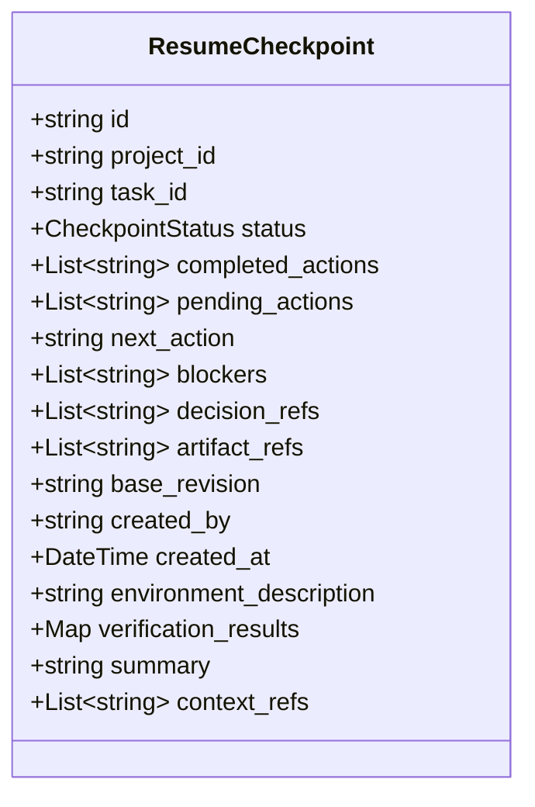

# Resume Checkpoint Specification

## 1. Overview

The **Resume Checkpoint (`ResumeCheckpoint`)** is the core operational construct in BMS that makes cross-agent collaboration seamless.

When an AI assistant (or human engineer) finishes a work session or reaches a handoff point, it does not simply say goodbye in chat. It generates a `ResumeCheckpoint`.

When a different AI model (e.g. switching from Claude to ChatGPT or Gemini) opens the project, it reads the active checkpoint to know:
1. Exactly what was accomplished (`completed_actions`).
2. What remains to be done (`pending_actions`).
3. **The exact immediate step to begin with (`next_action`)**.
4. Known blockers or missing credentials (`blockers`).
5. Governing architectural decisions (`decision_refs`).
6. Relevant files or source code (`artifact_refs`).
7. Base code/state revision (`base_revision`).

---

## 2. Checkpoint Structure

---

## 3. How a Resuming AI Agent Interprets a Checkpoint

When an AI agent is initialized with a Barsa project package:

1. **Locate Latest Checkpoint:** It reads `package.latest_checkpoint_id` and retrieves the corresponding `ResumeCheckpoint`.
2. **Review Governing Decisions:** It resolves `decision_refs` against `package.records.decisions` to understand technical constraints without re-debating architectural choices.
3. **Inspect Relevant Files:** It reviews `artifact_refs` to locate modified files, configuration paths, or documentation.
4. **Inspect Blockers:** If `blockers` is non-empty and status is `blocked`, it prompts the user for the necessary input.
5. **Execute Next Action:** If status is `active`, it begins executing `next_action` directly, eliminating "What were we doing?" friction.
6. **Update Checkpoint:** Upon completing the step, the agent updates the checkpoint and appends to `completed_actions`.
