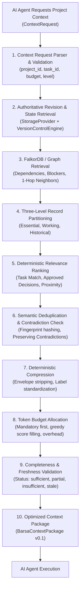

# Barsa Smart Context Engine (SCE) — Architecture & Pipeline Design

The **Barsa Smart Context Engine (SCE)** is the token-optimization subsystem of the BARSA Universal AI Infrastructure. It is designed to construct high-density, token-budgeted, graph-aware context packages that allow AI agents to resume complex projects without flooding their context windows.

---

## 1. Context Retrieval Pipeline

---

## 2. Core Subsystem Components

| Component | Module | Responsibility |
|---|---|---|
| **Models & Schemas** | [`src/barsa/context/models.py`](file:///d:/projects/BARSA/src/barsa/context/models.py) | Pydantic v2 schemas for `ContextRequest`, `BarsaContextPackage`, `CompletenessStatus`. |
| **Token Counter** | [`src/barsa/context/token_counter.py`](file:///d:/projects/BARSA/src/barsa/context/token_counter.py) | Exact (tiktoken) and heuristic multilingual token estimation abstraction. |
| **Relevance Ranker** | [`src/barsa/context/ranking.py`](file:///d:/projects/BARSA/src/barsa/context/ranking.py) | Algorithmic scoring with explainable reasons and anti-recency bias safeguards. |
| **Record Deduplicator** | [`src/barsa/context/deduplication.py`](file:///d:/projects/BARSA/src/barsa/context/deduplication.py) | Fingerprint-based duplicate removal preserving genuine architectural contradictions. |
| **Deterministic Compressor**| [`src/barsa/context/compression.py`](file:///d:/projects/BARSA/src/barsa/context/compression.py) | Structural envelope compaction without mandatory external LLM dependencies. |
| **Budget Allocator** | [`src/barsa/context/budget.py`](file:///d:/projects/BARSA/src/barsa/context/budget.py) | Priority packing enforcing strict token upper bounds and tracking omitted references. |
| **Incremental Sync** | [`src/barsa/context/incremental.py`](file:///d:/projects/BARSA/src/barsa/context/incremental.py) | DAG-aware delta computation across Git-style memory commits using LCA checks. |
| **Completeness Validator** | [`src/barsa/context/validation.py`](file:///d:/projects/BARSA/src/barsa/context/validation.py) | Multi-factor verification of task consistency, graph freshness, and project isolation. |
| **Orchestrator Engine** | [`src/barsa/context/engine.py`](file:///d:/projects/BARSA/src/barsa/context/engine.py) | High-level service composing the entire pipeline for REST and MCP callers. |

---

## 3. Design Principles & Boundary Guarantees

1. **No Silent Information Loss:** Critical blockers and approved architectural decisions are classified as Level 1 Mandatory. If they exceed the requested token budget, the engine returns `completeness: "insufficient"` rather than pretending the context is complete.
2. **Deterministic Baseline:** The engine does not rely on nondeterministic LLM summarization. All ranking, compression, and deduplication passes are pure Python functions with 100% reproducible outputs.
3. **Local-First & Provider-Independent:** Operates entirely over local SQLite databases and in-memory or FalkorDB graph projections without external cloud network dependencies.
4. **Strict Isolation:** Enforces tenant and workspace boundaries; attempting to inject cross-project records raises immediate isolation errors.
