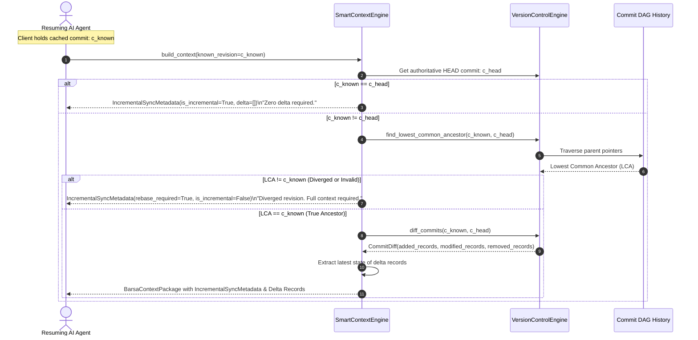

# Incremental Revision-Aware Context Synchronization

The **IncrementalSyncService** ([`src/barsa/context/incremental.py`](file:///d:/projects/BARSA/src/barsa/context/incremental.py)) enables AI agents that have cached a previous project commit to request only the delta changes that occurred since that commit.

---

## 1. Incremental Sync Workflow



---

## 2. DAG Ancestry Validation

Incremental synchronization relies on the **Lowest Common Ancestor (LCA)** algorithm rather than naive integer subtraction:

- **True Ancestor:** If `find_lowest_common_ancestor(project_id, known_revision, head_commit) == known_revision`, the known revision lies directly along the ancestry path of the current branch HEAD. A clean delta diff can be computed safely.
- **Diverged Revision:** If the LCA is not equal to `known_revision` (for example, the client cached a commit on an unmerged feature branch or an aborted rebase), Barsa flags `rebase_required = True` and delivers the full context package.

---

## 3. Incremental Metadata Schema

Included in `BarsaContextPackage.incremental_sync`:

```json
{
  "is_incremental": true,
  "known_revision": "b5de5c748e",
  "authoritative_revision": "689b1eeb46",
  "rebase_required": false,
  "added_records": ["cp-auth-step2"],
  "modified_records": ["task-auth-filter"],
  "deleted_records": [],
  "details": "Computed incremental update from commit b5de5c74 to 689b1eeb."
}
```
