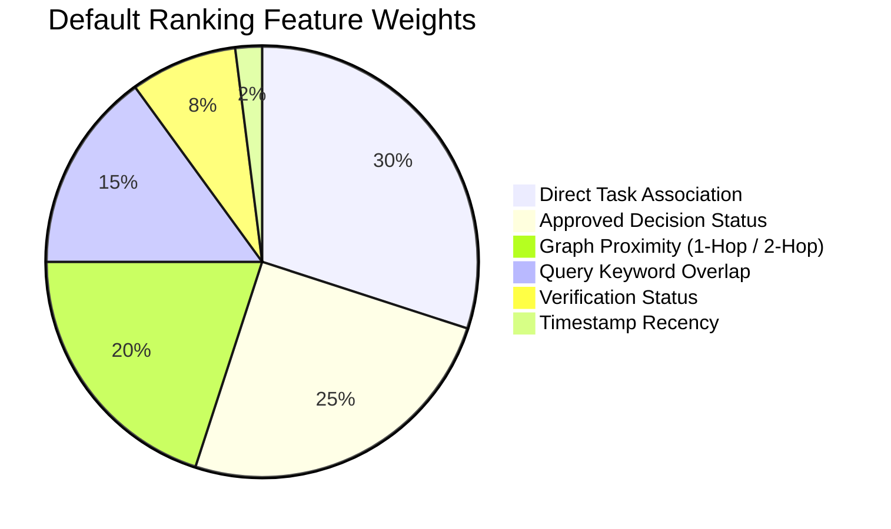

# Deterministic Relevance Ranking & Scoring

The **RelevanceRanker** module ([`src/barsa/context/ranking.py`](file:///d:/projects/BARSA/src/barsa/context/ranking.py)) provides deterministic algorithmic prioritization of candidate memory records.

---

## 1. Algorithmic Principles

1. **Ranking Score, Not Probability of Truth:**
   The calculated score $\in [0.05, 1.00]$ is an algorithmic sorting priority indicating task proximity and authority, not an epistemic probability.
2. **Anti-Recency Bias:**
   In distributed AI memory, newly created notes are often speculative or unverified. A recent unverified thought must NEVER automatically outrank an established, approved architectural decision.
3. **Transparent Explainability:**
   Every ranked record is accompanied by a `RankingExplanation` detailing the exact criteria that contributed to its position.

---

## 2. Configurable Ranking Weights

The default ranking model uses balanced multi-factor scoring:



| Factor | Weight | Scoring Condition |
|---|---|---|
| **Direct Task Match** | 0.30 | Record is attached directly to the requested `task_id` or is an explicit predecessor dependency. |
| **Approved Decision** | 0.25 | Architectural decision with status `approved` (proposed gets 0.10, superseded gets 0.02). |
| **Graph Proximity** | 0.20 | 1-hop neighbor gets full weight; 2-hop gets 60%; > 2 hops gets 20%. |
| **Query Similarity** | 0.15 | Normalized token set overlap between query and record title/content/rationale. |
| **Verification Status** | 0.08 | Formally verified fact (`is_verified == True`). Unverified claims receive 0 bonus. |
| **Recency** | 0.02 | Soft recency bonus for modifications within 30 days. Deliberately minimized. |

---

## 3. Explainable Ranking Metadata

Example output for an approved architectural decision:

```json
{
  "record_id": "dec-jwt-auth",
  "record_type": "decision",
  "relevance_score": 0.94,
  "reasons": [
    "Directly associated with target task",
    "Approved architectural decision",
    "Direct 1-hop neighbor in knowledge graph",
    "Explicitly referenced by latest resume checkpoint",
    "Query keyword overlap (2 match(es))"
  ]
}
```

Example output for an unverified knowledge record:

```json
{
  "record_id": "know-perf-claim",
  "record_type": "knowledge",
  "relevance_score": 0.45,
  "reasons": [
    "Unverified claim (no truth presumption)",
    "2-hop connected node in knowledge graph",
    "Query keyword overlap (1 match(es))"
  ]
}
```
