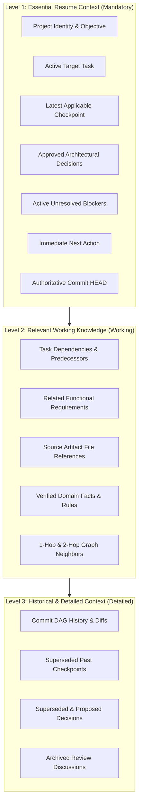

# Three-Level Memory Retrieval Strategy

The **Barsa Smart Context Engine (SCE)** organizes memory retrieval into three structured tiers. Instead of dumping monolithic historical transcripts, agents retrieve exactly the tier required for their immediate cognitive task.

---

## 1. Three-Level Memory Architecture

---

## 2. Retrieval Levels Matrix

| Retrieval Level | Included Components | Primary Target Workflow | Default Token Footprint |
|---|---|---|---|
| **`essential`** | Level 1 only | Quick status checks, high-level project handoffs, initial turn greeting | ~500 – 1,200 tokens |
| **`working`** | Level 1 + Level 2 | Active code generation, unit test implementation, subsystem integration | ~1,500 – 4,000 tokens |
| **`detailed`** | Level 1 + Level 2 + Level 3 | Architectural auditing, deep debugging, historical root-cause analysis | ~4,000 – 16,000 tokens |
| **`adaptive`** | Level 1 guaranteed; Level 2 & 3 prioritized by relevance ranking until token budget filled | Standard autonomous coding agent turn | Configurable (Default: 4,000 tokens) |

---

## 3. Graph-Aware Traversal Rules

When a target `task_id` is specified:
1. **Node Resolution:** Identifies the task node within the graph projection.
2. **Upstream Traversal (`DEPENDS_ON`, `BLOCKS`):** Traverses direct predecessor tasks and flags incomplete predecessors as active blockers.
3. **Decision Linkage (`REFERENCES`, `IMPLEMENTS`):** Pulls decisions directly connected to the active task.
4. **Artifact Linkage:** Resolves physical file URIs connected via `REFERENCES` edges.
5. **Freshness Guard:** Compares the last projected graph commit against the authoritative SQLite main branch HEAD. If lagging, records `CompletenessStatus.STALE` with explicit warnings.

---

## 4. Omission Reporting Protocol

When available token budget is exhausted:
- Lower-ranked Level 2 and Level 3 records are omitted.
- The record identifiers are logged in `omitted_record_refs: list[str]`.
- The package completeness is marked `partial`.
- Agents inspect `omitted_record_refs` and report to the user if critical domain knowledge was left unretrieved due to budget constraints.
