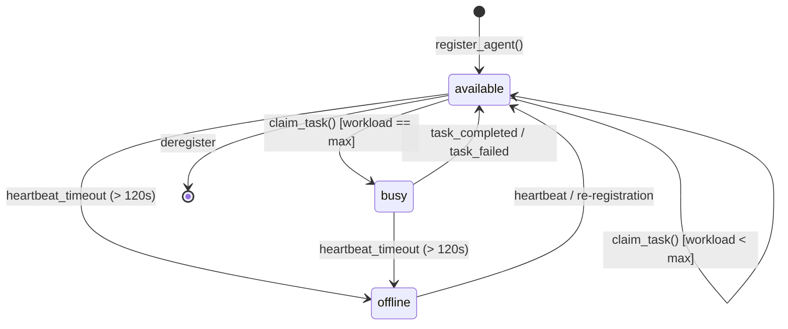

# Barsa Agent Registry & Capability Model

The **Barsa Agent Registry** tracks active, busy, and offline AI agents, their provider metadata, tool access, and verified vs. claimed capabilities.

---

## 1. Agent Lifecycle State Machine



---

## 2. Claimed vs. Verified Capabilities

To prevent lower-capability agents from claiming mission-critical tasks, Barsa maintains a two-tiered capability model:

| Level | Definition | Trust Model | Example |
|---|---|---|---|
| **Claimed** | Self-reported skills announced by the agent runtime during registration. | Untrusted, best-effort. | `python`, `documentation`, `summarization` |
| **Verified** | Capabilities confirmed through automated benchmarks, human signoff, or tool certifications. | High trust, audited. | `security-testing`, `db-migration`, `architecture-review` |

### Verification Enforcement
Tasks can specify `min_verified_level`:
- If `min_verified_level = "verified"`, the coordinator strictly requires all task `required_capabilities` to exist in `agent.verified_capabilities`. Any missing capability raises a `ValidationError`.
- If `min_verified_level = "claimed"`, the coordinator checks the union of `agent.claimed_capabilities` and `agent.verified_capabilities`.

---

## 3. Database Schema

The registry is stored in SQLite table `agents`:

```sql
CREATE TABLE IF NOT EXISTS agents (
    agent_id TEXT PRIMARY KEY,
    display_name TEXT NOT NULL,
    provider TEXT NOT NULL,
    model TEXT,
    claimed_capabilities TEXT,
    verified_capabilities TEXT,
    supported_tools TEXT,
    allowed_projects TEXT,
    availability_status TEXT DEFAULT 'available',
    last_heartbeat TIMESTAMP NOT NULL,
    current_workload INTEGER DEFAULT 0,
    maximum_concurrent_tasks INTEGER DEFAULT 2,
    registered_at TIMESTAMP NOT NULL,
    updated_at TIMESTAMP NOT NULL,
    metadata_json TEXT
);
```

---

## 4. Heartbeat & Availability Tracking

Agents maintain their active status by submitting periodic heartbeats.
- Default heartbeat interval: `15 seconds`.
- Dead agent threshold: `120 seconds` without a heartbeat marks the agent `offline` in candidate matching queries.
- Workload tracking is updated dynamically: claiming a task increments `current_workload`, completing or failing a task decrements it. If `current_workload >= maximum_concurrent_tasks`, the agent is marked `busy` and skipped by the scheduler.
