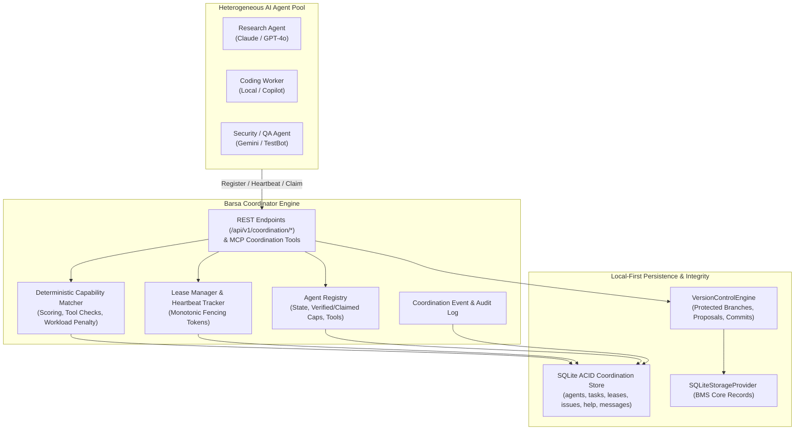

# Barsa Multi-Agent Coordination Engine — Architecture & Distributed Flow

The **Barsa Multi-Agent Coordination Engine** (Phase 9) provides a lightweight, persistent, capability-aware coordination and scheduling backbone for independent AI agents collaborating on complex software projects.

---

## 1. System Topology & Architectural Flow

---

## 2. Core Architectural Components

| Component | Module | Responsibility |
|---|---|---|
| **Data Models** | [`src/barsa/coordination/models.py`](file:///d:/projects/BARSA/src/barsa/coordination/models.py) | Pydantic v2 schemas for tasks, agent registrations, leases, messages, issues, help requests, and events. |
| **ACID Storage** | [`src/barsa/coordination/storage.py`](file:///d:/projects/BARSA/src/barsa/coordination/storage.py) | Transactional SQLite storage with atomic compare-and-swap claims, lease renewals, and sweeps. |
| **Capability Matcher** | [`src/barsa/coordination/matching.py`](file:///d:/projects/BARSA/src/barsa/coordination/matching.py) | Deterministic scoring algorithm balancing capability match, workload limits, and tool availability. |
| **Lease Manager** | [`src/barsa/coordination/leases.py`](file:///d:/projects/BARSA/src/barsa/coordination/leases.py) | Monotonic fencing token generator and millisecond-accurate lease duration calculators. |
| **Coordinator Engine** | [`src/barsa/coordination/engine.py`](file:///d:/projects/BARSA/src/barsa/coordination/engine.py) | High-level orchestration facade linking task discovery, reviews, issues, and version control. |
| **REST Router** | [`src/barsa/api/v1/endpoints/coordination.py`](file:///d:/projects/BARSA/src/barsa/api/v1/endpoints/coordination.py) | FastAPI routes exposed under `/api/v1/coordination/*`. |
| **MCP Tools** | [`src/barsa/mcp/tools.py`](file:///d:/projects/BARSA/src/barsa/mcp/tools.py) | 9 standardized MCP coordination tools exposed to external LLMs and IDE extensions. |

---

## 3. Distributed Invariants & Guarantees

1. **Local-First Reliability:** No dependence on external message brokers (Kafka, RabbitMQ, Redis) or container orchestrators (Kubernetes). All synchronization runs in local SQLite with `BEGIN IMMEDIATE` transaction serialization.
2. **Strict Mutual Exclusion:** Only one agent holds an active lease for any given task at a time. Atomic compare-and-swap ensures simultaneous claims result in one winner and immediate conflict errors for others.
3. **Monotonic Fencing Tokens:** Every lease grant increments an atomic counter. Late submissions from delayed or partition-isolated workers are unconditionally rejected by the fencing token validator.
4. **Shared Memory Through Version Control:** No agent can inject arbitrary unreviewed knowledge directly into the persistent knowledge graph. All contributions must pass through `VersionControlEngine` commits or peer-reviewed merge proposals.
5. **No Self-Approvals:** The reviewer must be a different agent from the proposal author. Self-approvals are strictly blocked at the coordinator layer.
