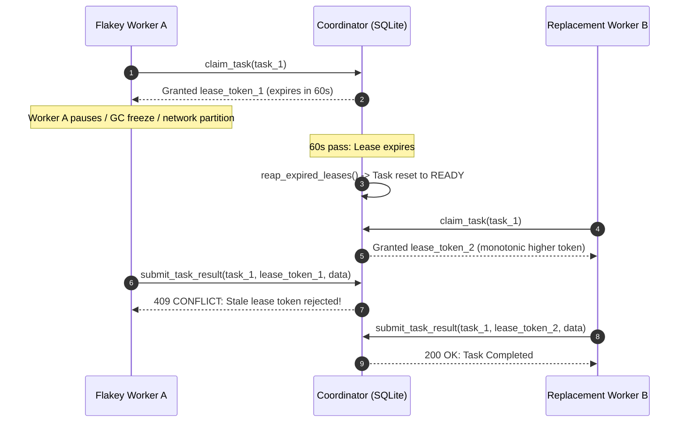

# Distributed Leases, Heartbeats & Monotonic Fencing Tokens

The **Barsa Lease Manager** provides distributed lock safety over local SQLite storage, eliminating "split-brain" worker updates and zombie writes without external consensus clusters (etcd/Zookeeper).

---

## 1. Monotonic Fencing Tokens & Stale Write Rejection



---

## 2. Fencing Token Construction

Fencing tokens are formatted as:
`lease-<prefix>-<unix_ms>-<counter>-<random_hex>`

Example: `lease-task-0-1791991904506-4-6aeca9`

Properties:
- **Monotonically Increasing:** Timestamp + sequence counter ensures new tokens strictly sort higher than previous tokens.
- **Unique & Unforgeable:** 6-character random hex suffix prevents guessing or token collision across rapid reassignment.

---

## 3. Compare-and-Swap (CAS) Atomic Claiming

To prevent race conditions when multiple agents try to claim the same task simultaneously:

```sql
UPDATE coordination_tasks
SET assigned_agent_id = :agent_id,
    lease_token = :lease_token,
    lease_expires_at = :lease_expires_at,
    status = 'claimed',
    attempt_count = attempt_count + 1,
    updated_at = :now
WHERE task_id = :task_id
  AND status IN ('ready', 'pending')
  AND (lease_expires_at IS NULL OR lease_expires_at < :now);
```

If zero rows are updated, the coordinator checks current task state and raises a `ConflictError("Task cannot be claimed; currently held by another agent")`.

---

## 4. Heartbeat Protocol

Running agents periodically invoke `barsa_renew_lease` or `POST /api/v1/coordination/tasks/{task_id}/heartbeat`:
- Validates the current `lease_token`.
- Extends `lease_expires_at` by the configured lease duration.
- Updates `last_heartbeat` on the worker's agent profile.
- Rejects requests if the lease was already expired and swept.
