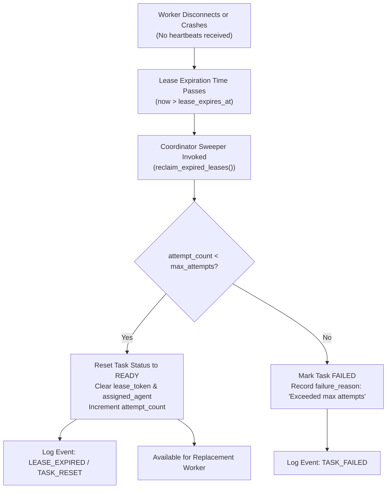

# Crash Recovery, Sweeper Cycles & At-Least-Once Semantics

The **Barsa Fault Tolerance System** guarantees task execution progress even when agents crash, experience network disconnects, or enter infinite compute loops.

---

## 1. Crash Recovery & Lease Reaping Lifecycle

---

## 2. At-Least-Once Task Execution Semantics

Barsa employs **at-least-once execution semantics**:
- If an agent crashes midway through a task, the task is re-queued for another agent to claim.
- Tasks should be structured idempotently: intermediate progress checkpoints can be persisted in BMS records so the replacement worker can resume from the last saved state rather than starting from scratch.
- The `max_attempts` parameter (default `3`) prevents infinite retry loops for fundamentally broken tasks (poison pill tasks).

---

## 3. Coordinator Restart Resilience

Because all coordination states are stored in persistent SQLite tables (not transient in-memory locks):
- The entire Barsa service can be killed (`SIGKILL`) and restarted at any time.
- Upon reboot, all tasks retain their exact states (`pending`, `ready`, `running`, `under_review`).
- When the first request or sweeper run triggers, expired leases are automatically reaped.
- Active workers who survived the restart can continue renewing their leases as long as their lease duration has not expired.
