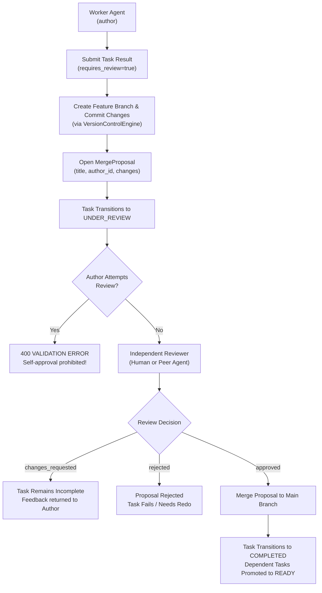

# Review Workflows & Self-Approval Prevention

The **Barsa Review Workflow** integrates task completion with Git-style memory version control (`VersionControlEngine`), ensuring all architectural and critical code changes undergo formal peer review before merging.

---

## 1. Review & Verification Workflow



---

## 2. Self-Approval Prohibition Enforcement

In `CoordinatorEngine.submit_review_decision`:

```python
proposal = self.vc.get_merge_proposal(project_id, proposal_id)
if proposal.author_id == reviewer_agent_id:
    raise ValidationError(
        f"Self-approval prohibited: reviewer '{reviewer_agent_id}' cannot review their own proposal '{proposal_id}'"
    )
```

This invariant ensures that no agent can unilaterally approve its own architectural decisions or code contributions, preventing hallucinated or faulty updates from silently entering shared memory.

---

## 3. Review Status Values

- `approved`: Formal approval signoff. When associated with an `UNDER_REVIEW` task, transitions the task to `completed` and unlocks downstream dependent tasks.
- `changes_requested`: Reviewer requests revisions. The task remains uncompleted until another submission and review cycle occurs.
- `rejected`: The proposal is formally declined.
