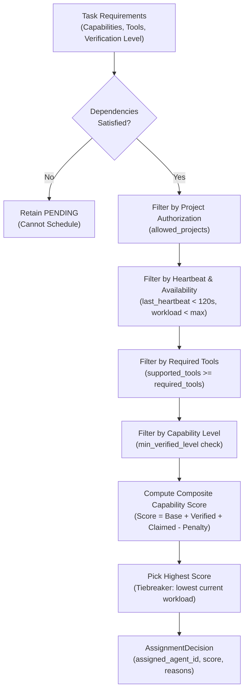

# Deterministic Capability-Based Scheduling & Task Assignment

The **Barsa Capability Matcher** assigns tasks to agents based on capability scoring, required tool sets, and live workloads without nondeterministic heuristic guessing.

---

## 1. Scheduling Pipeline & Matching Workflow



---

## 2. Scoring Algorithm Formulation

The score for candidate agent $a$ on task $t$ is calculated as:

$$\text{Score}(a, t) = S_{\text{base}} + (N_{\text{verified}} \times W_{\text{verified}}) + (N_{\text{claimed}} \times W_{\text{claimed}}) - (C_{\text{workload}} \times P_{\text{workload}})$$

Where:
- $S_{\text{base}} = 10.0$ (Base score for passing all eligibility filters)
- $N_{\text{verified}}$ = Number of task required capabilities verified for agent $a$
- $W_{\text{verified}} = 5.0$ (Verified capability weight)
- $N_{\text{claimed}}$ = Number of task required capabilities claimed (unverified) for agent $a$
- $W_{\text{claimed}} = 1.0$ (Claimed capability weight)
- $C_{\text{workload}}$ = Current running tasks on agent $a$
- $P_{\text{workload}} = 2.0$ (Penalty per concurrent task)

---

## 3. Explainability & Transparent Auditability

The matching engine never returns a bare ID without justification. Every assignment generates an `AssignmentDecision` with an audit explanation:

```json
{
  "task_id": "task-002-implement-auth",
  "assigned_agent_id": "agent-tester-c",
  "score": 20.2,
  "eligible_agents": ["agent-tester-c", "agent-coder-b"],
  "reasons": [
    "Selected optimal agent 'Security Tester C' (agent-tester-c) with composite score 20.20",
    "Matched capabilities: 2 verified, 0 claimed",
    "Workload 0/2 (penalty: -0.0)"
  ]
}
```

If no agent qualifies, `assigned_agent_id` is `null` and `reasons` records why each candidate was rejected (e.g. missing tool, capability deficit, or workload saturation).
