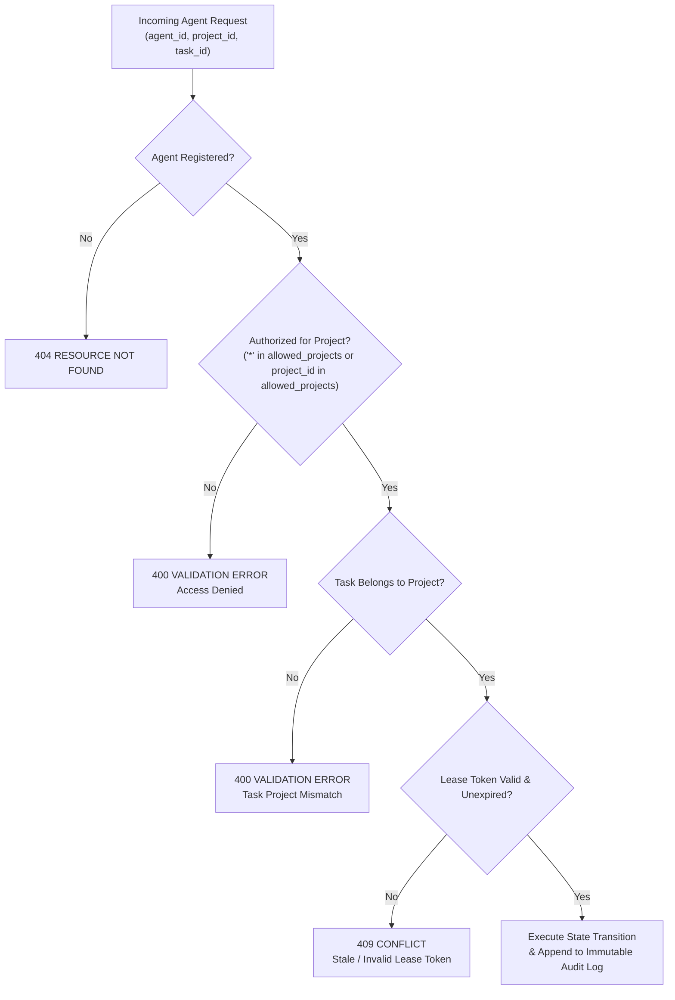

# Coordination Security, Isolation & Audit Logging

The **Barsa Coordination Engine** enforces strict project boundaries, authorization checks, untrusted agent comment filtering, and tamper-resistant audit logging.

---

## 1. Security Architecture & Boundary Verification



---

## 2. Multi-Tenant Project Isolation

Every agent profile includes `allowed_projects`:
- `allowed_projects = ["*"]`: The agent is authorized for all projects on the system (e.g. administrative or shared system agents).
- `allowed_projects = ["proj-finance-1"]`: The agent can only discover, claim, update, or comment on tasks belonging to `proj-finance-1`.
- Any attempt to claim a task or post comments to a project outside the agent's whitelist is blocked with an immediate validation error.

---

## 3. Untrusted Collaboration Content Sanitization

Agents can post comments, suggestions, and issue descriptions. To prevent prompt injection, script execution, or malformed payloads:
- All comments are stored as raw text without server-side shell interpretation.
- Field length limits are enforced via Pydantic models.
- Associated memory updates must be submitted as structured BMS records, which pass through schema validation and the `VersionControlEngine`.

---

## 4. Immutable Audit Event Log

All key coordinator actions emit events into the `coordination_events` table:

```sql
CREATE TABLE IF NOT EXISTS coordination_events (
    event_id TEXT PRIMARY KEY,
    project_id TEXT NOT NULL,
    event_type TEXT NOT NULL,
    agent_id TEXT,
    task_id TEXT,
    payload_json TEXT,
    created_at TIMESTAMP NOT NULL
);
```

Event types include:
- `AGENT_REGISTERED`
- `TASK_CLAIMED`, `TASK_STARTED`, `TASK_PROGRESS_UPDATED`, `TASK_SUBMITTED`, `TASK_COMPLETED`
- `LEASE_EXPIRED`, `TASK_RESET`, `TASK_FAILED`
- `ISSUE_REPORTED`, `ISSUE_RESOLVED`, `HELP_REQUESTED`, `HELP_CLAIMED`
- `KNOWLEDGE_COMMITTED`

The event log provides a complete forensic history of which agent performed which work, when leases were acquired, and how decisions were approved.
