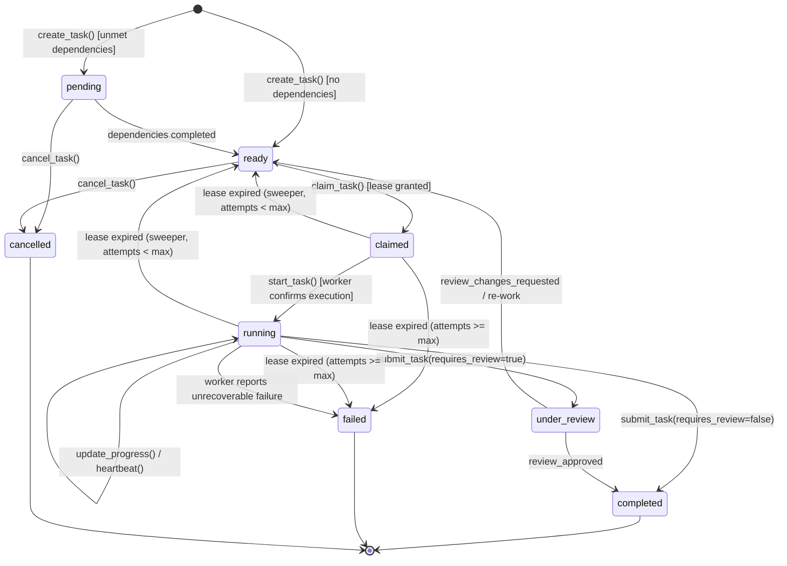

# Barsa Task Lifecycle & State Transitions

Tasks in the Barsa coordination engine progress through a strictly enforced state machine designed to prevent race conditions, stale updates, and duplicate execution.

---

## 1. Task State Machine

---

## 2. State Definitions

| State | Description | Permitted Next States |
|---|---|---|
| `pending` | Task has unmet dependency predecessors. Cannot be claimed. | `ready`, `cancelled` |
| `ready` | All dependencies satisfied. Available for capable agents to claim. | `claimed`, `cancelled` |
| `claimed` | An agent has acquired the lease; awaiting active execution start. | `running`, `ready` (lease timeout), `failed` |
| `running` | Worker is actively computing; heartbeating and sending progress. | `under_review`, `completed`, `ready` (timeout), `failed` |
| `under_review` | Worker has submitted result; awaiting peer or human review signoff. | `completed` (approved), `ready` (changes requested) |
| `completed` | Task successfully verified and finished. Results sealed in DB. | Terminal state |
| `failed` | Task exceeded max retries or hit unrecoverable fatal error. | Terminal state |
| `cancelled` | Task manually aborted by user or coordinator policy. | Terminal state |

---

## 3. Dependency Propagation

When a task transitions to `completed`:
1. The coordinator scans all other tasks in the project with state `pending`.
2. For each pending task, if all entries in its `dependencies` array are now `completed`, the coordinator atomically transitions the task to `ready`.
3. An audit event `TASK_PROMOTED_READY` is logged.
