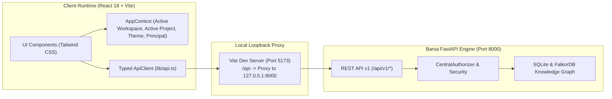

# Barsa Web Dashboard Architecture

The **Barsa Web Dashboard** serves as the graphical control center for the Barsa universal AI memory and collaboration infrastructure.

---

## 1. UI Navigation Architecture

```mermaid
flowchart TD
    App["App Root (/)] --> Layout["DashboardLayout"]
    Layout --> Sidebar["Collapsible Sidebar Navigation"]
    Layout --> Navbar["Top Navbar (Workspace & Project Switcher, Health Pill, Identity, Theme)"]
    Layout --> MainContent["Routed Page Content (<Outlet />)"]

    MainContent --> Overview["/ (Dashboard Overview)"]
    MainContent --> Workspaces["/workspaces (Workspace Management)"]
    MainContent --> Projects["/projects (Projects List)"]
    MainContent --> ProjectDetail["/projects/:projectId (Project Overview & Resume Context)"]
    MainContent --> Memory["/memory (Structured BMS Memory Explorer)"]
    MainContent --> VersionControl["/version-control (Commit DAG, Diffs, Branches, Conflicts)"]
    MainContent --> Graph["/graph (FalkorDB Knowledge Graph Explorer)"]
    MainContent --> Agents["/agents (Agent Registry & Workloads)"]
    MainContent --> Tasks["/tasks (Coordination Kanban Board)"]
    MainContent --> Security["/security (Identity, Agent Credentials, Audit Log)"]
    MainContent --> Storage["/storage (SQLite Status & BMS Import/Export)"]
    MainContent --> Settings["/settings (Preferences & Engine Diagnostics)"]
```

---

## 2. Component & State Management Architecture



---

## 3. Technology Stack Specification

- **Framework:** React 18 with TypeScript 5.5
- **Bundler:** Vite 5 with `@vitejs/plugin-react`
- **Routing:** React Router v6 (`BrowserRouter`, `Routes`, `Route`, `Navigate`)
- **Server Cache & Async Queries:** TanStack React Query v5
- **Styling & Tokens:** Tailwind CSS v3 with dark/light mode class tokens and custom design system
- **Icons:** Lucide React for consistent developer-tool iconography
- **Testing:** Vitest + React Testing Library + `@testing-library/jest-dom`

---

## 4. Production Build Architecture

When building for production:
```bash
npm run build
```
1. TypeScript compiles and validates all types (`tsc --noEmit`).
2. Vite bundles optimized CSS and JavaScript chunks into `frontend/dist/`.
3. The resulting single-page application (SPA) can be served directly by a static web server or embedded within the Barsa desktop daemon.
