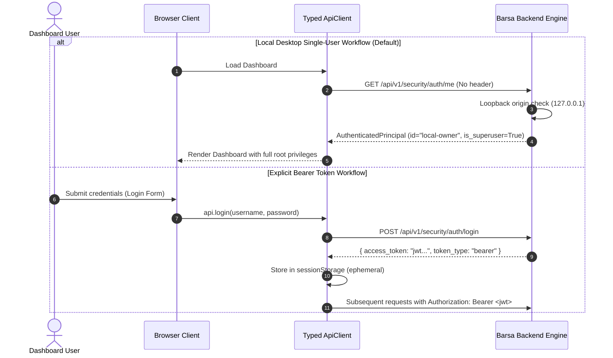

# Dashboard Authentication & Session Security

This document explains how the Barsa Web Dashboard interfaces with the Phase 10 security and identity engine.

---

## 1. Authentication Modalities

---

## 2. Key Security Invariants in the Frontend

1. **No Sensitive Access Tokens in Persistent LocalStorage:**
   - JWT tokens are stored solely in `sessionStorage` (which is scoped to the current browser tab and purged upon tab closure).
2. **One-Time Secret Key Display:**
   - Newly generated agent API keys (`barsa_ak_...`) are returned in the response payload of `POST /api/v1/security/agents/credentials` exactly once.
   - The UI displays a modal with a copy button and a prominent warning:
     > *"Store this secret securely now. It will NEVER be displayed again!"*
   - Once dismissed, the raw key cannot be retrieved from either the backend or frontend state.
3. **No Hash Exposure:**
   - Stored Argon2id and SHA-256 hashes are omitted from all dashboard API payloads.
4. **Local Origin Protection:**
   - The backend checks `Origin` headers on mutating requests, preventing malicious external web pages from forging requests to the local dashboard API.
