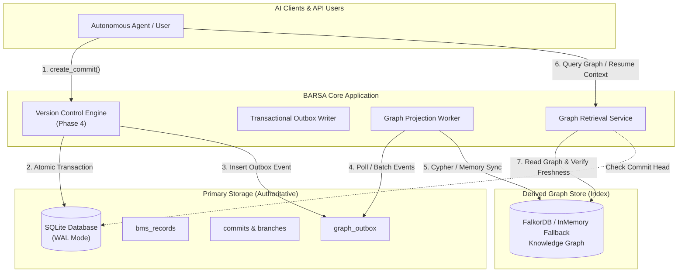
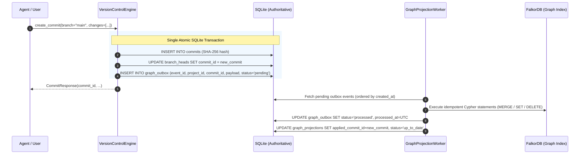

# BARSA Knowledge Graph Architecture

## 1. Dual-Store Model

BARSA implements an event-driven **dual-store architecture** designed for data integrity, multi-agent collaboration, and zero vendor lock-in.

### Roles and Boundaries:
1. **Authoritative Source of Truth:**
   - SQLite (Phase 3 & 4) holds the entire canonical history: raw BMS records, content-addressed commits, branch refs, artifacts, and reviews.
   - If FalkorDB fails, crashes, or is completely wiped, **zero project data is lost**.
2. **Derived Knowledge Index:**
   - FalkorDB (or the `InMemoryGraphProvider` fallback) holds an indexed projection of current entity relationships.
   - It is purely a query index optimized for multi-hop graph traversals (task dependencies, decision impact, agent contributions, and resume context).
   - Writes to the graph are strictly performed via projection of committed outbox events.

---

## 2. Transactional Outbox Pattern & Event Sync

To guarantee atomic persistence without dual-write inconsistencies or distributed 2PC transactions:

### Sync Guarantees:
- **At-Least-Once Delivery & Idempotency:** Every graph projection query uses Cypher `MERGE` semantics keyed by `node_id = {project_id}:{record_id}`. Replaying events produces identical graph state.
- **Ordered Consumption:** Events are processed monotonically by commit timestamp and sequence.
- **Main Branch Isolation:** Outbox events are only created for commits on `main` (or explicitly merged branches). Feature branch commits never pollute the primary graph index.

---

## 3. Consistency Boundaries and Freshness

Graph queries return metadata with:
- `is_fresh`: Boolean indicating whether `applied_commit_id` matches current `head_commit_id` on the `main` branch.
- `applied_commit_id`: The commit hash up to which the graph has processed.
- `pending_events_count`: Number of outbox events awaiting projection.
- `last_sync_timestamp`: UTC timestamp of the last processed outbox event.
