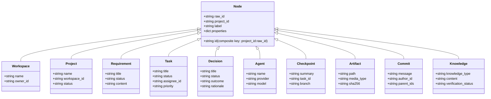

# BARSA Graph Data Model

## 1. Node Labels and Scoped Identifiers

All nodes in the BARSA knowledge graph use multi-project composite identifiers:
$$\text{node\_id} = \text{project\_id} + \text{":"} + \text{raw\_id}$$

This strictly prevents cross-project ID collisions in shared graph database instances while allowing human-readable BMS IDs (`proj-alpha`, `task-101`, `dec-201`).

---

## 2. Node Schema Reference

| Label | Primary Properties | Derived From |
| :--- | :--- | :--- |
| `Workspace` | `name`, `owner_id`, `created_at` | BMS Workspace / SQLite |
| `Project` | `name`, `workspace_id`, `status`, `created_at` | BMS Project / SQLite |
| `Requirement` | `title`, `status`, `content`, `verification_status` | `KnowledgeRecord(knowledge_type="requirement")` |
| `Task` | `title`, `status`, `priority`, `assignee_id`, `tags` | BMS TaskRecord |
| `Decision` | `title`, `status`, `outcome`, `rationale`, `impact` | BMS DecisionRecord |
| `Agent` | `name`, `provider`, `model`, `capabilities` | Commit author / task assignee |
| `Checkpoint` | `summary`, `task_id`, `branch`, `active_goal` | BMS CheckpointRecord |
| `Artifact` | `path`, `media_type`, `sha256`, `size_bytes` | BMS ArtifactReference |
| `Commit` | `message`, `author_id`, `timestamp`, `parent_ids` | Phase 4 MemoryCommit |
| `Knowledge` | `knowledge_type`, `content`, `verification_status` | BMS KnowledgeRecord (general) |

---

## 3. Index Strategy in FalkorDB

For constant-time node resolution and fast multi-hop expansions, FalkorDB creates indices on:
1. `(n:Project {id})`
2. `(n:Task {id})`
3. `(n:Decision {id})`
4. `(n:Requirement {id})`
5. `(n:Checkpoint {id})`
6. `(n:Agent {id})`
7. `(n:Commit {id})`
8. `(n:Artifact {id})`
9. `(n:Knowledge {id})`

All Cypher queries filter on `project_id = $project_id` and match on indexed composite `id = $node_id`.
