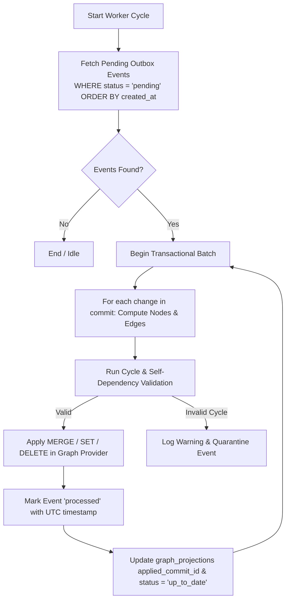

# BARSA Graph Projection Engine

## 1. Outbox Event Pipeline

The `GraphProjectionWorker` is responsible for consuming `graph_outbox` events written atomically by `VersionControlEngine` during commits on the `main` branch.



---

## 2. Event Schema and States

### Schema (`graph_outbox` table):
- `event_id`: UUIDv4 string.
- `project_id`: Scoped BARSA project identifier.
- `commit_id`: 64-character SHA-256 commit hash.
- `event_type`: Event category (`commit_created`, `rebuild_requested`).
- `payload`: Serialized JSON payload containing:
  - `branch_name`: Name of branch committed to (must be `main` for projection).
  - `author_id`: Commit author.
  - `message`: Commit summary.
  - `changes`: Array of `MemoryChange` objects (`operation`, `record_id`, `record_type`, `before_state`, `after_state`).
- `status`: Lifecycle state (`pending`, `processing`, `processed`, `failed`).
- `retry_count`: Integer tracking delivery attempts.
- `error_message`: Nullable string storing exception traceback.
- `created_at`: UTC ISO-8601 creation timestamp.
- `processed_at`: UTC ISO-8601 completion timestamp.

---

## 3. Idempotency and Deduplication

All projections are **strictly idempotent**:
- Node creation: `MERGE (n:Label {id: $id, project_id: $project_id}) SET n += $props`
- Relationship creation:
  ```cypher
  MATCH (a {id: $source_id, project_id: $project_id})
  MATCH (b {id: $target_id, project_id: $project_id})
  MERGE (a)-[r:REL_TYPE]->(b)
  SET r += $props
  ```
- Deletions: `MATCH (n {id: $id, project_id: $project_id}) DETACH DELETE n`
- If an outbox event is replayed multiple times, the resulting graph topology remains identical.

---

## 4. Rebuild Procedure

When full resynchronization is requested or graph corruption is detected:
1. `worker.rebuild_project_graph(project_id)` is invoked.
2. Status in `graph_projections` is set to `REBUILDING`.
3. The project's graph namespace is wiped (`clear_project_graph(project_id)`).
4. The project node is re-indexed.
5. All authoritative BMS records in SQLite for that project are read and projected.
6. The head commit on `main` is inspected, and `applied_commit_id` is updated.
7. Status in `graph_projections` returns to `UP_TO_DATE`.
