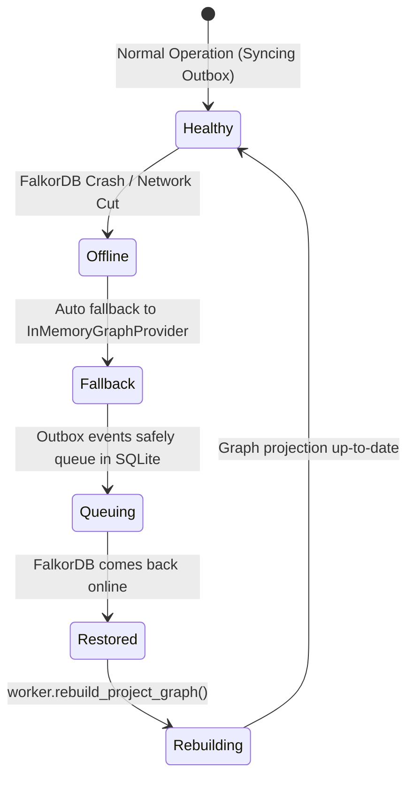

# BARSA Graph Recovery and Disaster Resilience

## 1. Resilience Philosophy

Because BARSA employs a **dual-store architecture**, the graph engine is strictly a **derived disposable index**.
- Primary, authoritative source: SQLite (WAL mode, ACID, full version-controlled history).
- Derived secondary store: FalkorDB (or in-memory cache).



---

## 2. Failure Scenarios and Mitigations

### 1. FalkorDB Is Completely Offline
- **Behavior:** The application logs a warning and automatically falls back to `InMemoryGraphProvider`.
- **Data Protection:** `VersionControlEngine` continues committing safely. The atomic SQLite transaction writes changes and inserts events into `graph_outbox` with status `pending`.
- **Result:** No user or agent commits fail. When FalkorDB is reconnected, running `rebuild_project_graph()` or processing outbox events restores the graph state completely.

### 2. Graph Corruption or Partial Sync Drift
- **Behavior:** If graph indices become corrupted or manual edits disrupt graph consistency:
  1. Trigger rebuild via CLI or API endpoint:
     `POST /api/v1/projects/{project_id}/graph/rebuild`
  2. The worker wipes the project's graph namespace (`clear_project_graph`).
  3. The worker walks authoritative SQLite records for that project and repopulates all nodes and edges.
  4. The worker inspects the latest `main` commit and marks the projection `up_to_date`.

### 3. Outbox Processing Crash Mid-Batch
- **Behavior:**
  - Events are processed in batches with SQLite transactions updating status to `processed`.
  - All Cypher operations use idempotent `MERGE` semantics.
  - If a worker crashes mid-batch, upon restart it re-processes pending events without duplicating nodes or relationships.

---

## 3. Disaster Recovery Runbook

To manually rebuild all project graphs across an entire BARSA instance:
```python
from barsa.core.config import get_settings
from barsa.storage.factory import get_storage_provider
from barsa.graph.factory import get_graph_provider
from barsa.graph.projection import GraphProjectionWorker

settings = get_settings()
storage = get_storage_provider(settings)
graph = get_graph_provider(settings)
worker = GraphProjectionWorker(storage, graph)

# Rebuild all projects in workspace
projects = storage.list_projects()
for p in projects:
    print(f"Rebuilding graph for project {p.id}...")
    meta = worker.rebuild_project_graph(p.id)
    print(f"Project {p.id} rebuild complete: {meta.status}")
```
