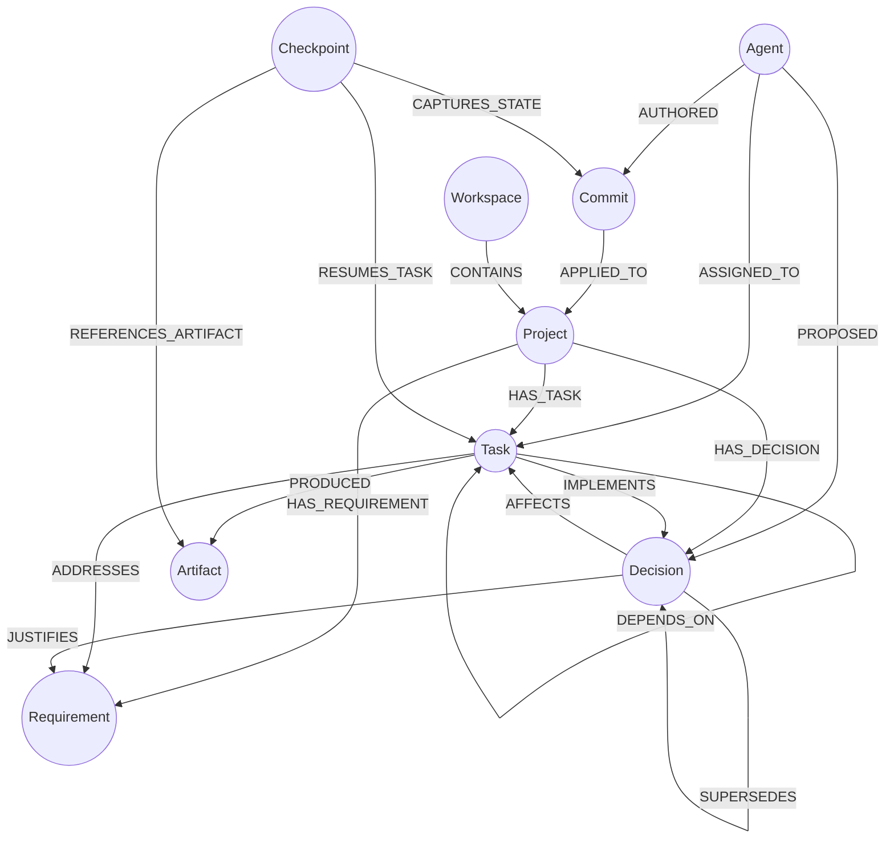

# BARSA Graph Relationships Catalog

## 1. Relationship Traversal Graph

The BARSA knowledge graph maps semantic connections between autonomous agents, architectural decisions, specifications, tasks, artifacts, and checkpoints.

---

## 2. Complete Relationship Catalog

| Relationship Type | Source Label | Target Label | Cardinality | Semantic Meaning |
| :--- | :--- | :--- | :--- | :--- |
| `CONTAINS` | `Workspace` | `Project` | 1-to-N | Workspace hierarchy containing projects. |
| `HAS_TASK` | `Project` | `Task` | 1-to-N | Project ownership of active and completed tasks. |
| `HAS_REQUIREMENT` | `Project` | `Requirement` | 1-to-N | System, domain, or user specification requirements. |
| `HAS_DECISION` | `Project` | `Decision` | 1-to-N | Architectural or technical decisions made in project. |
| `DEPENDS_ON` | `Task` | `Task` | M-to-N | Dependency DAG (source task depends on target task). Directed acyclic check enforced. |
| `IMPLEMENTS` | `Task` | `Decision` | M-to-N | Task executes or implements an architectural decision. |
| `ADDRESSES` | `Task` | `Requirement` | M-to-N | Task directly satisfies a requirement. |
| `PRODUCED` | `Task` | `Artifact` | 1-to-N | Artifacts (diffs, code, design docs) generated by task. |
| `JUSTIFIES` | `Decision` | `Requirement` | M-to-N | Architectural rationale explaining why requirement is formed/met. |
| `SUPERSEDES` | `Decision` | `Decision` | M-to-N | Architectural revision where new decision replaces previous one. |
| `AFFECTS` | `Decision` | `Task` | M-to-N | Scope impact of decision on ongoing or planned work. |
| `AUTHORED` | `Agent` | `Commit` | 1-to-N | Agent identity attributed to version control commit. |
| `ASSIGNED_TO` | `Agent` | `Task` | 1-to-N | Primary agent responsible for task execution. |
| `PROPOSED` | `Agent` | `Decision` | 1-to-N | Agent initiating an architectural decision record. |
| `RESUMES_TASK` | `Checkpoint` | `Task` | 1-to-1 | Exact task context preserved for resumption. |
| `CAPTURES_STATE` | `Checkpoint` | `Commit` | 1-to-1 | Git-style commit representing checkpointed state. |
| `REFERENCES_ARTIFACT` | `Checkpoint` | `Artifact` | M-to-N | Key outputs linked for continuation context. |

---

## 3. Structural Rules and Invariants

1. **Self-Dependency Prohibition:** No task may depend on itself:
   $$\forall t \in \text{Tasks},\quad (t) \not\to^{\text{DEPENDS\_ON}} (t)$$
2. **Cycle Prevention:** Task dependencies must form a Directed Acyclic Graph (DAG). If a proposed `DEPENDS_ON` relationship would create a cycle ($T_1 \to T_2 \to \dots \to T_1$), projection validation rejects the operation.
3. **Cross-Project Boundary:** No relationship may connect nodes belonging to different `project_id` namespaces.
