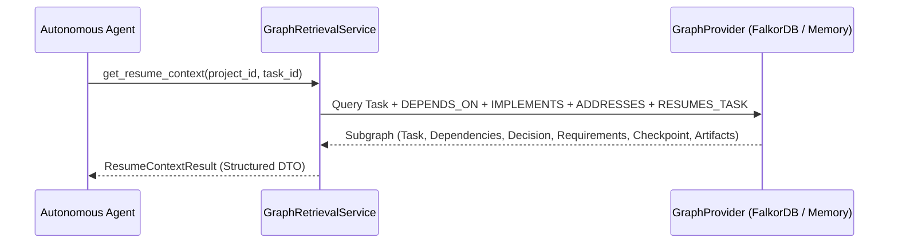

# BARSA Graph Retrieval Engine

## 1. Overview and Design

The `GraphRetrievalService` executes semantic domain queries against the graph index to provide agents with instant, structured context without scanning raw commit logs or performing sequential database queries.



---

## 2. Standard Query Patterns

### 1. Task Resume Context
**Purpose:** Answers *"What is the full context needed to resume task X?"*
Retrieves:
- The target task node.
- Upstream and downstream task dependencies (`DEPENDS_ON`).
- Architectural decisions implemented by the task (`IMPLEMENTS`).
- Requirements addressed by the task (`ADDRESSES`).
- Latest checkpoint referencing the task (`RESUMES_TASK`).
- Artifacts produced or referenced.

### 2. Decision Impact Analysis
**Purpose:** Answers *"What tasks, requirements, or subsequent decisions are affected if this decision changes?"*
Retrieves:
- Superseded decisions (`SUPERSEDES`).
- Requirements justified by the decision (`JUSTIFIES`).
- Tasks implementing or affected by the decision (`IMPLEMENTS`, `AFFECTS`).

### 3. Task Dependency Traversal
**Purpose:** Resolves upstream blockers and downstream unblocked tasks recursively or breadth-first.

### 4. Agent Contributions
**Purpose:** Summarizes an agent's authored commits, proposed decisions, and assigned tasks across a project.

---

## 3. Cypher Query Reference

All Cypher queries are strictly parameterized and scoped by `project_id`.

### Example: Resume Context Traversal
```cypher
MATCH (t:Task {id: $task_node_id, project_id: $project_id})
OPTIONAL MATCH (t)-[:DEPENDS_ON]->(dep:Task {project_id: $project_id})
OPTIONAL MATCH (t)-[:IMPLEMENTS]->(d:Decision {project_id: $project_id})
OPTIONAL MATCH (t)-[:ADDRESSES]->(r:Requirement {project_id: $project_id})
OPTIONAL MATCH (cp:Checkpoint {project_id: $project_id})-[:RESUMES_TASK]->(t)
OPTIONAL MATCH (t)-[:PRODUCED]->(art:Artifact {project_id: $project_id})
RETURN t, collect(DISTINCT dep) AS dependencies,
       collect(DISTINCT d) AS decisions,
       collect(DISTINCT r) AS requirements,
       collect(DISTINCT cp) AS checkpoints,
       collect(DISTINCT art) AS artifacts
```

### Performance & Index Utilization:
- All queries match on `id: $composite_key`, leveraging the exact hash/B-Tree index on `id`.
- Variable-length expansions (`*1..5`) are constrained with depth limits to guarantee bounded execution times.
