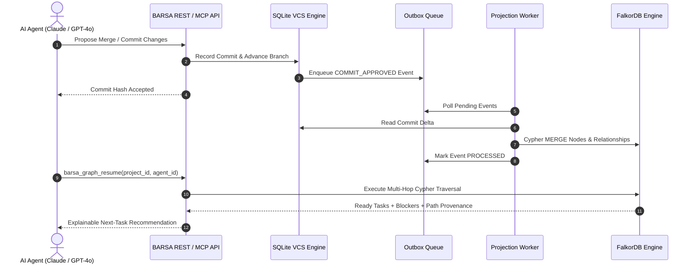

# FalkorDB Architecture & Indispensability in BARSA

## Executive Summary

BARSA (**Barsa Agentic Memory Standard Architecture**) provides persistent, version-controlled, token-efficient memory for collaborative AI agents across different platforms (Claude, ChatGPT, Gemini, local LLMs). 

In traditional AI memory architectures, memory retrieval and task selection rely either on vector similarity or flat database queries. Both approaches fail in non-trivial software engineering projects:
1. **Vector similarity has zero structural awareness**: An LLM searching for "what to do next" retrieves semantically similar tasks without knowing whether prerequisite architecture decisions or upstream dependencies have been completed.
2. **Relational queries suffer from combinatorial explosion**: Multi-hop dependency checks, transitive blocker cascades, and capability matching require expensive multi-table recursive CTEs that do not scale and lack path explainability.

**FalkorDB is the foundational graph reasoning engine of BARSA.** It serves as the primary graph database powering the **Project Continuation Engine** (`barsa_graph_resume`), transforming passive memory records into an active, multi-hop dependency graph.

---

## 1. Dual-Plane Storage Architecture

BARSA separates the storage plane into two complementary layers:

```
┌─────────────────────────────────────────────────────────────┐
│                       AI AGENTS                             │
│   (Claude 3.7 Sonnet, GPT-4o, Gemini 1.5, DeepSeek R1)      │
└──────────────┬──────────────────────────────┬───────────────┘
               │ MCP Tools / REST API         │ MCP / REST
               ▼                              ▼
┌──────────────────────────────┐ ┌────────────────────────────┐
│      AUTHORITATIVE VCS       │ │    GRAPH REASONING PLANE   │
│         PLANE (SQLite)       │ │         (FalkorDB)         │
├──────────────────────────────┤ ├────────────────────────────┤
│ • Git-style Commit DAG       │ │ • 10 Node Types            │
│ • State Hashes & Tree blobs  │ │ • 11 Relationship Types    │
│ • Branch pointers & merges   │ │ • Multi-hop Transitive     │
│ • Immutable Record storage   │ │   Dependency Traversal     │
│ • Transactional Outbox Queue │ │ • Blocker Propagation      │
│                              │ │ • Capability Matching      │
│                              │ │ • Decision Provenance      │
└──────────────┬───────────────┘ └────────────▲───────────────┘
               │                              │
               │      Transactional Outbox    │
               └────────── Event Worker ──────┘
```

1. **VCS Plane (Authoritative Storage)**:
   - Manages immutable commits, branches, conflict detection, and BMS records using relational ACID storage.
   - Whenever an approved commit is merged into `main`, an event is placed into the `graph_outbox` table.

2. **Graph Reasoning Plane (FalkorDB Engine)**:
   - The asynchronous projection worker consumes outbox events and projects nodes and relationships into FalkorDB.
   - FalkorDB executes low-latency Cypher queries using Redis Graph engine primitives and sparse matrix graph algorithms.
   - Computes transitive dependencies, blocker detection, agent capability alignment, and architectural decision lineage.

---

## 2. Why FalkorDB is Indispensable (Rule 2 & Rule 3 Compliance)

### Rule 2: FalkorDB is the Primary Graph Database
FalkorDB is not an auxiliary cache; it is the sole graph database underpinning BARSA's central multi-agent continuation protocol. All graph queries for continuation, dependency resolution, and path provenance are issued directly to FalkorDB via Cypher.

### Rule 3: The Graph Does Real Work (Cannot Work Without FalkorDB)
BARSA explicitly rejects superficial "graph visualizations over relational tables":
- **Hard Dependency**: The central product capability, `barsa_graph_resume(project_id, agent_id)`, executes five specialized Cypher queries in FalkorDB.
- **No Silent Fallback**: If FalkorDB is offline or stopped, `barsa_graph_resume` **strictly raises `FalkorDBUnavailableError` (HTTP 503)**. It does **not** fall back to SQLite or in-memory heuristics to fabricate an answer.
- **Non-Graph Independence**: Ordinary non-graph endpoints (retrieving raw commit logs, reading a BMS document, listing projects) continue functioning normally via SQLite, proving clean architectural separation.

---

## 3. Projection Pipeline: From Commit to Graph



1. **Deterministic Projection**:
   - Every BMS record corresponds to a graph node (`Task`, `Requirement`, `Decision`, `Knowledge`, `Artifact`, `Issue`, `Agent`, `Capability`).
   - Relationships (`DEPENDS_ON`, `BLOCKED_BY`, `REQUIRES`, `HAS_CAPABILITY`, `AFFECTS`, `REFERENCES`, `DECIDED_BY`) are extracted from explicit foreign keys and metadata fields.
2. **Idempotent Cypher Execution**:
   - All projections utilize parameterized `MERGE (n:Label {id: $id})` operations with `ON CREATE SET` and `ON MATCH SET` clauses, guaranteeing convergence.
3. **Graph Freshness Tracking**:
   - Every project graph stores its current `applied_commit_id` and `applied_revision`. Queries verify that the graph projection revision matches the authoritative VCS HEAD.

---

## 4. Architectural Summary

| Dimension | Authoritative VCS (SQLite) | Graph Reasoning Engine (FalkorDB) |
| :--- | :--- | :--- |
| **Primary Role** | Immutable state store, audit trail, branching | Reasoning, continuation, multi-hop traversal |
| **Data Structure** | Relational tables, JSON trees, commit DAG | Labeled Property Graph (LPG), Adjacency Matrices |
| **Query Language** | SQL | OpenCypher |
| **Continuation Function** | None (Fails with 503 if FalkorDB offline) | `barsa_graph_resume` (Transitive multi-hop analysis) |
| **Explainability** | Flat record lists | End-to-end verified graph paths |
