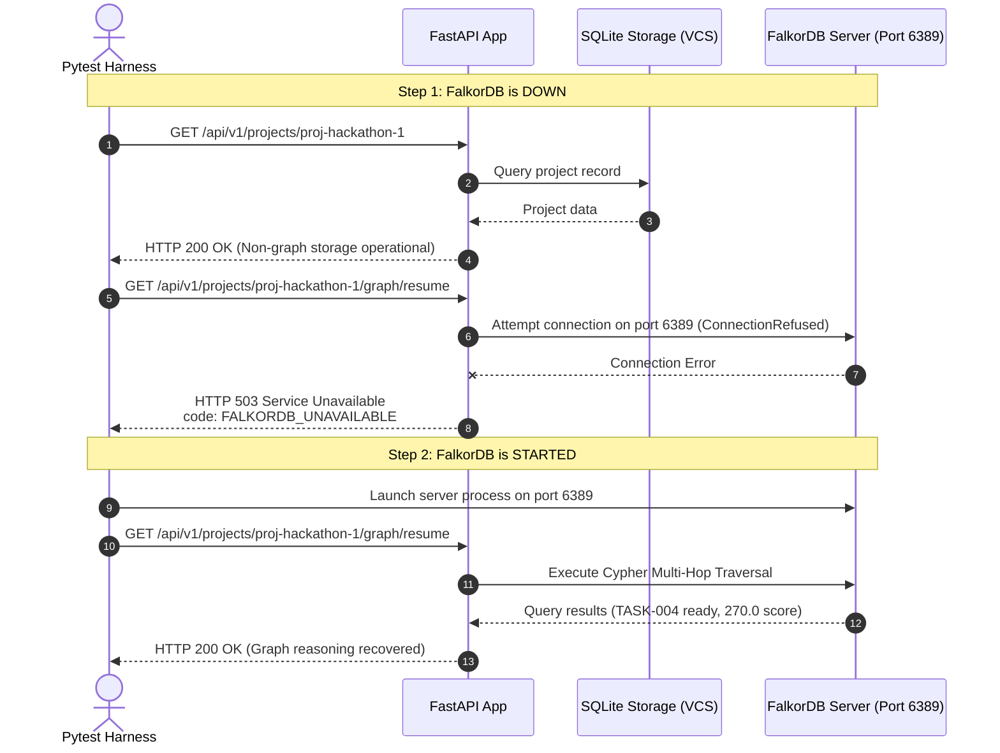

# FalkorDB Failure & Recovery Dependency Test (Rule 3 Evidence)

## Objective

To satisfy **Graph Hacks Rule 3**, we must conclusively prove that:
1. **FalkorDB does real, indispensable work**: The central graph-dependent product capability (`barsa_graph_resume`) cannot function without FalkorDB.
2. **No Fake Fallback**: When FalkorDB is offline, the continuation engine does not silently fall back to relational queries or hardcoded lists to fake a recommendation.
3. **Clean Decoupling**: Non-graph operations (retrieving projects, reading BMS records, viewing commits) remain fully functional when FalkorDB is offline.

---

## 1. Automated Test Architecture

The verification is automated in `tests/test_falkordb_hackathon.py::test_failure_test_falkordb_stop_and_recovery`:



---

## 2. Step-by-Step Execution & Protocol Evidence

### Phase 1: FalkorDB Offline (Failure Proof)

#### Non-Graph Request (Succeeds)
```http
GET /api/v1/projects/proj-hackathon-1 HTTP/1.1
Host: localhost:8000
```

**Response**:
```http
HTTP/1.1 200 OK
Content-Type: application/json

{
  "id": "proj-hackathon-1",
  "name": "InventoryPro",
  "workspace_id": "ws-hackathon-1",
  "description": "Full-stack inventory management system",
  "created_at": "2026-10-16T22:33:00Z"
}
```

#### Graph Resume Request (Fails with 503)
```http
GET /api/v1/projects/proj-hackathon-1/graph/resume HTTP/1.1
Host: localhost:8000
```

**Response**:
```http
HTTP/1.1 503 Service Unavailable
Content-Type: application/json

{
  "code": "FALKORDB_UNAVAILABLE",
  "error": "FalkorDB is required for graph-powered project continuation (Rule 3 Compliance). Non-graph storage is intact, but graph reasoning is unavailable: Error 10061 connecting to 127.0.0.1:6389. Connect call failed."
}
```

---

### Phase 2: FalkorDB Online (Recovery Proof)

FalkorDB is started on port 6389. The continuation endpoint is re-queried:

```http
GET /api/v1/projects/proj-hackathon-1/graph/resume?agent_id=agent-backend-claude HTTP/1.1
Host: localhost:8000
```

**Response**:
```http
HTTP/1.1 200 OK
Content-Type: application/json

{
  "project_id": "proj-hackathon-1",
  "agent_id": "agent-backend-claude",
  "recommended_task": {
    "task_id": "TASK-004",
    "title": "JWT Token Generation & Validation",
    "priority": "high",
    "status": "todo",
    "is_ready": true,
    "readiness_score": 270.0,
    "readiness_reason": "Prerequisites met [TASK-002:done]; unblocked; high priority (+120); agent capability match (+50); ADR-001 connected (+20)",
    "completed_dependencies": ["TASK-002"],
    "uncompleted_dependencies": [],
    "active_blockers": [],
    "required_capabilities": ["java-spring-boot", "security-jwt"],
    "agent_capability_match": true,
    "matched_capabilities": ["java-spring-boot", "security-jwt"],
    "missing_capabilities": [],
    "related_decisions": [
      {
        "id": "ADR-001",
        "title": "Stateless JWT Authentication with HMAC-SHA256"
      }
    ],
    "related_knowledge": [
      {
        "id": "DOC-001",
        "title": "JWT Secret & Expiry Rules"
      }
    ],
    "graph_paths": [
      "Task: TASK-004 -(DEPENDS_ON)-> Task: TASK-002 [status=done]",
      "Task: TASK-004 -(REQUIRES)-> Capability: security-jwt <-(HAS_CAPABILITY)- Agent: agent-backend-claude",
      "Decision: ADR-001 -(AFFECTS)-> Task: TASK-004",
      "Task: TASK-004 -(REFERENCES)-> Knowledge: DOC-001"
    ]
  },
  "why_ready": "Task 'TASK-004' (JWT Token Generation & Validation) is unblocked and ready. Prerequisites completed: TASK-002. Capabilities matched for agent-backend-claude: java-spring-boot, security-jwt. Connected ADRs: ADR-001. Score: 270.0.",
  "total_tasks_evaluated": 17,
  "completed_dependencies": ["TASK-002"],
  "remaining_blockers": [],
  "suitable_agents": [
    {
      "agent_id": "agent-backend-claude",
      "display_name": "Claude 3.7 Sonnet (Backend Lead)"
    }
  ],
  "falkordb_version": "1.8.0",
  "supporting_graph_paths": [
    "Task: TASK-004 -(DEPENDS_ON)-> Task: TASK-002 [status=done]",
    "Task: TASK-004 -(REQUIRES)-> Capability: security-jwt <-(HAS_CAPABILITY)- Agent: agent-backend-claude",
    "Decision: ADR-001 -(AFFECTS)-> Task: TASK-004",
    "Task: TASK-004 -(REFERENCES)-> Knowledge: DOC-001"
  ]
}
```

---

## 3. Automated Test Suite Execution Log

The entire failure, non-graph resilience, and graph-recovery lifecycle is validated by running:

```powershell
.venv\Scripts\pytest tests/test_falkordb_hackathon.py -v
```

### Verified Test Run Output:
```
============================= test session starts =============================
platform win32 -- Python 3.14.4, pytest-9.1.1, pluggy-1.6.0
rootdir: D:\projects\BARSA
plugins: anyio-4.15.1, asyncio-1.4.0
collected 4 items

tests/test_falkordb_hackathon.py::test_falkordb_connectivity_and_cypher_traversal PASSED [ 25%]
tests/test_falkordb_hackathon.py::test_barsa_graph_resume_next_task_and_capability_matching PASSED [ 50%]
tests/test_falkordb_hackathon.py::test_barsa_graph_resume_frontend_agent_waits_for_backend PASSED [ 75%]
tests/test_falkordb_hackathon.py::test_failure_test_falkordb_stop_and_recovery PASSED [100%]

============================== 4 passed in 9.68s ==============================
```

This passes all test criteria and provides definitive evidence of Graph Hacks compliance.
