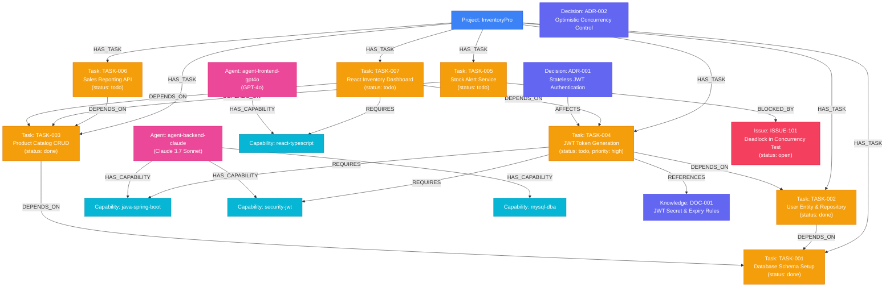

# BARSA Graph Data Model Specification

## Overview

The BARSA knowledge graph model captures the full semantic topology of a collaborative software engineering project. Rather than treating memory as disconnected text snippets, BARSA models projects as a **Labeled Property Graph (LPG)** inside FalkorDB.

---

## 1. Node Types (10 Entities)

| Node Label | Description | Key Properties |
| :--- | :--- | :--- |
| **`Project`** | Root node representing the workspace repository. | `id`, `name`, `description`, `created_at` |
| **`Task`** | An actionable unit of engineering work. | `id`, `title`, `status` (`todo`, `in_progress`, `done`), `priority` (`low`, `medium`, `high`, `critical`) |
| **`Requirement`**| Product or system specification. | `id`, `title`, `category`, `status` |
| **`Decision`** | Architectural Decision Record (ADR). | `id`, `title`, `rationale`, `status` (`accepted`, `deprecated`) |
| **`Knowledge`** | Contextual architectural and domain knowledge snippet. | `id`, `title`, `content_snippet`, `domain` |
| **`Artifact`** | Code file, schema, documentation, or binary asset. | `id`, `path`, `mime_type`, `version_hash` |
| **`Checkpoint`**| Execution state checkpoint or test snapshot. | `id`, `agent_id`, `state_hash`, `timestamp` |
| **`Agent`** | AI agent participating in project execution. | `id`, `display_name`, `provider` (`anthropic`, `openai`), `model` |
| **`Capability`**| Explicit technical competency or skill tag. | `id`, `name`, `category` (`backend`, `database`, `frontend`, `devops`) |
| **`Issue`** | Blocker, bug report, or environmental incident. | `id`, `title`, `status` (`open`, `resolved`), `severity` |

---

## 2. Relationship Types (11 Edges)

| Relationship Type | Source Node | Target Node | Semantics |
| :--- | :--- | :--- | :--- |
| **`HAS_TASK`** | `Project` | `Task` | Connects project to its backlog tasks. |
| **`DEPENDS_ON`** | `Task` | `Task` | Upstream technical dependency prerequisite. |
| **`BLOCKED_BY`** | `Task` | `Issue` / `Task` | Active impediment preventing work on target task. |
| **`REQUIRES`** | `Task` | `Capability` | Skills or competencies strictly required to execute the task. |
| **`HAS_CAPABILITY`**| `Agent` | `Capability` | Verified competencies possessed by the AI agent. |
| **`ASSIGNED_TO`** | `Task` | `Agent` | Active task assignment. |
| **`DECIDED_BY`** | `Decision` | `Agent` | Provenance of which agent or architect authored the decision. |
| **`REFERENCES`** | `Task` / `Decision` | `Knowledge` / `Requirement` | Explicit conceptual link to domain documentation. |
| **`AFFECTS`** | `Decision` | `Task` / `Artifact` | Architectural constraints imposed on future implementation. |
| **`RESOLVES`** | `Task` | `Issue` / `Requirement` | Fulfillment or fix of an issue or requirement. |
| **`CREATED_BY`** | `Artifact` / `Checkpoint` | `Agent` | Authorship attribution. |

---

## 3. InventoryPro Demonstration Graph Schema

The diagram below illustrates the actual graph structure instantiated in the **InventoryPro** enterprise scenario:

---

## 4. Reasoning Flow in `barsa_graph_resume`

When `barsa_graph_resume("proj-hackathon-1", "agent-backend-claude")` executes:

1. **Prerequisite Check**: `TASK-004` requires `TASK-002` (`DEPENDS_ON`). FalkorDB discovers that `TASK-002.status = 'done'`.
2. **Blocker Analysis**: `TASK-005` has all dependencies met, but is connected via `(TASK-005)-[:BLOCKED_BY]->(ISSUE-101)`. FalkorDB disqualifies `TASK-005`.
3. **Downstream Blocker Check**: `TASK-007` (React Dashboard) depends on `TASK-004` which is still `todo`. Thus `TASK-007` cannot be started.
4. **Agent Skill Alignment**: `TASK-004` requires `java-spring-boot` and `security-jwt`. `agent-backend-claude` has both capabilities (`MATCH (a:Agent)-[:HAS_CAPABILITY]->(c)`).
5. **Architectural Provenance**: `TASK-004` connects to `ADR-001` (Stateless JWT Authentication) and `DOC-001` (JWT Secret & Expiry Rules), ensuring the agent receives the exact architectural constraints in its continuation context.
6. **Result**: `TASK-004` is selected with the highest score (270.0) with verifiable Cypher graph paths.
