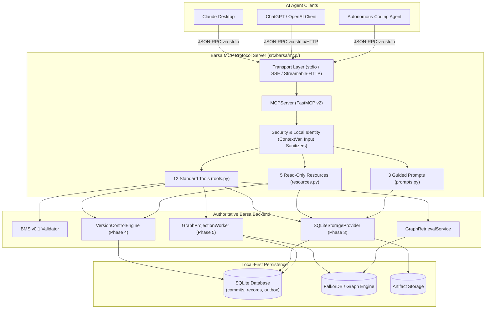
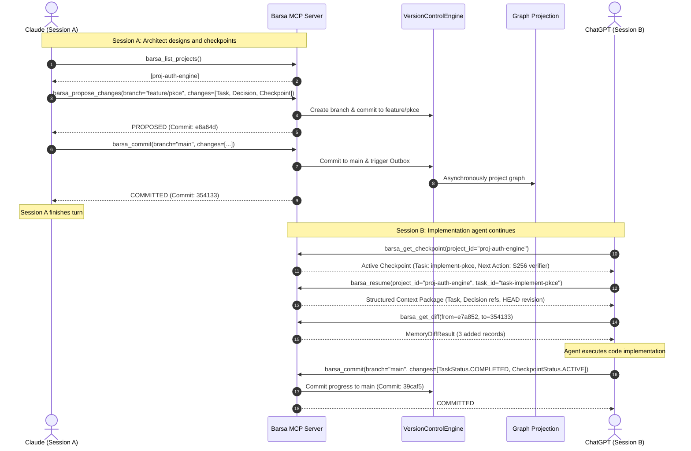

# Barsa MCP Server — Architecture & Design

BARSA exposes structured, provider-independent AI working memory to AI clients (Claude Desktop, ChatGPT, Cursor, Windsurf, coding agents) through the standard **Model Context Protocol (MCP)**.

---

## 1. Core Architecture Principles

1. **Adapter Pattern, Not Second Memory Engine:**
   The MCP server is strictly a stateless protocol adapter over existing, authoritative Barsa backend engines:
   - **StorageProvider (`SQLiteStorageProvider`)**: Local-first record and artifact persistence.
   - **VersionControlEngine**: DAG history, content hashes, branching, diffs, conflicts, and merge control.
   - **GraphProjectionWorker & GraphRetrievalService**: Contextual multi-hop retrieval over FalkorDB / In-Memory graph projections.
   - **BMS Serialization (`validate_record`)**: Strict schema enforcement on every record mutation.

2. **Single Source of Truth:**
   The MCP server never holds separate in-memory record stores or bypasses version control. Any mutation committed through MCP goes through the standard BMS validation and Git-style commit lifecycle.

3. **Protocol Isolation & Stdio Hygiene:**
   - In standard `stdio` transport mode, standard output (`stdout`) is strictly reserved for valid JSON-RPC 2.0 frames.
   - All diagnostic, error, and lifecycle logs are routed exclusively to `stderr` or rotating file handlers to prevent client stream corruption.

---

## 2. Component Diagram

---

## 3. Communication Sequence: Cross-Session Continuity

---

## 4. Key Architectural Decisions

1. **Idempotent Outbox Triggering:**
   When committing directly to `main` via `barsa_commit`, the tool calls `worker.process_pending_events(project_id)` to proactively update graph projections, guaranteeing retrieval freshness for subsequent queries.
2. **Rejection of Unvalidated State:**
   No record can be saved without passing `validate_record()`. Raw JSON blobs that violate BMS schemas are rejected with `INVALID_BMS_RECORD` error before touching disk.
3. **Protected Main Branch:**
   `barsa_propose_changes` strictly rejects targeting the `main` branch directly, requiring agents to specify a feature branch name. Direct mutations to `main` must use `barsa_commit` with explicit commit messages and expected HEAD verification.
