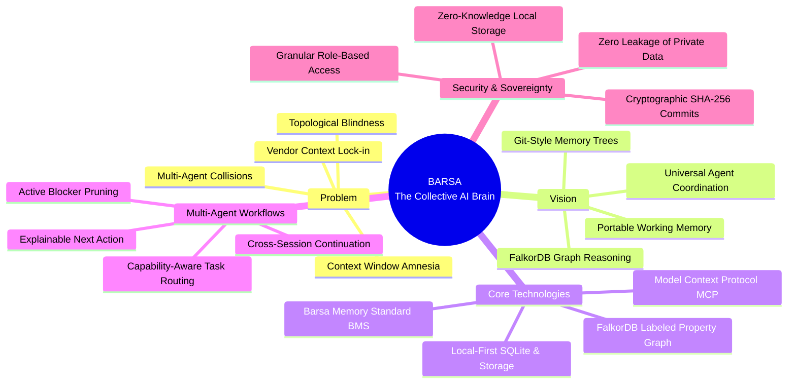

# BARSA — Product Vision & Architecture Manifesto
> **"Switch AI, Not Your Progress."**

---

## 1. Executive Product Narrative

### What is BARSA?
**BARSA** (Barsa Agent Relational State & Memory Architecture) is an open-standard, persistent, version-controlled memory and multi-agent coordination infrastructure. 

BARSA is **not** a chatbot, a prompt wrapper, or a proprietary IDE extension. It is a **foundational infrastructure layer** that sits underneath modern AI coding assistants (Claude Code, Cursor, Copilot, Antigravity, ChatGPT, and custom agents), enabling them to persist project intent, coordinate tasks, and navigate complex architectural dependencies across sessions and boundaries.

---

## 2. Why BARSA Was Created

Modern software engineering with AI faces three systemic roadblocks:

1. **Context Window Amnesia**: When an LLM context window reaches its limit, or when a developer closes an active terminal or IDE session, the entire accumulated understanding of the codebase, rejected architectural alternatives, and pending implementation steps evaporates.
2. **Topological Blindness**: Standard vector search and raw context summaries cannot understand prerequisite graph topology. An agent cannot determine whether Task `TASK-017` is ready to execute unless it traverses the dependency graph `(t)-[:DEPENDS_ON]->(dep)` to confirm that `TASK-005` and `TASK-016` are satisfied, and verifies that no active blocker `(t)-[:BLOCKED_BY]->(issue)` exists.
3. **Multi-Agent Disconnection**: Teams use specialized agents (Claude for deep backend logic, ChatGPT for frontend UI, Gemini for DevOps). Without a shared coordination graph, agents step on each other's work, violate architectural constraints, and duplicate implementation effort.

---

## 3. Who Benefits?

- **Software Engineering Teams**: Seamlessly hand off development from one engineer's AI session to another without 30 minutes of manual re-prompting.
- **AI Coding Agent Users**: Switch between Claude Code in the terminal and Cursor in the IDE while maintaining continuous project memory.
- **Autonomous Multi-Agent Systems**: Coordinate swarms of specialized agents with topological task routing and blocker-aware scheduling.
- **Open-Source Maintainers**: Preserve architecture decision records (ADRs) and onboarding context for incoming AI contributors.

---

## 4. Before & After BARSA

| Workflow Dimension | Traditional AI Agent Interaction | With BARSA Infrastructure |
| :--- | :--- | :--- |
| **Session End** | Context is completely lost when session terminates. | Context is committed to a versioned checkpoint with a cryptographic hash. |
| **Agent Switching** | User must manually copy-paste massive prompt summaries. | New agent calls `barsa_graph_resume` and receives instant, relevant context. |
| **Dependency Awareness** | Agent blindly picks tasks or asks developer what to do. | FalkorDB computes topological readiness via Cypher across all project tasks. |
| **Blocker Detection** | Agent hits broken build, gets stuck in error loops. | Active blockers prune affected task subtrees before execution begins. |
| **Historical Decisions** | Rationale for decisions is buried in lost chat logs. | Architectural decisions (ADRs) are linked directly to affected tasks in the graph. |
| **Data Ownership** | Trapped in proprietary SaaS cloud chat histories. | Local-first, user-owned storage (SQLite + FalkorDB) on developer's machine or cloud. |

---

## 5. Why Not Just a Chat Summary?

Developers often ask: *"Can't I just use a markdown summary or a vector database?"*

| Dimension | Flat Chat Summary | Vector Embedding DB | BARSA + FalkorDB |
| :--- | :---: | :---: | :---: |
| **Prerequisite Chains** | ❌ Cannot traverse multi-hop chains | ❌ Fails at topological order | ✅ Native Cypher \(O(1)\) graph traversal |
| **Blocker Exclusion** | ❌ Hallucinates unblocked status | ❌ Semantic similarity ignores state | ✅ Strict graph edge exclusion |
| **Capability Matching** | ❌ Manual prompt instructions | ❌ Approximate text matching | ✅ Deterministic set intersection |
| **Decision Provenance** | ❌ Buried in narrative text | ❌ Returns irrelevant chunks | ✅ Linked `[:AFFECTS]` edges to ADRs |
| **Version History** | ❌ Single mutable text snapshot | ❌ Unversioned vector space | ✅ Full Git-style DAG of memory commits |

---

## 6. Architectural Inspiration

BARSA synthesizes four proven architectural paradigms:
- **JVM-Inspired Portability**: "Write once, run anywhere." Standardized Barsa Memory Standard (BMS) records allow any AI model (Anthropic, OpenAI, Google, local open-source) to read and write uniform project context.
- **Git-Inspired Versioning**: Checkpoints are immutable commits forming a directed acyclic graph (DAG) with parent hashes, branches, and diffing.
- **Local-First Storage**: The developer owns all data locally in SQLite, syncing to remotes only when explicitly configured.
- **FalkorDB Labeled Property Graph**: Sub-millisecond graph reasoning powered by Redis wire protocol and Cypher, evaluating task readiness and agent alignment dynamically.
