# BARSA — Repository & Documentation Audit

**Audit Timestamp**: 2026-10-18T22:00:00+05:30  
**Repository Branch**: `master`  
**Commit Hash**: `16d0dc6722e54e3fa52eb16002be50802b49b491`  
**Target Event**: Graph Hacks 2026 Submission  
**Lead Auditor**: Senior Software Architect & Documentation Reviewer

---

## 1. Executive Audit Summary

BARSA has a rich, highly modular documentation library spanning technical specifications (BMS standard, storage, sync, coordination, dashboard, MCP, skills, graph projection). However, prior to this audit, documentation was distributed across multiple ad-hoc root markdown files, internal implementation notes, and fragmented test outputs.

This audit establishes:
1. **Definitive Inventory**: An index of all existing markdown documents with clear audience, purpose, and action classifications.
2. **Duplication Elimination**: Identification of overlapping reports (e.g., historical synthetic test claims vs. live FalkorDB Cloud verified results).
3. **Evidence Classification**: Strict categorization into **LIVE VERIFIED**, **AUTOMATED TEST VERIFIED**, **SOURCE-CODE SUPPORTED**, and **SIMULATED**.
4. **Information Architecture Plan**: A consolidated 7-domain hierarchy (`docs/product/`, `docs/architecture/`, `docs/graph/`, `docs/agents/`, `docs/case-studies/`, `docs/evidence/`, `docs/submission/`).

---

## 2. Complete Document Inventory & Assessment

| Document Path | Core Purpose | Primary Audience | Quality (1-5) | Evidence Status | Overlaps / Action |
| :--- | :--- | :--- | :---: | :--- | :--- |
| `README.md` | Primary GitHub landing page, quickstart & hero | Judges, Developers | 5/5 | LIVE VERIFIED | **KEEP & REFINE** (Maintain as authoritative summary) |
| `GRAPH_HACKS_SUBMISSION.md` | Official submission form text, tracks, problem/solution | Hackathon Judges | 5/5 | LIVE VERIFIED | **KEEP** (Authoritative submission package) |
| `GRAPH_HACKS_FINAL_PROOF.md` | Rule 2 & 3 empirical proofs (local + cloud) | Judges, Evaluators | 5/5 | LIVE VERIFIED | **KEEP & LINK** (Definitive FalkorDB proof) |
| `BARSA_FINAL_RELEASE_REPORT.md` | 13-stage release scorecard and verification log | Release Engineers | 5/5 | LIVE VERIFIED | **KEEP** (Authoritative engineering sign-off) |
| `demo/project-atlas/genuine_falkordb_cloud_evidence.json` | Raw telemetry & Cypher responses from FalkorDB Cloud | Evaluators | 5/5 | LIVE VERIFIED | **KEEP** (Direct empirical artifact) |
| `ATLAS_PROJECT_SPECIFICATION.md` | Domain specifications for Project ATLAS | Developers, Judges | 4/5 | SOURCE-CODE SUPPORTED | **MERGE** into `docs/case-studies/PROJECT_ATLAS.md` |
| `ATLAS_GRAPH_MODEL.md` | Entity and relationship mapping for ATLAS | Database Engineers | 4/5 | SOURCE-CODE SUPPORTED | **MERGE** into `docs/graph/GRAPH_MODEL.md` |
| `ATLAS_TEST_SCENARIOS.md` | Historical test cases (Flows A-H) | QA Engineers | 4/5 | AUTOMATED TEST VERIFIED | **MERGE** into `docs/case-studies/PROJECT_ATLAS.md` |
| `ATLAS_ACCEPTANCE_REPORT.md` | Early local test report | QA Engineers | 3/5 | SIMULATED (Local RESP) | **ARCHIVE** in favor of Cloud Evidence |
| `ATLAS_DEMO_SCRIPT.md` | Live demo walkthrough steps | Presenters, Users | 4/5 | LIVE VERIFIED | **MERGE** into `docs/submission/VIDEO_SCRIPT.md` |
| `docs/bms/overview.md` | Barsa Memory Standard data types | Agent Builders | 5/5 | SOURCE-CODE SUPPORTED | **KEEP** (Foundation of memory format) |
| `docs/graph/architecture.md` | FalkorDB graph projection architecture | Architects | 5/5 | LIVE VERIFIED | **KEEP & EXPAND** into `docs/graph/` suite |
| `docs/mcp/tools.md` | Model Context Protocol tool specifications | Tool Builders | 5/5 | AUTOMATED TEST VERIFIED | **KEEP** (Reference for MCP server) |
| `skills/barsa/SKILL.md` | Universal Agent Skill instruction set | AI Agents, Developers | 5/5 | SOURCE-CODE SUPPORTED | **KEEP** (Agent system prompt standard) |

---

## 3. Discrepancies & Gap Identification

1. **Emulator vs. Cloud Clarification**: Historical scripts referenced `scripts/falkordb_server.py` (a local lightweight RESP test harness). The documentation must explicitly differentiate that harness from genuine **FalkorDB Cloud on AWS Mumbai** (`Linux 6.12.88 aarch64`, Redis `8.10.2`, `['falkordbe', 'graph', 'vectorset']`), which was used for final verification.
2. **Token Savings Claim Calibration**: Historical claims of "99.5% token savings" represented selected payload comparisons (22,385 bytes down to 118 bytes of extracted task context). The documentation must honestly state that this measures raw payload compression, not guaranteed end-to-end model inference savings across arbitrary LLM prompts.
3. **Multi-Agent Simulation Clarification**: Differentiate test client sessions (driven by automated scripts with distinct agent capability personas) from commercial multi-tenant AI subscriptions.

---

## 4. Documentation Information Architecture Plan

```mermaid
graph TD
    classDef root fill:#2563eb,stroke:#1d4ed8,color:#fff;
    classDef domain fill:#0891b2,stroke:#0e7490,color:#fff;
    classDef doc fill:#10b981,stroke:#059669,color:#fff;

    R[README.md & Submission]:::root
    
    P[Product Domain]:::domain
    A[Architecture Domain]:::domain
    G[Graph & FalkorDB Domain]:::domain
    AG[Agents & MCP Domain]:::domain
    CS[Case Studies Domain]:::domain
    EV[Evidence & Benchmarks]:::domain
    SUB[Video & Submission Assets]:::domain

    R --> P & A & G & AG & CS & EV & SUB

    P --> P1[docs/product/PRODUCT_VISION.md]:::doc
    P --> P2[docs/product/PROBLEM_AND_SOLUTION.md]:::doc

    A --> A1[docs/architecture/SYSTEM_OVERVIEW.md]:::doc
    A --> A2[docs/architecture/MEMORY_LIFECYCLE.md]:::doc

    G --> G1[docs/graph/GRAPH_MODEL.md]:::doc
    G --> G2[docs/graph/CYPHER_QUERIES.md]:::doc
    G --> G3[docs/graph/RULE_3_PROOF.md]:::doc

    CS --> CS1[docs/case-studies/PROJECT_ATLAS.md]:::doc
    EV --> EV1[docs/evidence/RESULTS_AND_BENCHMARKS.md]:::doc
    SUB --> S1[docs/submission/VIDEO_SCRIPT.md]:::doc
    SUB --> S2[docs/submission/VIDEO_STORYBOARD.md]:::doc
    SUB --> S3[docs/submission/RECORDING_CHECKLIST.md]:::doc
```

---

## 5. Audit Verdict & Action Items

- **Documentation Cleanliness**: High quality, zero secrets detected, zero broken links in primary paths.
- **Action Items**:
  1. Author `docs/product/PRODUCT_VISION.md` to establish the complete narrative.
  2. Author `docs/case-studies/PROJECT_ATLAS.md` integrating the 124-node cloud verification.
  3. Author `docs/evidence/RESULTS_AND_BENCHMARKS.md` providing honest payload metrics.
  4. Author `docs/submission/VIDEO_SCRIPT.md` and `docs/submission/VIDEO_STORYBOARD.md` for flawless 4-minute demo recording.
