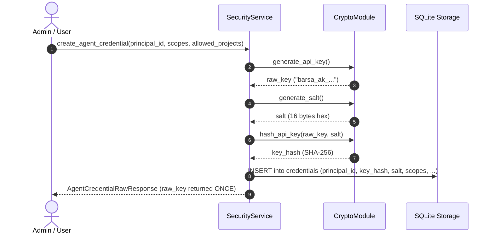
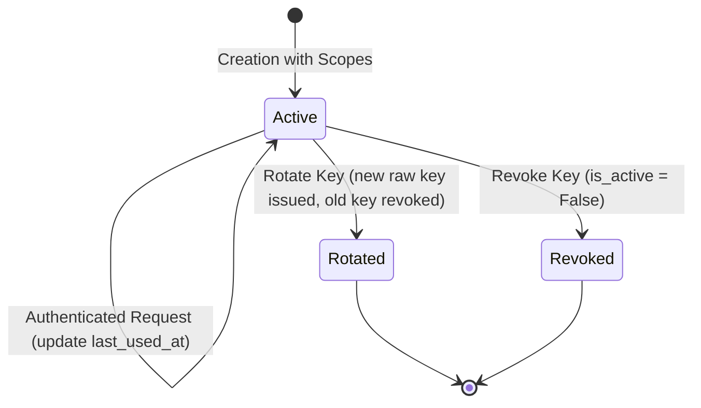

# Agent Credentials & API Key Lifecycle

This document specifies the creation, storage, rotation, and revocation of API credentials for autonomous AI agents and automated services in **BARSA**.

---

## 1. Key Format & Generation

Barsa API keys are generated using cryptographically secure random bytes (`secrets.token_hex(24)`):

```text
barsa_ak_a1b2c3d4e5f60718293a4b5c6d7e8f90123456789abcdef0
```

- **Prefix:** `barsa_ak_` (allows instant pattern recognition by secret scanners).
- **Entropy:** 192 bits (24 bytes hex-encoded, 48 hex characters).
- **Transmission:** Sent via HTTP header `X-API-Key: barsa_ak_...` or `Authorization: Bearer barsa_ak_...`.

---

## 2. Storage & Salted Hashing

To protect credentials against database compromise, **raw API keys are never stored on disk**:



- When verifying an incoming API key, Barsa calculates `hash = sha256(raw_key + salt)` and compares it against the stored hash using `hmac.compare_digest` to prevent timing attacks.
- Once created, the raw key is never visible again through any API or database query.

---

## 3. Key Lifecycle Management



### 3.1. Last-Used Timestamping
Every time an API key successfully authenticates a request, its `last_used_at` timestamp is updated in the database. Inactive or orphaned agent keys can thus be identified during security audits.

### 3.2. Seamless Rotation
The credential rotation endpoint (`POST /api/v1/security/credentials/{id}/rotate`):
1. Immediately marks the existing credential as revoked.
2. Generates a new raw key and fresh salt with identical scopes and project bindings.
3. Records an audit event linking the old and new credential IDs.
4. Returns the new raw key to the caller.

### 3.3. Immediate Revocation
Revocation takes effect immediately across all active connections. Any subsequent request with the revoked key fails with `401 Unauthorized` (`CREDENTIAL_REVOKED`).

---

## 4. Least-Privilege Scoping & Project Allowlisting

Agents should be configured with the minimum set of permissions necessary to execute their assigned role:

```json
{
  "principal_id": "agent_code_reviewer",
  "label": "Reviewer Bot Production",
  "scopes": [
    "memory:read",
    "artifact:read",
    "review:create",
    "review:comment"
  ],
  "allowed_projects": [
    "proj_core_api"
  ]
}
```

- **Scope Enforcement:** If an agent attempts an action outside its scopes (e.g. `memory:commit`), the central authorizer rejects the request before business logic executes.
- **Project Isolation:** If `allowed_projects` is specified, the agent cannot access or view memories in any project not explicitly listed, even if granted membership in the workspace.
