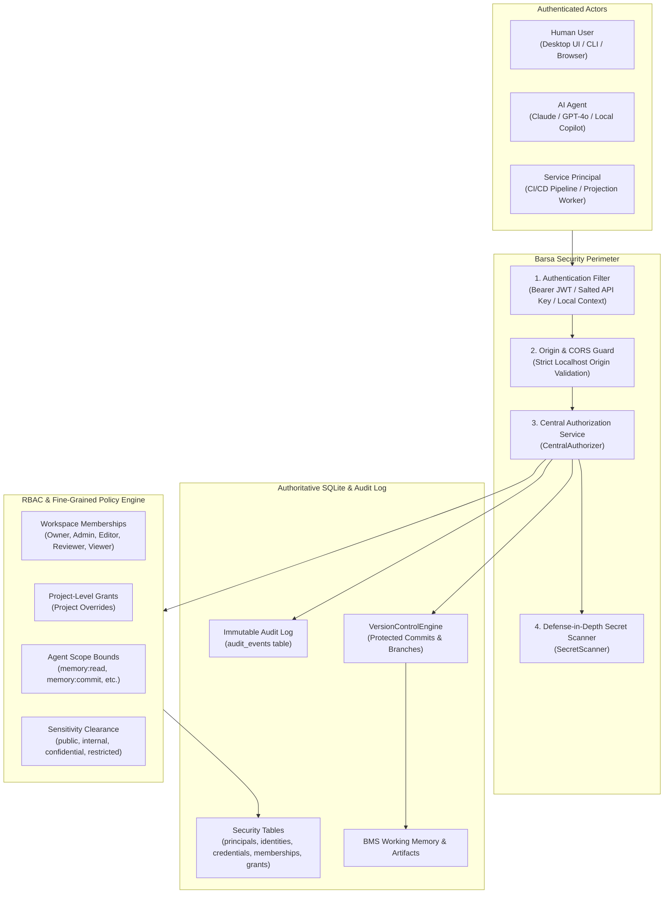

# Barsa Security, Authentication & Authorization Architecture

The **Barsa Security Subsystem** provides a zero-cloud-dependency, local-first identity, authentication, and authorization architecture protecting multi-tenant AI working memory, artifacts, knowledge graphs, and agent tasks.

---

## 1. Security Architecture Topology

---

## 2. Core Security Invariants

1. **Model-Generated Agent IDs are Untrusted:** An agent claiming to be `admin-bot` or `alice` in request arguments is never trusted. Identity is derived strictly from validated cryptographic API keys, signed JWT bearer tokens, or trusted local OS process context.
2. **Local-First Threat Model Protection:** Network APIs bind to `127.0.0.1` by default. Cross-origin requests from external web pages are blocked at the HTTP middleware layer.
3. **No Unencrypted Stored Passwords:** Human user passwords are hashed using Argon2id with unique per-user salts following OWASP guidelines.
4. **Hashed Agent Credentials:** Raw API keys are shown exactly once at generation time. Only salted SHA-256 hashes are stored in SQLite.
5. **No Blind Privilege Escalation:** An agent cannot escalate its permissions simply by declaring high capabilities in coordination tasks. All actions require explicit workspace membership or credential-scoped project grants.
6. **Defense-in-Depth Secret Prevention:** All memory updates undergo regex-based scanning to prevent accidental committing of AWS keys, private keys, OpenAI keys, or JWT tokens.
