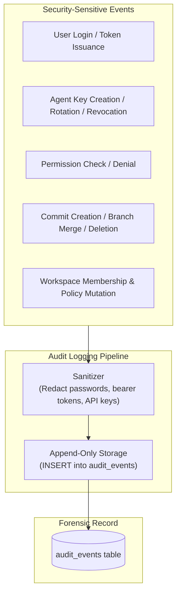

# Security Audit Logging & Forensic Trail

This document describes the design, schema, and operational practices of the immutable audit logging subsystem in **BARSA**.

---

## 1. Audit Logging Architecture

Barsa records every security-sensitive action in an append-only audit log stored in the SQLite `audit_events` table.



---

## 2. Audit Record Schema

Each entry in `audit_events` contains the following structured attributes:

| Field Name | Type | Description |
| :--- | :--- | :--- |
| `event_id` | String (UUID) | Unique identifier for the audit record |
| `timestamp` | String (ISO-8601) | Exact UTC timestamp of the event |
| `actor_id` | String | ID of the principal executing the action (`usr_...`, `agt_...`, `local_user`) |
| `actor_type` | String | Principal type (`user`, `agent`, `service`) |
| `event_type` | String | Categorical event type (`auth.login`, `auth.failed`, `credential.created`, `access.denied`, etc.) |
| `resource_type`| String | Target resource category (`workspace`, `project`, `credential`, `commit`) |
| `resource_id` | String (Optional) | Specific ID of the resource affected |
| `workspace_id`| String (Optional) | Associated workspace ID |
| `action` | String | Attempted action (`read`, `write`, `commit`, `revoke`, `login`) |
| `status` | String | Outcome status: `success` or `failure` |
| `details` | JSON Object | Structured context (sanitized; excludes sensitive credentials) |
| `ip_address` | String (Optional) | Client network IP address if available |

---

## 3. Automated Sanitization & Sensitive Field Redaction

Before any audit payload is persisted:
- **Passwords:** Any dictionary key containing `password`, `pwd`, or `secret` is replaced with `"[REDACTED]"`.
- **API Keys & Tokens:** Keys containing `token`, `key`, `authorization`, or `credential` are masked or removed.
- **Payload Truncation:** Overly large payloads are truncated to prevent log injection and denial of service via oversized logs.

---

## 4. Querying the Audit Log

Authorized administrators and security auditors can inspect audit trails via the REST API:

```http
GET /api/v1/security/audit?workspace_id=ws_engineering&event_type=access.denied&status=failure&limit=50
Authorization: Bearer <admin_token>
```

### Forensic Capabilities:
- **Detecting Brute Force:** Filter for `event_type=auth.failed` grouped by IP address or username.
- **Auditing Agent Activity:** Filter by `actor_id=agt_qa_bot` to trace all memory writes and task claims across branches.
- **Investigating Permission Denials:** Filter for `status=failure` to pinpoint unauthorized attempts to access confidential or restricted project data.
