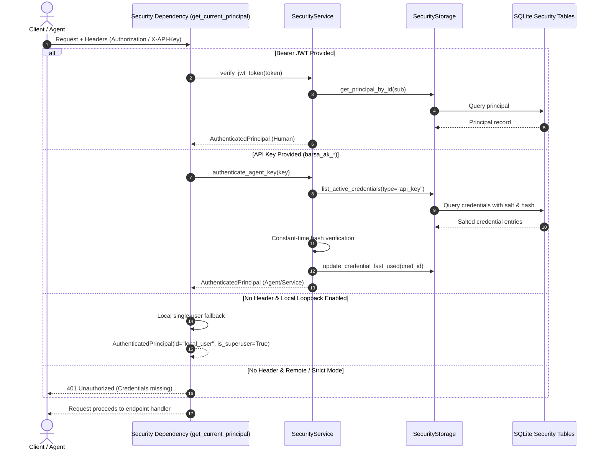

# Barsa Authentication Architecture & Flow

This document details the authentication subsystem in **BARSA**, covering human user authentication, agent identification, session tokens, and the local desktop context fallback.

---

## 1. Authentication Overview

Barsa supports three primary authentication modalities:

1. **Human Users (JWT Bearer Token):**
   - Registered with a unique username and password.
   - Passwords are verified against stored hashes using **Argon2id**.
   - Upon successful login, an access token (JWT) is issued with an expiration window and signed with HMAC-SHA256.
2. **AI Agents & Service Principals (Salted API Keys):**
   - Created with high-entropy cryptographic keys formatted as `barsa_ak_<random_hex>`.
   - Incoming keys via `X-API-Key` or `Authorization: Bearer barsa_ak_...` are verified against salted SHA-256 hashes using constant-time comparison (`hmac.compare_digest`).
3. **Local Desktop Single-User Mode (Implicit Fallback):**
   - Designed for local-first desktop workflows where no credentials are provided on loopback requests.
   - Resolves to a default trusted `AuthenticatedPrincipal` (`id="local_user"`, `is_superuser=True`).

---

## 2. Authentication Flow Diagram

---

## 3. Cryptographic Implementation Details

### 3.1. Argon2id Password Hashing
Password hashing is implemented with `argon2_cffi` using OWASP-compliant parameters:
- **Algorithm:** Argon2id (resistant to GPU and side-channel attacks)
- **Time cost:** 2 iterations
- **Memory cost:** 64 MB (65,536 KiB)
- **Parallelism:** 1 thread
- **Salt length:** 16 bytes (automatically managed per hash)

### 3.2. JWT Bearer Tokens
JWT tokens are signed with HMAC-SHA256 (`HS256`):
- **Claims:** `sub` (principal ID), `exp` (expiration), `iat` (issued at), `role`, `type` (principal type).
- **Validation:** Signature verification, expiration check, and principal active status verification.

### 3.3. Rate Limiting on Login Attempts
To mitigate brute-force password guessing, the `SecurityService` maintains an in-memory tracking bucket per username:
- Maximum 5 failed attempts within 60 seconds.
- Additional attempts trigger a `429 Too Many Requests` error before cryptographic hash verification.
