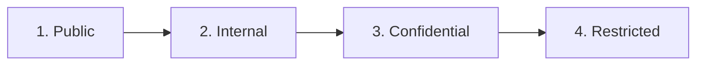
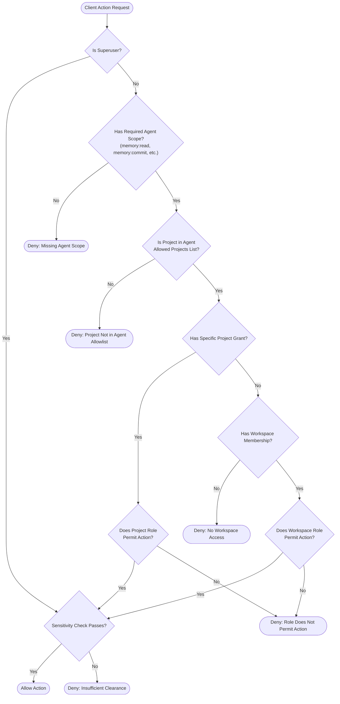

# Barsa Authorization & RBAC Architecture

This document describes the role-based and attribute-based access control engine implemented in **BARSA**, governed by the `CentralAuthorizer`.

---

## 1. Role-Based Access Control (RBAC) Matrix

Barsa provides five hierarchical workspace roles:

| Action / Permission | Viewer | Reviewer | Editor | Admin | Owner |
| :--- | :---: | :---: | :---: | :---: | :---: |
| `memory:read` / `project:read` | ✅ | ✅ | ✅ | ✅ | ✅ |
| `artifact:read` / `graph:read` | ✅ | ✅ | ✅ | ✅ | ✅ |
| `review:read` | ✅ | ✅ | ✅ | ✅ | ✅ |
| `review:create` / `review:comment` | ❌ | ✅ | ✅ | ✅ | ✅ |
| `memory:write` / `memory:commit` | ❌ | ❌ | ✅ | ✅ | ✅ |
| `artifact:write` / `coordination:claim` | ❌ | ❌ | ✅ | ✅ | ✅ |
| `branch:create` / `branch:merge` | ❌ | ❌ | ✅ | ✅ | ✅ |
| `project:create` / `project:delete` | ❌ | ❌ | ❌ | ✅ | ✅ |
| `member:manage` / `agent:create` | ❌ | ❌ | ❌ | ✅ | ✅ |
| `policy:manage` | ❌ | ❌ | ❌ | ✅ | ✅ |
| `workspace:*` (Ownership Transfer / Delete) | ❌ | ❌ | ❌ | ❌ | ✅ |

---

## 2. Sensitivity Classification & Clearance Levels

All project memories, commits, and artifacts can be tagged with an optional `sensitivity` classification level:

### Clearance Rules:
- An authenticated principal has a maximum sensitivity clearance (e.g., `internal`, `confidential`, `restricted`).
- Superusers default to `restricted` clearance.
- Regular principals with clearance `X` may only read or write records with sensitivity level `Y <= X`.
- Access to records with sensitivity `Y > X` is rejected with `403 Forbidden` (`INSUFFICIENT_CLEARANCE`).

---

## 3. Central Authorization Decision Flow

---

## 4. Project-Level Grants

While a workspace provides default role memberships across all contained projects, specific projects can have explicit overrides via `project_grants`:
- **Read-Only Narrowing:** A workspace `editor` can be restricted to `viewer` on a critical audit project.
- **Selective Escalation:** A workspace `reviewer` can be granted `editor` privileges on a designated sandbox project without granting broader workspace edit permissions.

---

## 5. Scope Bounds for AI Agents

For AI agents, authorization enforces a strict **two-key validation**:
1. The agent must possess a workspace role (or project grant) permitting the action.
2. The agent's issued credential must explicitly include the capability scope (e.g., `Scope.MEMORY_COMMIT`).

Even if an agent is granted `editor` in a workspace, if its issued API key only holds `Scope.MEMORY_READ`, any attempt to commit memory is denied.
