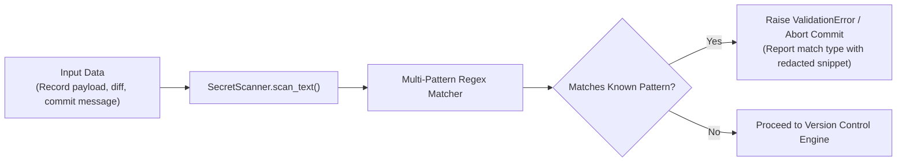

# Data Protection & Secret Scanning

This document outlines the defense-in-depth data protection mechanisms in **BARSA**, including pre-commit secret scanning, secure local storage, and transport security.

---

## 1. Secret Scanning Engine (`SecretScanner`)

Barsa includes an automated, pre-commit secret scanner designed to prevent developers and autonomous AI agents from inadvertently committing sensitive credentials into version-controlled memory.

### 1.1. Monitored Credential Patterns

| Secret Type | Regex Pattern Specification | Risk Mitigation |
| :--- | :--- | :--- |
| **AWS Access Key** | `(?:A3T[A-Z0-9]|AKIA|AGPA|AIDA|AROA|AIPA|ANPA|ANVA|ASIA)[A-Z0-9]{16}` | Prevents AWS cloud resource compromise |
| **Private Keys** | `-----BEGIN (?:RSA|OPENSSH|DSA|EC|PGP)?\s?PRIVATE KEY-----` | Prevents SSH/TLS private key leaks |
| **GitHub Tokens** | `gh[pousr]_[A-Za-z0-9_]{36,}` or `github_pat_[A-Za-z0-9_]{22,}` | Prevents repository hijacking |
| **OpenAI API Keys** | `sk-[a-zA-Z0-9_\-]{32,}` | Prevents unauthorized LLM billing/usage |
| **Slack Tokens** | `xox[baprs]-[0-9a-zA-Z]{10,48}` | Prevents workspace communication leaks |
| **Barsa API Keys** | `barsa_ak_[0-9a-fA-F]{32,}` | Prevents internal agent impersonation |
| **JSON Web Tokens** | `ey[A-Za-z0-9_-]{10,}\.ey[A-Za-z0-9_-]{10,}\.[A-Za-z0-9_-]{10,}` | Prevents leaked bearer tokens |

### 1.2. Multi-Layer Interception Points
Secret scanning is enforced across three distinct layers:
1. **API Endpoints:** Request payloads to `/api/v1/projects/{id}/commits` and `/api/v1/memory/*` are scanned upon arrival.
2. **MCP Tools:** `save_memory_tool` and `propose_changes_tool` scan inputs before executing any storage logic.
3. **Core Version Control Engine:** `VersionControlEngine.create_commit()` executes a final pre-commit check on all serialized memory records. If any secret is detected, the transaction rolls back immediately with a `ValidationError`.

---

## 2. Local-First Storage Protection

Barsa stores memory and configuration locally in an embedded SQLite database (`barsa.db`):
- **User Passwords:** Stored exclusively as Argon2id hashes with unique salts.
- **Agent API Keys:** Stored as salted SHA-256 hashes.
- **Audit Logs:** Sanitized to ensure that bearer tokens and passwords are redacted prior to insertion.
- **Local Filesystem Permissions:** The SQLite database file should be placed in a directory with restricted user-only permissions (`chmod 600` on Unix-like systems, or standard Windows user directory ACLs).

---

## 3. Data in Transit Protection

1. **Local Loopback Boundary:** By default, Barsa binds strictly to `127.0.0.1` and `[::1]`.
2. **Local Origin Validation:** Requests carrying cross-origin headers from untrusted origins are blocked by `validate_local_origin` middleware.
3. **Production Remote Deployments:** When deployed in a team or distributed environment, Barsa should always be placed behind a reverse proxy (e.g. Nginx, Caddy, or Envoy) terminating TLS 1.3.
