# Local-First vs. Remote Deployment Security Architecture

This document describes how **BARSA** bridges local-first single-user desktop environments with multi-tenant remote deployments while preserving robust security guarantees.

---

## 1. Deployment Topology Comparison

```mermaid
flowchart TD
    subgraph LocalDeployment ["Mode A: Local-First Desktop Mode"]
        LocalClient["Local Agent / IDE / CLI"]
        Loopback["Loopback Interface (127.0.0.1)"]
        LocalEngine["Barsa Engine (Single-User Context)"]
        LocalDB[(Local SQLite)]

        LocalClient --> Loopback --> LocalEngine --> LocalDB
    end

    subgraph RemoteDeployment ["Mode B: Shared Remote / Team Mode"]
        RemoteClients["Remote AI Agents / Browser Dashboard"]
        TLS["Reverse Proxy & TLS Termination\n(Nginx / Caddy / Cloudflare)"]
        RemoteEngine["Barsa Engine (Multi-Tenant RBAC)"]
        RemoteDB[(Shared SQLite / Volume)]

        RemoteClients -->|HTTPS + JWT / API Key| TLS --> RemoteEngine --> RemoteDB
    end
```

---

## 2. Local-First Desktop Mode

In standard local development, Barsa is designed for zero friction:
- **No Mandatory Login Prompt:** Desktop tools and CLI processes connecting over the loopback interface (`127.0.0.1`) without an `Authorization` header resolve to an implicit trusted local principal (`id="local_user"`, `is_superuser=True`).
- **Web Drive-By Protection:** Because local servers are susceptible to DNS rebinding or CSRF-like requests from browser tabs, Barsa's `validate_local_origin` middleware validates the `Origin` and `Host` headers. Any mutating request initiated by an external website is dropped with `403 Forbidden`.
- **Process Isolation:** The MCP server running over `stdio` inherits the local developer's OS credentials and file access boundaries.

---

## 3. Remote & Team Deployment Mode

When hosting Barsa for distributed teams or shared agent fleets:

### 3.1. Disabling Local Fallback
Set configuration flag `BARSA_SECURITY_STRICT_AUTH=true`:
- Every incoming request to both REST APIs and SSE endpoints must present a valid Bearer JWT or `barsa_ak_...` API key.
- Requests without credentials receive an immediate `401 Unauthorized`.

### 3.2. Mandatory TLS Termination
Barsa should never be exposed directly to the public Internet without TLS:
- Deploy behind an edge proxy (such as Caddy, Nginx, Traefik, or AWS ALB) enforcing **TLS 1.3**.
- Configure HSTS (`Strict-Transport-Security`) headers to prevent protocol downgrade attacks.

### 3.3. OpenID Connect (OIDC) Readiness
Barsa's identity architecture cleanly decouples the `principals` table from `identities`:
- Human principals can link multiple identity providers (`AuthMethod.OIDC`, `AuthMethod.OAUTH`, `AuthMethod.LOCAL_PASSWORD`).
- When federated login is configured, an upstream identity token (e.g. from Okta, GitHub, or Google Workspace) resolves to an existing internal `principal_id`, retaining all assigned workspace roles and project grants.
