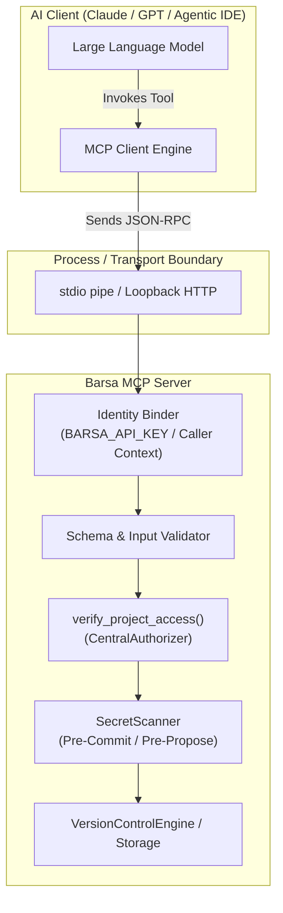

# Model Context Protocol (MCP) Security Architecture

This document describes the security boundaries, authorization integration, and defense-in-depth protections implemented in the **Barsa MCP Server**.

---

## 1. The MCP Security Boundary

AI agents interact with Barsa via the Model Context Protocol (MCP) using either:
1. **Local Standard I/O Transport (`stdio`):** The agent framework spawns Barsa as a child process. Security is rooted in local OS process permissions and configured environment variables.
2. **Server-Sent Events / HTTP Transport (`sse`):** The agent connects to a Barsa daemon listening on localhost. Security is governed by HTTP authentication headers and strict loopback bindings.



---

## 2. Invariant: Caller Identity is External, Not Prompt-Driven

> [!CAUTION]
> Never trust an LLM prompt or tool parameter to declare its own security identity.

In naive MCP integrations, an LLM might pass `{"agent_id": "root"}` or `{"user": "admin"}` in the tool arguments. In Barsa:
- The agent's identity is **strictly derived from the transport environment** (e.g., `BARSA_API_KEY` in environment variables or HTTP `X-API-Key` / Bearer token).
- Tool arguments declaring an `agent_id` or `author` are treated as informational metadata only and verified against the authenticated principal.
- An agent cannot impersonate another agent or escalate permissions across projects.

---

## 3. Tool Authorization Check (`verify_project_access`)

Every MCP tool that accesses project data calls `verify_project_access(project_id, action, current_user)`:

```python
# Verification flow inside MCP tool
is_allowed = authorizer.is_authorized(
    principal=current_principal,
    action=action,
    project_id=project_id,
    workspace_id=workspace_id,
    sensitivity=sensitivity,
)
if not is_allowed:
    return ToolResult(
        is_error=True,
        content=f"Access denied: Principal '{current_principal.id}' lacks permission for '{action}' on project '{project_id}'.",
    )
```

If the agent lacks the required workspace role, project grant, or API key scope, the tool execution is halted before reading from or writing to storage.

---

## 4. Defense-in-Depth Secret Scanning

When agents execute memory mutation tools (such as `propose_changes_tool` or `save_memory_tool`):
1. The tool payload (content, diffs, parameters, metadata) is fed to `SecretScanner.scan_text()`.
2. If any matching credential pattern is detected (e.g. OpenAI key, AWS access key, private key, or Barsa API key):
   - The tool execution aborts immediately.
   - An informative error message indicating the detected secret type is returned to the agent.
   - The memory mutation is not written to SQLite or the knowledge graph.
