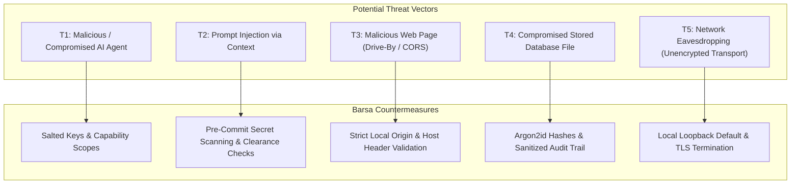

# Threat Model & STRIDE Analysis

This document details the threat modeling exercise conducted for **BARSA**, assessing attack surfaces, threat vectors, and corresponding mitigations using the **STRIDE** methodology.

---

## 1. System Attack Surfaces

---

## 2. STRIDE Assessment Matrix

### 2.1. Spoofing Identity
* **Threat:** An AI model generates an arbitrary `agent_id` or `author` in an MCP tool invocation to impersonate an administrator.
* **Mitigation:**
  - Invariant: Caller identity is derived exclusively from cryptographic bearer tokens or API key headers, never from model parameters.
  - Model parameters asserting author identity are cross-checked against the authenticated principal.

### 2.2. Tampering with Data
* **Threat:** An agent or user attempts to alter historical commits or inject secrets into shared memory.
* **Mitigation:**
  - Commit history is linked in an immutable directed acyclic graph (DAG) where parents cannot be retroactively modified without invalidating child commit hashes.
  - `SecretScanner` validates every commit payload before persistence, rejecting any payload containing API keys, private keys, or tokens.

### 2.3. Repudiation
* **Threat:** A user or agent performs destructive actions (e.g. branch deletion, unauthorized memory rollback) and denies doing so.
* **Mitigation:**
  - All mutating operations generate an append-only record in `audit_events` with an exact UTC timestamp, actor ID, IP address, and sanitized operation details.

### 2.4. Information Disclosure
* **Threat:** An agent in Workspace A retrieves confidential memory records belonging to Workspace B, or a low-clearance agent reads `restricted` project data.
* **Mitigation:**
  - Multi-tenant isolation: `CentralAuthorizer` enforces strict workspace boundaries.
  - Attribute-based sensitivity clearance (`public` < `internal` < `confidential` < `restricted`) blocks reads when principal clearance is insufficient.

### 2.5. Denial of Service (DoS)
* **Threat:** Brute-force guessing of user passwords, or rapid agent memory commits exhausting disk space.
* **Mitigation:**
  - In-memory rate limiting blocks repeated failed login attempts (max 5 per 60 seconds).
  - Schema validation bounds maximum artifact size, payload size, and commit limits.

### 2.6. Elevation of Privilege
* **Threat:** A malicious web page open in the user's browser makes cross-origin requests (`fetch('http://127.0.0.1:8000/api/v1/...')`) to steal project data or execute commands.
* **Mitigation:**
  - `validate_local_origin` middleware intercepts state-changing HTTP requests and rejects requests bearing an untrusted `Origin` header.
  - Loopback binding defaults to `127.0.0.1` rather than `0.0.0.0`.
