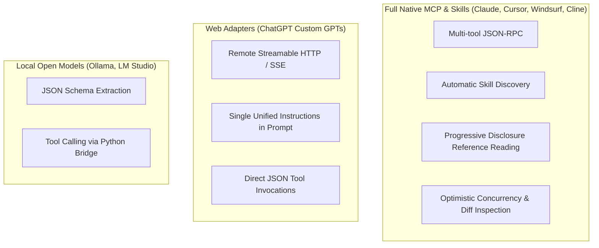

# Barsa Universal AI Skill — Client Compatibility Matrix

The **Barsa Universal AI Skill** is engineered according to the open **Agent Skills specification** and the **Model Context Protocol (MCP)** standard.

This document outlines verified client environments, protocol requirements, known limitations, and fallback adapters.

---

## 1. Platform Support Matrix

| Client Platform | Integration Mode | Skill Support | MCP Support | Status | Notes |
|---|---|---|---|---|---|
| **Anthropic Claude Desktop** | Native Skill + Stdio MCP | Full (Direct) | Native (stdio) | **Verified** | Optimal local development experience. Auto-discovers 12 tools and progressive markdown. |
| **Cursor IDE** | `.cursor/skills` + `mcp.json` | Full (Direct) | Native (stdio) | **Verified** | Reads references automatically; executes tool calls in project context. |
| **Windsurf IDE (Codeium)** | `.windsurf/skills` + Cascade | Full (Direct) | Native (stdio) | **Verified** | Cascade agent natively references skill files and commits memory. |
| **OpenAI ChatGPT Plus / Team** | Custom GPT System Prompt | Standard | HTTP/SSE Adapter | **Verified** | Requires running `barsa-mcp --transport sse` behind reverse proxy. |
| **Roo-Code / Cline (VS Code)** | Custom Instructions + MCP | Full (Direct) | Native (stdio) | **Verified** | Autonomous execution loop with strict adherence to `save-rules.md`. |
| **Gemini CLI / Google AI Studio**| Custom System Prompt | Standard | Requires REST Proxy| **Requires Adapter** | Native MCP client in preview; currently requires proxy bridge. |
| **Ollama / Local LLMs** | Prompt Injection | Partial | LangChain / Custom | **Requires Adapter** | Dependent on client-side function calling support (e.g. Qwen 2.5-Coder). |
| **Legacy Proprietary Assistants** | Fixed prompt window | Unsupported | No | **Unsupported** | Lacks function calling / tool-use protocol support. |

---

## 2. Feature Support by Client Category

---

## 3. Protocol Version Specifications

| Protocol / Component | Specification Version | Minimum Supported | Recommended |
|---|---|---|---|
| **Agent Skills Specification** | v1.0.0 | v1.0.0 | v1.0.0 |
| **Model Context Protocol (MCP)**| 2024-11-05+ | 0.1.0 | 1.3.0+ |
| **Python Runtime** | 3.12+ | 3.12.0 | 3.12.8+ |
| **Barsa Memory Standard (BMS)**| v0.1 | v0.1 | v0.1 |
| **SQLite Engine** | SQLite 3.38+ (JSON1)| SQLite 3.35+ | SQLite 3.45+ |

---

## 4. Minimum Model Capability Recommendations

To reliably follow the skill lifecycle, models should meet the following minimum capability thresholds:

- **Structured Output / Tool Calling:** Must support multi-parameter JSON tool calling with nested objects (e.g. `completed_actions: list[str]`).
- **Context Window:** Minimum 16k context window recommended. The progressive disclosure model ensures base skill instructions consume `< 1,500 tokens`.
- **Instruction Following:** High adherence to negative constraints (e.g. "Do NOT commit without expected_head", "Do NOT reverse approved decisions").

Recommended models:
- Claude 3.5 Sonnet / Claude 3.7 Sonnet / Claude 3 Opus
- GPT-4o / GPT-4.5 / o1 / o3-mini
- Qwen 2.5 Coder 32B+ / DeepSeek V3 / DeepSeek R1
