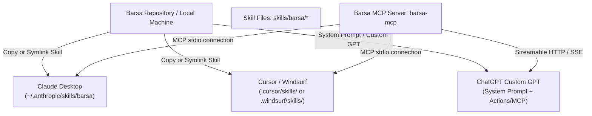

# Barsa Universal AI Skill — Client Installation & Setup

This guide details how to install and activate the **Barsa Universal AI Skill** across popular AI platforms and coding environments.

---

## 1. Prerequisites

Before installing the skill, ensure the **Barsa MCP Server** is running or available as an executable command:

- Python 3.12+ installed.
- Active virtual environment with Barsa dependencies installed:
  ```bash
  pip install -e .
  ```
- Fast verification command:
  ```bash
  barsa-mcp --help
  ```

---

## 2. Platform Installation Matrix



---

## 3. Anthropic Claude Desktop Setup

### Step A: Configure MCP Server
Edit your `claude_desktop_config.json`:
- **macOS:** `~/Library/Application Support/Claude/claude_desktop_config.json`
- **Windows:** `%APPDATA%\Claude\claude_desktop_config.json`
- **Linux:** `~/.config/Claude/claude_desktop_config.json`

Add the `barsa` entry:

```json
{
  "mcpServers": {
    "barsa": {
      "command": "python",
      "args": ["-m", "barsa.mcp.server"],
      "env": {
        "BARSA_DB_PATH": "C:/Users/username/.barsa/barsa.db",
        "BARSA_ARTIFACTS_DIR": "C:/Users/username/.barsa/artifacts"
      }
    }
  }
}
```

### Step B: Install Skill Instructions
Copy the skill folder into Claude's skill directory:
```bash
# Windows PowerShell
New-Item -ItemType Directory -Force "$env:APPDATA\Claude\skills\barsa"
Copy-Item -Recurse -Force skills/barsa/* "$env:APPDATA\Claude\skills\barsa"

# Linux / macOS
mkdir -p ~/.anthropic/skills/barsa
cp -r skills/barsa/* ~/.anthropic/skills/barsa/
```

Restart Claude Desktop. Verify that the hammer/tool icon shows 12 `barsa_*` tools available.

---

## 4. Cursor / Windsurf IDE Setup

### Cursor Agent Skills
Cursor supports agent rules and skills via `.cursor/skills` or `.cursorrules`:

1. Symlink or copy the `skills/barsa` directory into your project root:
   ```bash
   mkdir -p .cursor/skills/
   cp -r skills/barsa .cursor/skills/
   ```
2. In `.cursor/mcp.json`, configure the MCP server:
   ```json
   {
     "mcpServers": {
       "barsa": {
         "command": "python",
         "args": ["-m", "barsa.mcp.server"]
       }
     }
   }
   ```

### Windsurf Cascade Setup
In `.windsurfrules` or Cascade global memory:
1. Add reference:
   ```markdown
   Always consult `skills/barsa/SKILL.md` when starting, resuming, or completing user project tasks.
   ```
2. Configure MCP server in `~/.codeium/windsurf/mcp_config.json`.

---

## 5. ChatGPT / OpenAI Clients Setup

For ChatGPT Plus or Team custom GPTs:

1. **System Prompt / Instructions:**
   Copy the contents of [`skills/barsa/SKILL.md`](file:///d:/projects/BARSA/skills/barsa/SKILL.md) into the GPT's **Instructions** field.
2. **MCP / Action Integration:**
   Run the Barsa MCP server in Streamable HTTP/SSE mode:
   ```bash
   barsa-mcp --transport sse --port 8000
   ```
3. Expose the MCP endpoint via reverse proxy (e.g., ngrok, Cloudflare Tunnel) and import into the Custom GPT Actions manifest.

---

## 6. Verifying Installation

To verify that the skill is recognized by your AI client:

1. Start a fresh chat session.
2. Enter the prompt:
   ```text
   What memory management tools and skills do you have available?
   ```
3. The model should identify the **Barsa Memory Standard (BMS v0.1)** and the `barsa_*` MCP tool suite.
4. Issue a test discovery prompt:
   ```text
   Please discover my existing Barsa workspaces and projects.
   ```
5. The agent should invoke `barsa_discover_projects` and report active projects without error.
