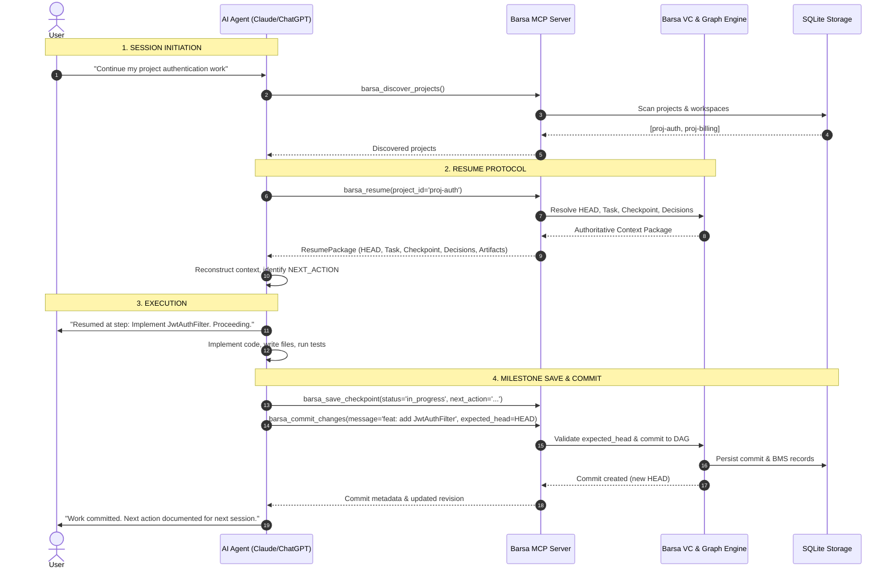
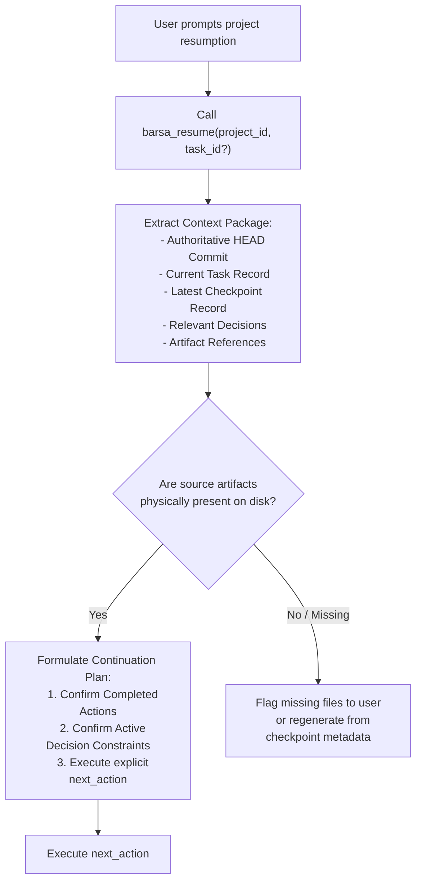
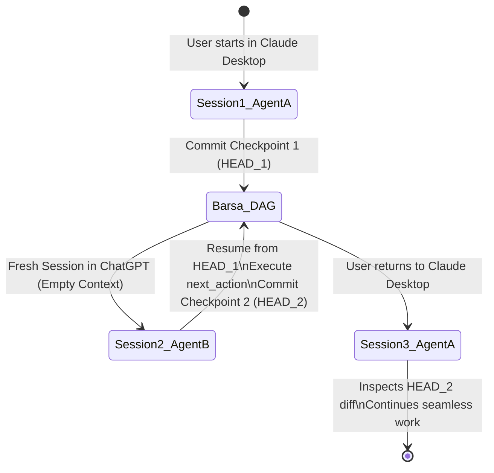

# Barsa Universal AI Skill — Session Lifecycle & Protocols

This document details the complete operational lifecycle of an AI agent operating under the **Barsa Universal AI Skill**, covering initial discovery, resume execution, milestone saves, concurrency management, and multi-agent handoffs.

---

## 1. End-to-End Session Lifecycle



---

## 2. Phase 1: Session Initiation & Discovery

When a user mentions a project or asks to continue previous work, the agent must not rely on stale chat history or guess project identifiers.

### Step 1.1: Project Discovery
Call [`barsa_discover_projects`](file:///d:/projects/BARSA/skills/barsa/references/tool-reference.md):
```json
{}
```
If multiple projects exist and the user was ambiguous, list the matching projects concisely and ask the user to clarify.

---

## 3. Phase 2: Resume Protocol

When a project is targeted, execute the **authoritative resume protocol**:



### Resume Verification Checklist
1. **Authoritative Revision:** Cache `authoritative_revision` as `expected_head` for concurrency safety.
2. **Task Validation:** Check `current_task.status`. If `completed`, inspect pending tasks or ask user.
3. **Decision Constraints:** Review all `relevant_decisions` marked `approved`. Do NOT reverse approved architectural decisions without explicit user instruction.
4. **Completed Actions:** Do NOT repeat actions already listed in `latest_checkpoint.completed_actions`.
5. **Next Action Target:** Begin work directly on `latest_checkpoint.next_action`.

---

## 4. Phase 3: Checkpoint & Commit Protocol

### Save Triggers
Save a new checkpoint and commit when:
1. **Milestone Reached:** A discrete sub-task, class, test suite, or module has been implemented and verified.
2. **Session Interruption:** The user pauses, asks to stop, or the conversation budget approaches context limits.
3. **Architectural Decision:** An important design choice or trade-off is made and approved.
4. **Blocker Encountered:** A blocker or external dependency prevents further automated progress.

### Anti-Patterns (What NOT to do)
- ❌ Do NOT commit on every trivial shell command or typo fix.
- ❌ Do NOT leave `next_action` blank or ambiguous (e.g. "continue work").
- ❌ Do NOT commit without passing `expected_head` (avoids silent race conditions).
- ❌ Do NOT store raw secrets, passwords, or personal keys in memory records.

---

## 5. Phase 4: Multi-Agent Handoff Flow

Barsa ensures seamless collaboration between different AI systems:



1. **Agent A** creates task and records exact `next_action`.
2. **Agent B** launches with an empty context window, calls `barsa_resume`, acquires the state, and continues instantly without re-asking questions.
3. **Agent A** returns, checks `barsa_get_history` and `barsa_get_diff`, and immediately understands all modifications introduced by Agent B.
