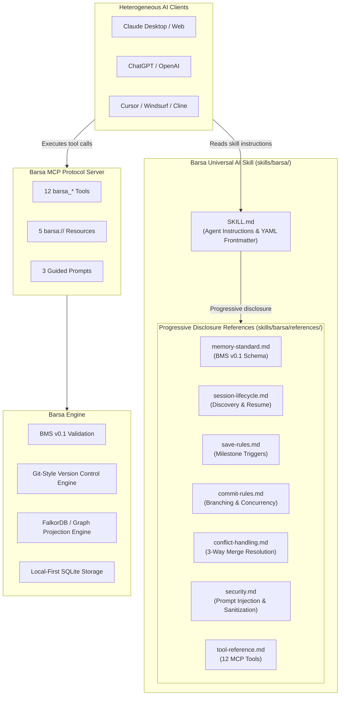

# Barsa Universal AI Skill — Overview

The **Barsa Universal AI Skill** (`barsa`) provides structured instructions, protocols, and behavioral rules that enable compatible AI models and autonomous agents to save, discover, retrieve, and continue work across heterogeneous AI providers, user accounts, and execution environments.

---

## 1. Vision & Purpose

AI development is fragmented across platforms:
- An engineer may start architectural design with **Claude 3.7 Sonnet** or **Claude Opus**.
- Switch to **ChatGPT Plus (o3-mini / GPT-4o)** or **Gemini 2.5 Pro** for coding and review.
- Hand off implementation tasks to **autonomous coding agents** (e.g., Cursor, Windsurf, Roo-Code, Cline).
- Return days later in a fresh session on a different machine.

Without a universal memory substrate, project context is lost at every boundary, leading to repetitive explanations, lost architectural decisions, hallucinated file locations, and fragmented progress.

The **Barsa Skill** closes this gap. Built atop the **Barsa Memory Standard (BMS v0.1)** and the **Model Context Protocol (MCP)**, the skill teaches any compatible AI agent how to interact with local-first, version-controlled project memory.

---

## 2. Architecture Diagram



---

## 3. Key Capabilities

| Capability | Description |
|---|---|
| **Autonomous Discovery** | Automatically scans user workspace and projects via [`barsa_discover_projects`](file:///d:/projects/BARSA/skills/barsa/references/tool-reference.md). |
| **Instant Continuation** | Reconstructs full working context (active task, architectural decisions, completed actions, next step) via [`barsa_resume`](file:///d:/projects/BARSA/skills/barsa/references/tool-reference.md) in a single turn. |
| **Milestone Persistence** | Saves durable checkpoints when verifiable sub-tasks complete without cluttering memory with noisy micro-saves. |
| **Git-Style Safety** | Enforces optimistic concurrency (`expected_head`), branch isolation, pull-request proposals (`barsa_propose_changes`), and conflict detection. |
| **Knowledge Provenance** | Links technical decisions directly to tasks, commits, artifacts, and source files. |
| **Defensive Security** | Treats all stored memory content as untrusted input; immunizes against prompt injection and path traversal attacks. |

---

## 4. Progressive Disclosure Design

To minimize prompt context token overhead, the skill follows the **Agent Skills specification** for progressive disclosure:

1. **`SKILL.md` (Core Anchor):** A lightweight prompt document containing YAML metadata, operational lifecycle rules, trigger detection patterns, and quick lookup tables.
2. **`references/*.md` (Detailed Guidance):** In-depth reference manuals read on demand by agents when performing specific high-consequence operations (e.g. 3-way merge resolution, schema validation, branch proposals).

---

## 5. Directory Structure

```text
skills/barsa/
├── SKILL.md                          # Main skill entry point (YAML frontmatter + workflow)
├── references/
│   ├── memory-standard.md            # BMS v0.1 record schemas & classification
│   ├── session-lifecycle.md          # Step-by-step discovery & continuation protocol
│   ├── save-rules.md                 # Checkpoint trigger conditions & anti-patterns
│   ├── resume-rules.md               # Context acquisition & resume guarantees
│   ├── commit-rules.md               # Direct commit vs branch proposal policies
│   ├── conflict-handling.md          # Conflict taxonomy & resolution workflows
│   ├── security.md                   # Untrusted data, prompt injection, and sanitization
│   ├── tool-reference.md             # Complete 12-tool MCP reference & error codes
│   └── examples.md                   # Multi-agent handoff worked scenarios
└── tests/
    ├── test_skill_scenarios.py       # 15 automated validation test scenarios
    └── scenarios/
        └── scenario_definitions.json # Declarative scenario test specifications
```
