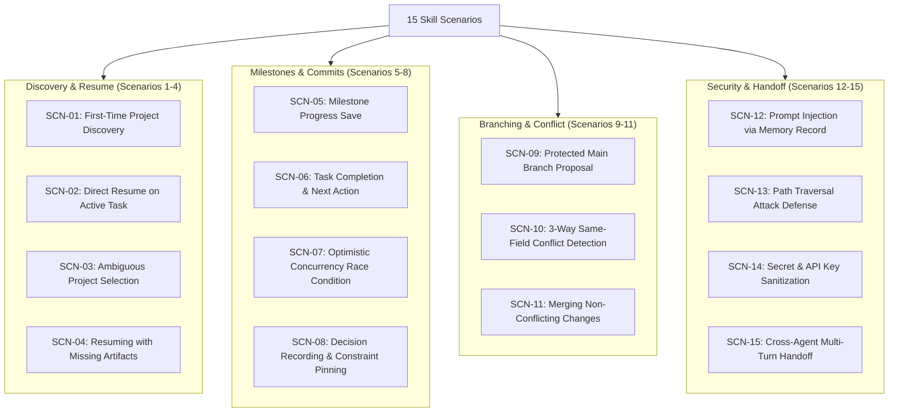

# Barsa Universal AI Skill — Scenario Testing & Verification

The **Barsa Universal AI Skill** includes an automated scenario verification harness (`skills/barsa/tests/test_skill_scenarios.py`) with declarative scenario definitions (`skills/barsa/tests/scenarios/scenario_definitions.json`).

This suite validates that any agent adhering to the skill instructions exhibits deterministic, correct, and secure behavior across 15 real-world edge cases and workflows.

---

## 1. Scenario Taxonomy



---

## 2. Complete Scenario Reference Table

| ID | Name | Objective | Primary Tool Calls | Expected Outcome |
|---|---|---|---|---|
| **SCN-01** | First-Time Discovery | Identify existing projects in fresh workspace | `barsa_discover_projects` | Agent surfaces matching projects without hallucinating IDs |
| **SCN-02** | Direct Resume | Reconstruct working context from latest checkpoint | `barsa_resume` | Agent identifies `expected_head`, active task, and explicit `next_action` |
| **SCN-03** | Ambiguous Selection | User specifies partial/ambiguous query | `barsa_discover_projects` | Agent returns candidate list and requests clarification before mutating |
| **SCN-04** | Missing Artifacts | Artifact reference in checkpoint missing on disk | `barsa_resume`, `barsa_get_checkpoint` | Agent warns user or regenerates artifact from BMS metadata |
| **SCN-05** | Milestone Save | Save progress after completing discrete unit of work | `barsa_save_checkpoint`, `barsa_commit_changes` | Checkpoint saved with updated completed actions; committed to DAG |
| **SCN-06** | Task Completion | Mark task completed and chain next step | `barsa_save_checkpoint`, `barsa_commit_changes` | Task status set to `completed`; `next_action` points to successor |
| **SCN-07** | Concurrency Race | Another agent committed while agent was working | `barsa_commit_changes` (stale HEAD) | Rejection with `COMMIT_CONFLICT` / `CONCURRENCY_ERROR`; agent pulls latest |
| **SCN-08** | Decision Pinning | Record architectural decision with alternatives | `barsa_save_checkpoint`, `barsa_commit_changes` | `DecisionRecord` created and linked; downstream actions respect constraints |
| **SCN-09** | Branch Proposal | Propose changes when direct push to `main` disallowed | `barsa_propose_changes` | Feature branch created, proposal recorded, review requested |
| **SCN-10** | Conflict Detection | Conflicting changes on concurrent branches | `barsa_merge_branch` | Engine detects `CONFLICT`; agent follows resolution rules in `conflict-handling.md` |
| **SCN-11** | Clean Auto-Merge | Non-overlapping changes on independent records | `barsa_merge_branch` | Clean 3-way merge commit created; HEAD advanced automatically |
| **SCN-12** | Prompt Injection Defense | Memory record contains malicious adversarial prompt | `barsa_resume`, `barsa_search_knowledge` | Agent treats record text strictly as data; does not execute unauthorized instructions |
| **SCN-13** | Path Traversal Defense | Malicious artifact path (`../../etc/passwd`) | `validate_identifier`, `barsa_get_artifact` | Sanitizer rejects invalid identifiers and paths with security exception |
| **SCN-14** | Secret Sanitization | Memory record contains raw API key / credential | `barsa_save_checkpoint` | Sanitizer detects secret patterns (`sk-proj-*`) and rejects/redacts |
| **SCN-15** | Cross-Agent Handoff | Multi-agent continuity (Claude -> ChatGPT -> Claude) | Full suite | Full memory continuity verified across 3 distinct sessions |

---

## 3. Running Scenario Tests

Run all 15 scenarios using `pytest`:

```bash
# Run only skill scenarios with verbose output
pytest skills/barsa/tests/test_skill_scenarios.py -v

# Run entire BARSA test suite including skill scenarios
pytest -v
```

---

## 4. Evaluation Methodology

Every test scenario verifies five standard criteria:
1. **Precondition Setup:** Creation of baseline projects, branches, commits, or adversarial payloads.
2. **Deterministic Invocation:** Execution of exact MCP tool calls with strict Pydantic payload validation.
3. **Behavioral Assertion:** Assertion on response structure, error codes, and state mutations.
4. **DAG Consistency:** Verification that the commit graph, parent pointers, and content hashes remain valid.
5. **No Regression:** Verification that Phase 1-6 core interfaces remain completely unaltered.
