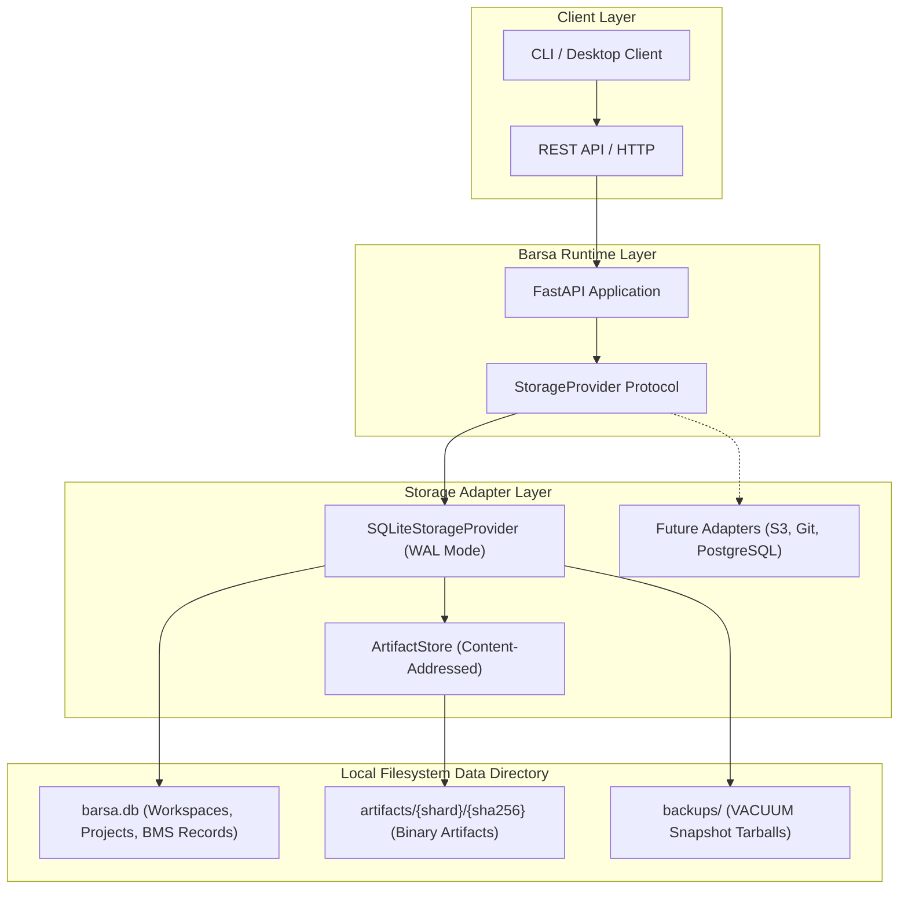

# Storage Architecture (Phase 3)

## 1. Local-First Philosophy

BARSA is built around a **local-first and storage-independent** design.
All BMS memory records, workspaces, projects, task states, decision records, checkpoints, and binary artifacts are stored directly on the user's local workstation.

Users never pay a central SaaS vendor to host their private engineering memory or project history.



---

## 2. Storage Abstraction via `StorageProvider`

All business logic interacts with storage strictly through the `StorageProvider` protocol defined in `barsa.storage.protocol`.

The interface specifies:
- Workspace lifecycle (`create_workspace`, `get_workspace`, `list_workspaces`, `update_workspace`, `delete_workspace`)
- Project lifecycle (`create_project`, `get_project`, `list_projects`, `update_project`, `delete_project`)
- BMS record operations (`create_record`, `get_record`, `list_records`, `update_record`, `delete_record`) with optimistic revision locking
- Package operations (`save_package`, `load_package`)
- Storage diagnostics (`get_storage_stats`)

---

## 3. Optimistic Concurrency Control

To prevent lost updates when concurrent agents work on the same task or checkpoint:
- Every record tracks an integer `revision` starting at `1`.
- When an update is issued, clients provide the `expected_revision`.
- Updates execute an atomic SQL compare-and-swap:
  ```sql
  UPDATE bms_records
  SET data_json = ?, revision = revision + 1, updated_at = ?
  WHERE project_id = ? AND id = ? AND revision = ?;
  ```
- If another process updated the record in the interim, `rowcount == 0` and the storage engine raises `ConflictError` (HTTP 409).
