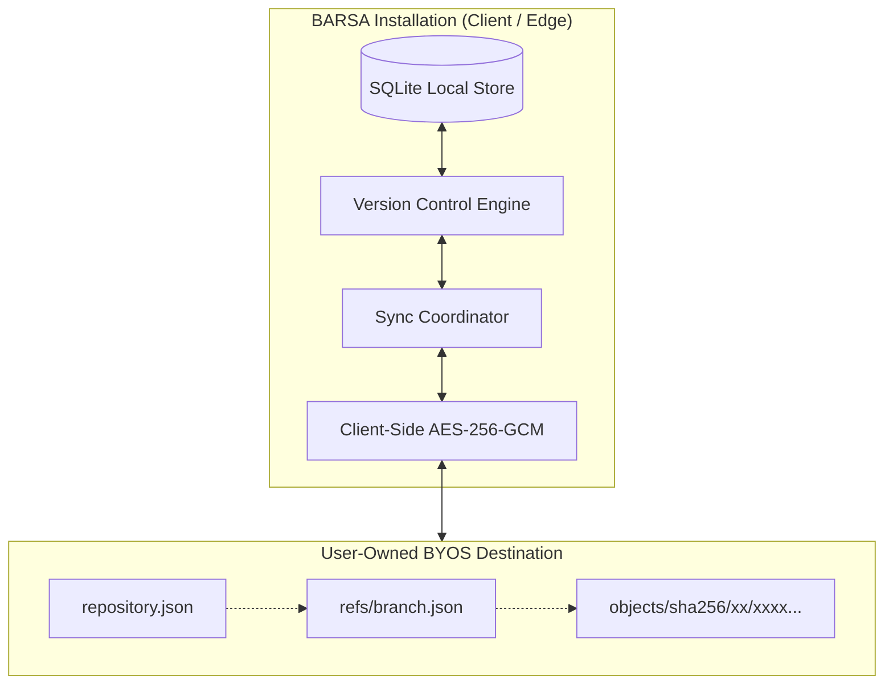
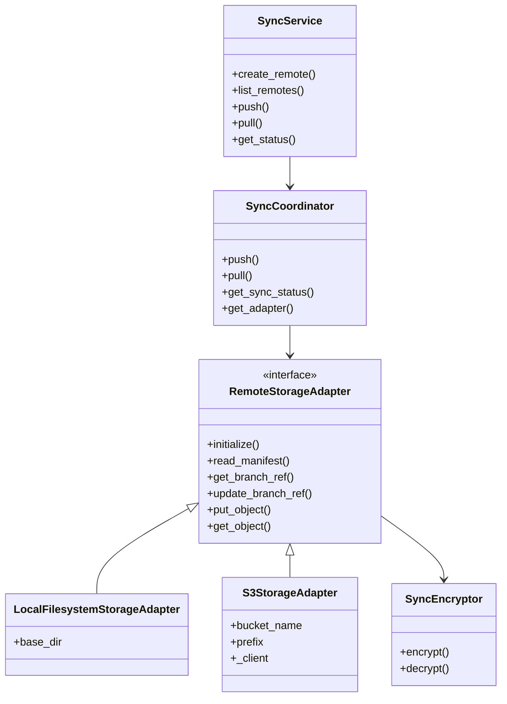

# BARSA Cloud Synchronization & Bring Your Own Storage (BYOS) Architecture

## 1. Executive Summary

BARSA Phase 13 introduces **Bring Your Own Storage (BYOS)** and **Cloud Synchronization**, establishing a decentralized, privacy-preserving storage layer for universal AI agent memory. Rather than relying on a centralized vendor silo, users maintain complete sovereign control over their knowledge graphs, checkpoints, decisions, and task execution trails.

---

## 2. Core Architectural Principles

1. **Local-First Sovereign Operation**: All reading, writing, querying, graph traversals, and checkpoint creation occur on the local SQLite storage engine with zero latency and zero external network dependency.
2. **Content-Addressed Storage (CAS)**: Immutable entities (commits, BMS records, checkpoints, artifacts) are identified and stored strictly by their cryptographic SHA-256 digest (`objects/sha256/<prefix>/<hash>`).
3. **Commit DAG Synchronization**: Remote repositories mirror the Git commit graph. Branches are mutable reference pointers containing commit hashes and concurrency ETags.
4. **Client-Side Zero-Knowledge Encryption**: When enabled, all records, commit payloads, and manifests are encrypted locally using AES-256-GCM with PBKDF2 key derivation before leaving the host machine. Remote storage providers hold only opaque encrypted blobs.
5. **Optimistic Concurrency & Divergence Protection**: Branch updates enforce condition checks via ETags. Divergent histories cannot overwrite remote state without explicit resolution.

---

## 3. Component Hierarchy

- **SyncService**: Coordinates CRUD operations for remote definitions in SQLite, RBAC permissions via `CentralAuthorizer`, and delegates execution to `SyncCoordinator`.
- **SyncCoordinator**: Manages CAS transfers, DAG topological sorting, ancestry verification, and SQLite outbox / sync history recording.
- **RemoteStorageAdapter**: Abstract interface decoupling physical storage backends from synchronization logic.
- **LocalFilesystemStorageAdapter**: Atomic, path-traversal-guarded adapter for local directories, external hard drives, NAS, and SMB/NFS mounts.
- **S3StorageAdapter**: High-performance adapter supporting AWS S3, MinIO, Cloudflare R2, and Ceph with optimistic concurrency via ETag headers.
- **SyncEncryptor**: Authenticated encryption utility handling salt generation, PBKDF2 key stretching, and AES-256-GCM envelope sealing.
