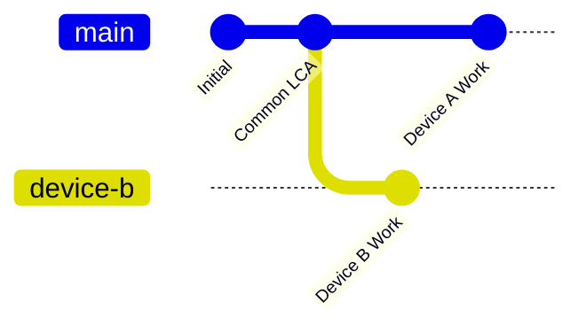

# Conflict Handling & Divergence Resolution

## 1. Concurrency Model

BARSA implements **Optimistic Concurrency Control (OCC)** coupled with **Git-style DAG Divergence Detection** to prevent accidental data overwrites when multiple devices or AI agents collaborate on the same memory stream.



---

## 2. Divergence Detection

When attempting to push local commits to a remote branch:
1. Local fetches `RemoteBranchRef` (`remote_head`).
2. Local computes the Lowest Common Ancestor (`LCA = find_lowest_common_ancestor(local_head, remote_head)`):
   - **Fast-Forward (`LCA == remote_head`)**: The remote branch is an ancestor of local. Push proceeds safely.
   - **Up To Date (`local_head == remote_head`)**: No transfer needed.
   - **Diverged (`LCA != remote_head` and `LCA != local_head`)**: Both local and remote have created independent commits since the branch split.

```
       [Common Ancestor]
          /          \
  [Local Head]     [Remote Head]
       ^                 ^
       |                 |
  (Branch Diverged - Push Rejected with ConflictError)
```

---

## 3. Optimistic Locking with ETags

Even if local believes it is ready to fast-forward, another collaborator might update the remote between the status check and the write.
- The remote branch file `refs/<branch>.json` has an ETag (its SHA-256 hash or S3 Object ETag).
- `update_branch_ref(branch_name, commit_id, expected_etag=etag)` ensures that if the remote changed in the millisecond window before write, the write fails with `ConflictError(409)`.

---

## 4. Resolution Strategies

When divergence occurs:
1. **Pull First**: Pull the remote commits into the local DAG.
2. **Local Three-Way Merge**: Use `VersionControlEngine.create_merge_commit(...)` to perform a three-way state reconciliation between `local_head`, `remote_head`, and their `LCA`.
3. **Push Merged Commit**: Once merged locally, the new commit has both `local_head` and `remote_head` as parents, allowing a clean fast-forward push.
4. **Force Push (Administrative Override)**: If explicitly enabled (`force=True`), the remote reference is overwritten. Force push requires elevated administrative privileges.
