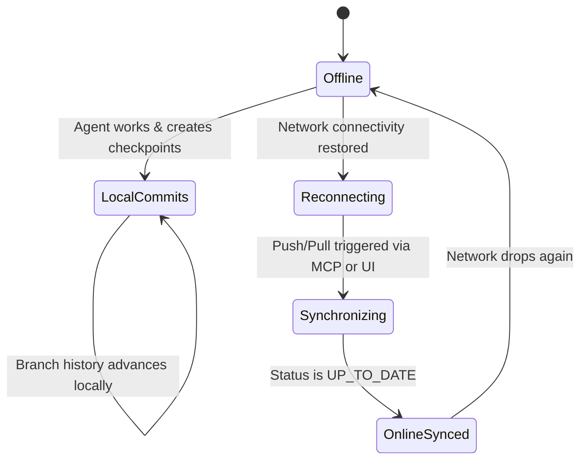

# Offline-First Operation Guide

## 1. Local-First Philosophy

BARSA is designed from first principles as an **offline-first** knowledge system. Unlike traditional cloud memory systems that fail when connectivity drops:
- All agent interactions, context retrievals, checkpoint updates, and memory commits run directly against the local SQLite database.
- AI agents function with 100% feature parity while completely disconnected from the internet or LAN.

---

## 2. Working While Disconnected

1. **Creating Memories**: AI agents create knowledge records, decisions, tasks, and resume checkpoints normally.
2. **Commit History**: Commits advance the local branch pointer (`main` or feature branch).
3. **Graph Projections**: Local FalkorDB graphs project the commits immediately for semantic and graph context queries.
4. **Outbox Pattern**: Changes are staged and pending events are recorded in local outbox tables.

---

## 3. Reconnection and Catch-Up Sync

When internet access is restored:
1. **Status Inspection**: Query `/api/v1/sync/projects/{project_id}/remotes/{remote_id}/status` or invoke the MCP tool `barsa_get_sync_status`.
2. **Reconciliation**:
   - If local is `AHEAD`: A single `barsa_push_remote` uploads all offline commits in one atomic batch.
   - If remote also advanced: Pull first, perform automatic three-way merge on non-conflicting fields, and push.
3. **Zero Data Loss Guarantee**: Local commits are immutable; disconnecting never discards or rolls back unpushed local work.
